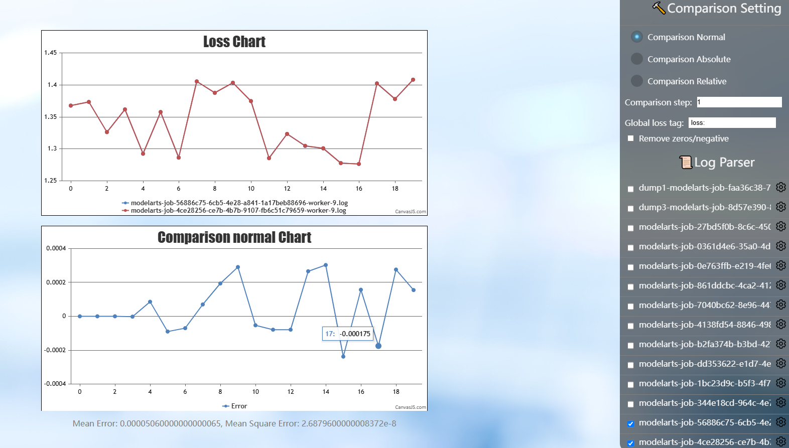
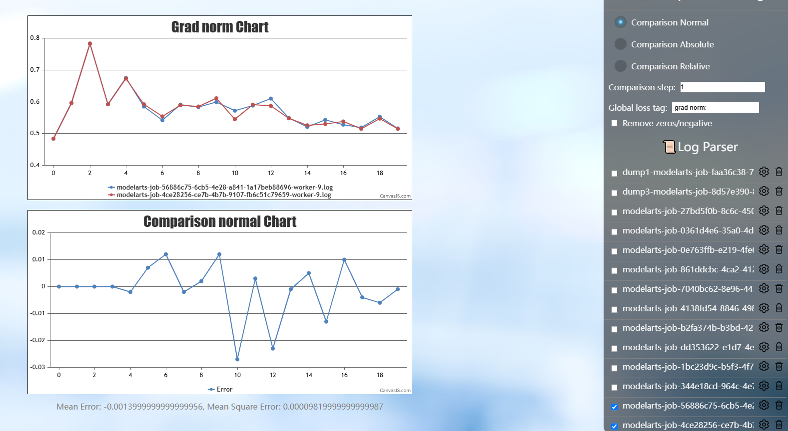
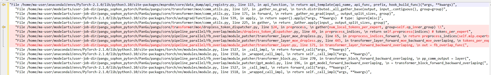
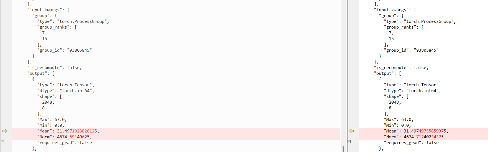
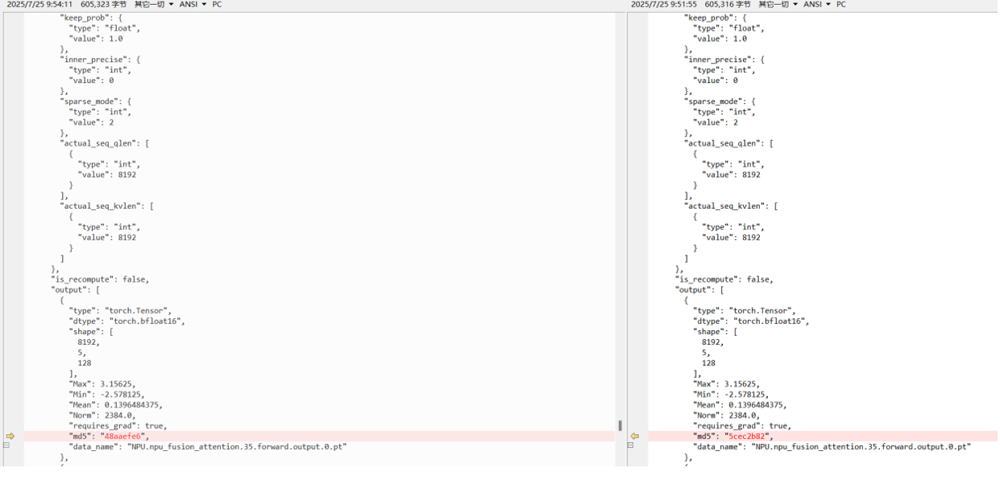
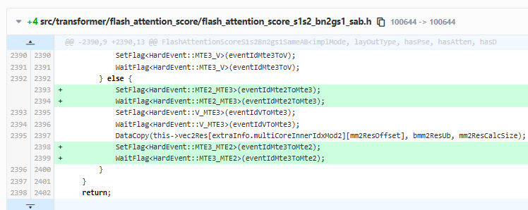

# Determinism Troubleshooting for Ascend-based 80-Card Large Model Training

## Background

In large-scale parallel training, the determinism of training results is a key factor affecting reproducibility. In multi-rank parallel or high-concurrency scenarios, if the data movement within an operator lacks a synchronization mechanism, non-deterministic computation results will be produced. This document records the process of localizing the problem that the determinism of training results could not be fixed in an 80-card large-scale training job. The problem was ultimately traced to a data race inside the Flash Attention operator, and a fix and a troubleshooting method are provided as a reference for similar determinism troubleshooting.

## Symptoms

When performing an 80-card large-scale training job, it was found that the determinism of the training results could not be guaranteed. Details are as follows:

- **Environment version difference**:
  - With CANN 8.0.0 RC4, two consecutive training jobs produced exactly the same loss curve.
  - With CANN 8.1.0 RC1, two consecutive training jobs produced inconsistent loss curves.
- **Parallel strategy**: TP8 PP5 VPP5 CP1 EP2.
- **Reproduction characteristics**:
  - In 8.1.0 RC1, step 0 was exactly the same, but starting from step 1 (logged as step 2), the backward propagation gradients of the second DP group (rank 8-15, 24-31, etc.) were inconsistent even before `Unreduce`.
  - The forward propagation results differed as early as step 1, resulting in inconsistent subsequent loss computation.

## Problem Localization

### Step 1: Preliminary Boundary Determination and Establishment of the Data Collection System

1. **Monitor data analysis**: Monitor data was collected initially, and it was found that step 0 was consistent, while in step 1 the gradients of all ranks in the second DP group were inconsistent before `Unreduce`. It could be concluded that the problem occurred in the forward propagation phase and was concentrated in the second DP group.
2. **Dump tool attempt and blockage**: An attempt was made to use the dump tool to collect L0-level data, but the collection failed initially due to errors or memory usage expansion. The problem persisted after disabling the overlap_1f1b feature, ruling out interference from that feature. It was found that when full mix-level dump was enabled, the problem no longer reproduced (multiple steps ran exactly the same), suggesting that the collection behavior itself affected reproduction (possibly introducing synchronization or changing the execution timing).
3. **Adjusting the collection strategy**: The collection level was changed to L1, and the inconsistency was successfully reproduced. An attempt was made to collect MD5 checksums to locate the source, but this was blocked by memory usage expansion and the fact that asynchronous dump does not support MD5. Finally, by reducing the scale, disabling asynchronization, and limiting the number of steps (each collection limited to within 5 steps), the key data was successfully reproduced and collected at step 16.

   

   

### Step 2: Link Tracing and Difference Point Localization

1. **Communication link backtracking**: Starting from the inconsistent output of `Distributed._all_gather_base` on rank 0, backtracking was performed level by level to the upstream communication groups (group 0-7, 7-15, etc.).

   

   The source of the difference was found to point to the `Distributed.batch_isend_irecv` operator, whose input was consistent but output was inconsistent.

   

   Further tracing to ranks such as rank 35, 36, and 37 revealed that the difference originated from operators such as `NPU.npu_fusion_attention` or `Distributed._reduce_scatter_base`.
2. **Locking down the suspicious operator**: The main suspect was `NPU.npu_fusion_attention` (the FA operator), because on rank 36 the input of this operator was completely consistent but the output was inconsistent. Tensor data of `NPU.npu_fusion_attention` was specifically collected, and the difference was reproduced again at rank 55 in step 8.

   

### Step 3: Single-Operator Reproduction and Root Cause Analysis

1. **Building a single-operator script**: The Input (Query, Key, Value, Mask) and Output at the difference point were extracted, and a Python script was written to call `torch_npu.npu_fusion_attention` for single-operator verification. The single operator was run hundreds of times in a loop on the localization machine, but the problem was not reproduced.
2. **Ruling out other factors**: An attempt was made to disable the FA feature, but the problem still existed. An attempt was made to set the environment variable `CLOSE_MATMUL_K_SHIFT=1`, but the problem still existed.
3. **Introducing memory race detection**: A race condition inside the operator was suspected. Static instrumentation detection was performed using msSanitizer, which confirmed the race risk. After temporarily adding a synchronization mechanism to the code, the error disappeared, verifying the race hypothesis.

   

## Root Cause

- **Root cause**: There is a data race problem inside the Flash Attention (FA) operator in CANN 8.1.0 RC1.
- **Specific mechanism**: When the FA operator performs data movement operations internally, the necessary synchronization mechanism is not added before and after. In multi-rank parallel or high-concurrency scenarios, this lack of synchronization leads to an indeterminate timing of data reads or writes, thus producing non-deterministic computation results.
- **Version difference**: 8.0.0 RC4 does not have this problem; the defect was introduced in 8.1.0 RC1.

## Solution and Verification

1. **Fix**: Obtain the fix package. The core change is: add a synchronization mechanism before and after the data movement operations inside the operator.
2. **Verification result**: After rerunning the experiment with the fixed operator package, consecutive training jobs produced exactly the same loss curve, and the problem was completely fixed.

## Summary of Experience and Recommendations

1. **Determinism debugging tips**: When full dump causes the problem not to reproduce, consider the impact of the collection behavior on execution timing, and try reducing the collection granularity (such as the L1 level) or reducing the model scale. For random problems that are difficult to reproduce, a single-operator script combined with msSanitizer is an effective means of localizing memory races.
2. **Operator development specifications**: In operator development that involves multi-core parallelism or data movement, the synchronization mechanism must be strictly checked to ensure the atomicity and ordering of data access and avoid race conditions.
3. **Environment configuration reference**: If a similar inter-operator race problem is encountered, you can try setting ASCEND_LAUNCH_BLOCKING=1 to force serial operator dispatch, to help determine whether it is an inter-operator concurrency race problem. If a similar intra-operator race problem is encountered, you can try adding a large number of flag waits inside the operator, to help determine whether it is an intra-operator concurrency race problem.
