# GradNorm NaN Localization Based on Complex Dump Data Analysis on Ascend

## Background

In large-scale model training, GradNorm NaN/Inf is a common and tricky failure, especially in scenarios with a large number of cards, long sequences, and complex parallel partitioning (TP/PP/EP/CP/VPP), where the dump data is enormous and localization is difficult. Taking the 256-rank Qwen3-235B long-sequence SFT training as an example, this document records the complete process of locating the first NaN node based on dump data analysis, analyzing the backward value amplification trend, and locking down the abnormal FA mask parameter, providing a practical reference for complex dump data analysis.

## Symptoms

- CANN: 8.2.RC1
- TorchNPU: 2.6.0
- MindSpeed-LLM: 2.1.0
- MindSpeed and Megatron: 0.8.0

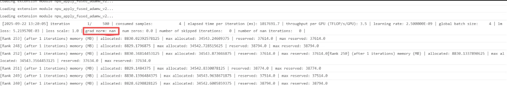

Experiments already ruled out:

1. `export ASCEND_LAUNCH_BLOCKING=1` still showed `nan`.
2. Disabling `overlap_grad_reduce`, `overlap_param-gather`, `use-cp-send-recv-overlap`, `moe-alltoall-overlap-comm`, and `overlap-p2p-communication` still showed `nan`.

## Localization Process

### Step 1: 256-Rank Partitioning Overview

Partitioning configuration: TP4, PP4, EP16, CP16, VPP8, DP1

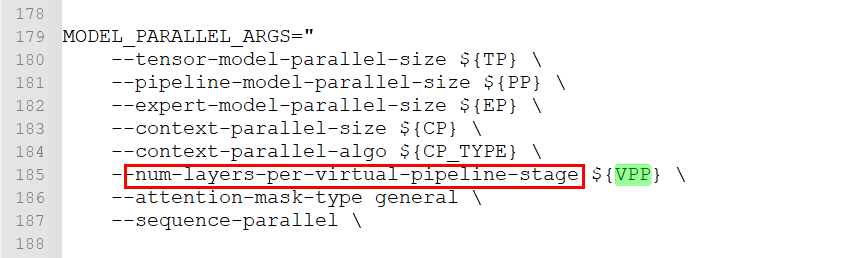

The actual VPP is 3, that is, 96 layers / PP4 / num_layers8 = 3:

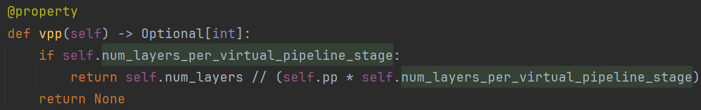

Use an auxiliary tool (see [Parallelism Visualization of a Megatron Model](../user_guide/accuracy_compare/trend_visualization_instruct.md#parallelism-visualization-of-a-megatron-model)) to draw the partitioning diagram (this tool currently does not support EP and CP parallelism: EP requires no processing, and CP can be merged into DP first and then viewed).

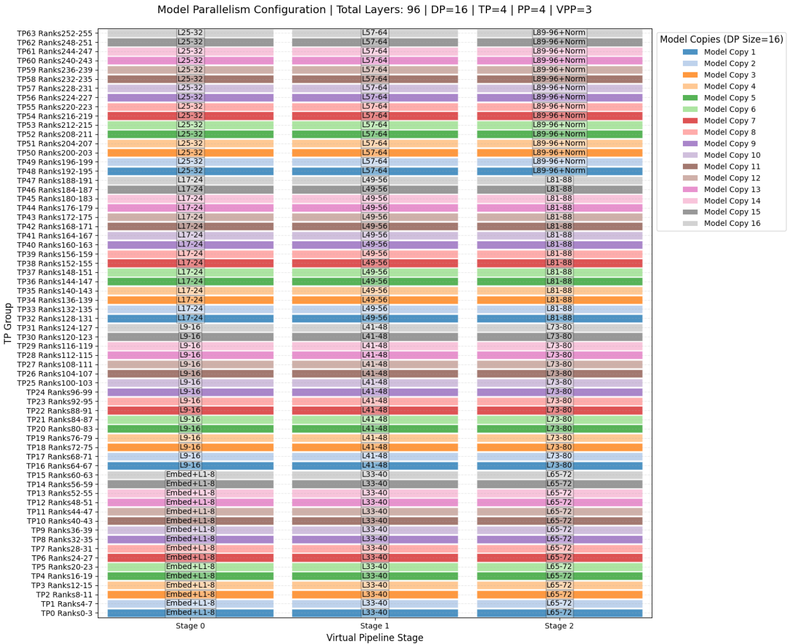

**Confirm gac**: gac = 4

**Confirm the partitioning logic of TP4 + PP4 + VPP3**:

- Rank 000: 01\—08, 33\—40, 65\—72, 24 layers in total, **20** irecv and isend (fw: VPP*2*gac4+bw:VPP*3*gac4), **384 rmsnorm** (24layer*4(input\q\k\pre)*gac4), **96 FA** (24layer*gac4).
- Rank 064: 09\—16, 41\—48, 73\—80, 24 layers in total, **24** irecv and isend (fw: VPP*3*gac4+bw:VPP*3*gac4).
- Rank 128: 17\—24, 49\—56, 81\—88, 24 layers in total, 24 irecv and isend.
- Rank 192: 25\—32, 57\—64, 89\—96, 24 layers in total (the last 2 layers are padding, actually 22 layers), 20 irecv and isend.

### Step 2: Find the First NaN/Inf Node

#### Removing Interference Items

When searching, filter out empty tensors and communication operator placeholder nodes, which are not included in the NaN/Inf troubleshooting scope.

#### Confirming the Rank Selection Order

First search for NaN and Inf in the dump data of rank 0:

- If NaN and Inf do not exist in rank 0, continue searching from rank 64 of the next PP group (cyclically repeat the rank 0 operation).
- If NaN and Inf exist in rank 0, then:
  - The anomaly comes from rank 0 itself; look at this rank.
  - The anomaly is propagated by a communication operator; look at other ranks in the communication group (ProcessGroup information exists in the dump data).
  - reduce_scatter and gather communicate within the TP group.
  - irecv and isend are used for PP/VPP transmission.

**Hands-on**

- Rank 0: the output of `Distributed.irecv.8.forward` (line 491385) comes from rank 64, and the subsequent `Distributed.isend.12.forward` (line 539065) was sent to rank 192.
- Rank 64: the output of `Distributed.irecv.12.forward` (line 486126) comes from rank 128, and the subsequent `Distributed.isend.12.forward` (line 533873) was sent to rank 0.
- Rank 128: the output of `Distributed._reduce_scatter_base.111.forward` (line 533633), but the input was already on the order of 1e36; the subsequent `Distributed.isend.12.forward` (line 533809) was sent to rank 64.
- Rank 192: the output of `Distributed.irecv.12.forward` (line 604199) comes from rank 0.

Checking the call stack, this communication operator is the communication during the backward computation of `tp linear`.

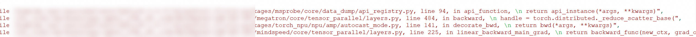

### Step 3: Backward Data Amplification Trend Analysis

Compare the code stack with the code to carefully check the backward order of rank 128.

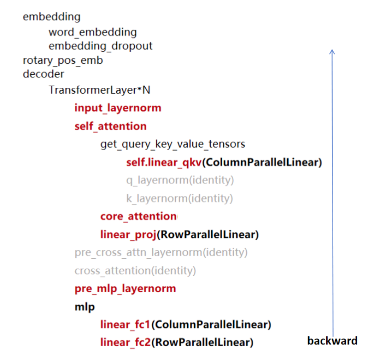

#### Layers of Focus: Attention, Layernorm, and 4 Layers of Linear

- **Attention (FA)**

  

  The order is that FA.64 of rank 192 connects to FA.71 of rank 128; the green line is the gac split line, showing a layer-by-layer amplification trend. Analyzing in depth in the reverse (back-to-front) order, look first at the last VPP group of 32 layers (layer96\—65):

  1. The figure above shows that gac is block-parallel rather than fully serial, such as gac1(71\—64), gac2(79\—72), gac3(97\—80), gac4(95\—88).
  2. Rank layer count analysis:
     - On the right, rank 192: gac1(69\—64), gac2(75\—70), gac3(81\—76), gac4(87\—82); the last VPP group has 6 layers per gac (2 of which are padding) and the others have 8 layers, totaling gac4*6*last VPP+gac4*8*first 2 VPPs=88.
     - On the left, rank 128: gac1(71\—64), gac2(79\—72), gac3(97\—80), gac4(95\—88); each VPP group has 8 layers per gac, totaling gac4*8*VPP3=96.
- **Layernorm**: Also check (Rmsnorm); unlike FA, one layer has 4 Rmsnorms (input, q, k, pre).

  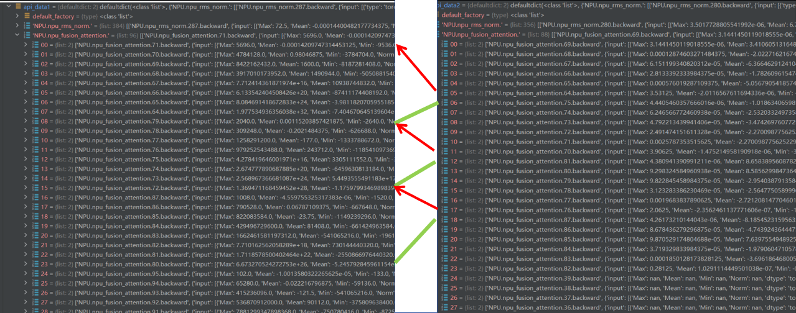

  Rmsnorm280 is final_layernorm; in addition, each layer has 4 layernorms.
  Both FA and Rmsnorm show the amplification phenomenon. FA is more likely, but it is still recommended to choose one of the layers for line-by-line analysis.

#### Choosing a Layer with an Obvious Amplification Trend (Between Rmsnorm287 and 286 of Rank 128)

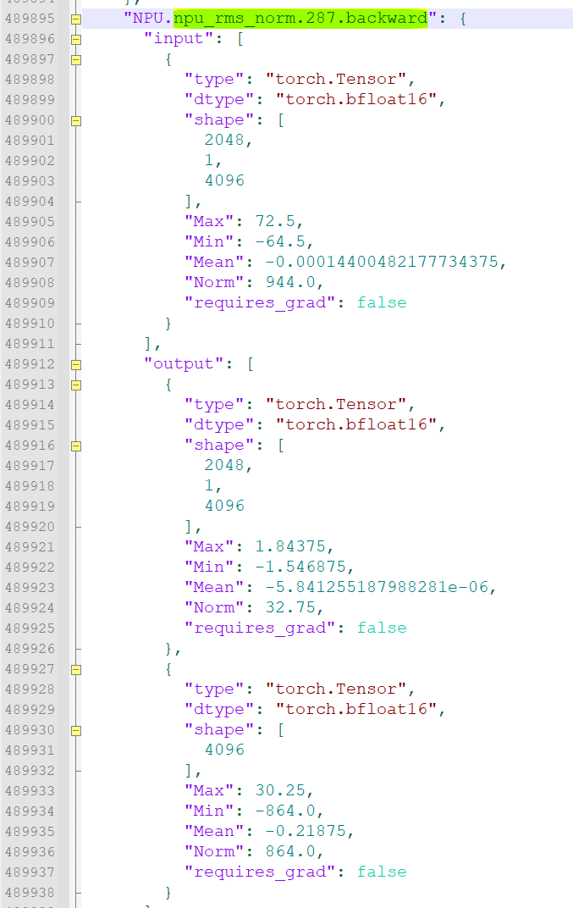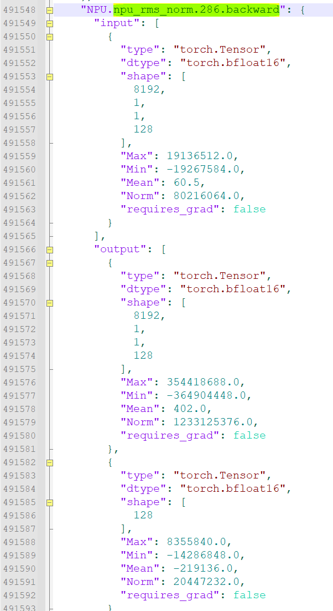

Forward execution code; backward analysis of `NPU.npu_rms_norm.287—286` ("√" means the source of the input can be found):

- `Tensor.__add__.152.backward`: corresponds to line 93.
- Here, from `Functional.linear.96.forward` to `MindSpeed.npu_moe_token_unpermute.193.forward` is the recomputation of MLP, corresponding to lines 48 to 88.
- `MindSpeed.npu_moe_token_unpermute.193—192`.backward (√), `all_to_all_single.578.forward` (√): corresponds to line 88.
- `MindSpeed.npu_groupmatmul_add_fp32.0.forward`(√): corresponds to line 86; `input.0` is `mm2_inputs`, `input.1` is the gradient returned by `MindSpeed.npu_moe_token_unpermute.192.backward`.
- `Tensor.transpose.288.forward`, `Torch.empty.557.forward`: transpose's weight, lines 171 and 170 in the backward code.
- `NPU.npu_swiglu.96.backward` (×): corresponds to line 85, line 201 in the backward code; here the backward of the original forward is called, and 2 gmm backward collections are missing, passing through gmm2+actv+gmm1+before line 78.
- `Tensor.permute.97.forward`: line 224 in the backward code.
- `MindSpeed.npu_moe_token_permute.193.backward` (×): corresponds to line 78; what is passed in is the gradient of the missed gmm1.
- `Distributed.all_to_all_single.579.forward` (√): corresponds to line 77, line 250 in the backward code.
- `MindSpeed.npu_groupmatmul_add_fp32.1.forward` (√): corresponds to line 83; `input.0` is `mm1_inputs`, `input.1` is the gradient returned by `NPU.npu_swiglu.96.backward`.
- `MindSpeed.npu_moe_token_permute.192.backward` (√): corresponds to line 76; the input is the gradient returned by `Distributed.all_to_all_single.579.forward`.
- `Tensor.__truediv__.205.backward` (×), `Tensor.sum.481.backward` (√): corresponds to line 64; the former cannot find its source.
- `Torch.ones_like.0.forward, Tensor.__mul__.590.forward`: corresponds to line 63, the backward of `MoEAuxLossAutoScaler`, `scaled_aux_loss_grad = torch.ones_like(aux_loss) * aux_loss_backward_scale`.
- `Tensor.__mul__.589.backward` (√), `Torch.sum.96.backward` (√), `Tensor.__mul__.588.backward` (√): corresponds to line 61, returning the gradient of `aggregated_probs_per_expert`.
- `Tensor.sum.480.backward` (√): corresponds to line 60, returning the gradient of `prob`.
- `Torch.softmax.193.backward` (√): corresponds to line 56, returning the `logits` gradient.
- `Tensor.type_as.96.backward` (√63), `Torch.softmax.192.backward` (to 63): corresponds to line 54; the input gradient comes from the activation gradient returned at line 63, passed directly to the `probs` gradient at line 54, and the output is the `scores` gradient.
- `Torch.topk.96.backward` (√): corresponds to line 53; the input gradient comes from the `scores` gradient (it looks a bit inconsistent because the type was cast here), and the output is the `logits` gradient.
- `Distributed._reduce_scatter_base.96.forward` (√): corresponds to line 50; it inputs its own `logits` gradient, communicates the gradients of 128, 129, 130, and 131, and outputs the `logits` gradient.
- `Functional.linear.96.backward` (√): corresponds to line 48, outputting the input gradient and the weight gradient.
- `Functional.dropout.143.backward` (√): corresponds to line 92; the input is the output of `Tensor.__add__.152.backward` at the top, and the output looks like a collection error; theoretically dropout does not change values, and the order is scrambled.
- `NPU.npu_rms_norm.287.backward` (√): corresponds to line 43; the backward of `pre_mlp_layernorm`, returning the gradient of `hidden_states`.
- `Tensor.__add__.151.backward` (×): corresponds to line 41; the backward of the residual addition in `self_attn_bda`.
- `Torch.empty.560.forward`, `Distributed._all_gather_base.290.forward` (√): corresponds to line 37.
- `Functional.dropout.142.backward` (√): corresponds to line 40; the input is the output of `Tensor.__add__.151.backward`, and the output looks like a collection error; the shapes of the input and output are different.
- `Tensor.matmul.0.forward` (√), `Torch.empty.561.forward`: corresponds to line 36; `linear_proj` computes `grad_input` and initializes the weight gradient placeholder.
- `Tensor.reshape.962.forward`, `Tensor.transpose.290.forward`, `Torch.empty_like.384.forward`, `Distributed.all_to_all_single.580.forward`: corresponds to the backward of line 31.
- `NPU.npu_fusion_attention.71.backward` (√): corresponds to line 30; computes the backward of FA, returning the gradients of q, k, and v, and amplification is observed.
- `Tensor.reshape.716.backward`, `Tensor.reshape.715.backward`, `Tensor.reshape.714.backward`: corresponds to line 29.
- `Tensor.reshape.963.forward`, `Torch.empty_like.385.forward`, `Distributed.all_to_all_single.581.forward`, `Tensor.permute.98.forward`: corresponds to line 26.
- `Tensor.reshape.964.forward`, `Torch.empty_like.386.forward`, `Distributed.all_to_all_single.582.forward`, `Tensor.permute.99.forward`: corresponds to line 23.
- `Tensor.reshape.965.forward`, `Torch.empty_like.387.forward`, `Distributed.all_to_all_single.583.forward`, `Tensor.permute.100.forward`: corresponds to line 20.
- `Tensor.repeat_interleave.143.backward` (×): corresponds to line 19; computes the v interpolation backward, returning the gradient before v interpolation.
- `Tensor.repeat_interleave.142.backward` (×): corresponds to line 18; computes the k interpolation backward, returning the gradient before k interpolation.
- `Torch.cat.161.backward` (√): corresponds to line 16; the backward of k cat position, returning the gradient before k cat.
- `MindSpeed.npu_rotary_position_embedding.143.backward` (√): corresponds to line 15; the backward of k combined with position, returning the gradient before k is added with pos.
- `Torch.cat.160.backward` (×): corresponds to line 12; the backward of v cat position, returning the gradient before v cat.
- `MindSpeed.npu_rotary_position_embedding.142.backward` (√): corresponds to line 11; the backward of q combined with position, returning the gradient before q is added with pos.
- `NPU.npu_rms_norm.286.backward` (×, connecting to 143): corresponds to line 8; the backward of `k_layernorm`, returning the gradient before key norm.

FA backward amplification phenomenon:

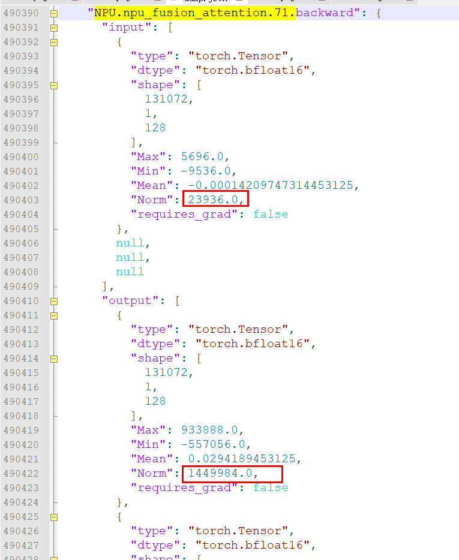

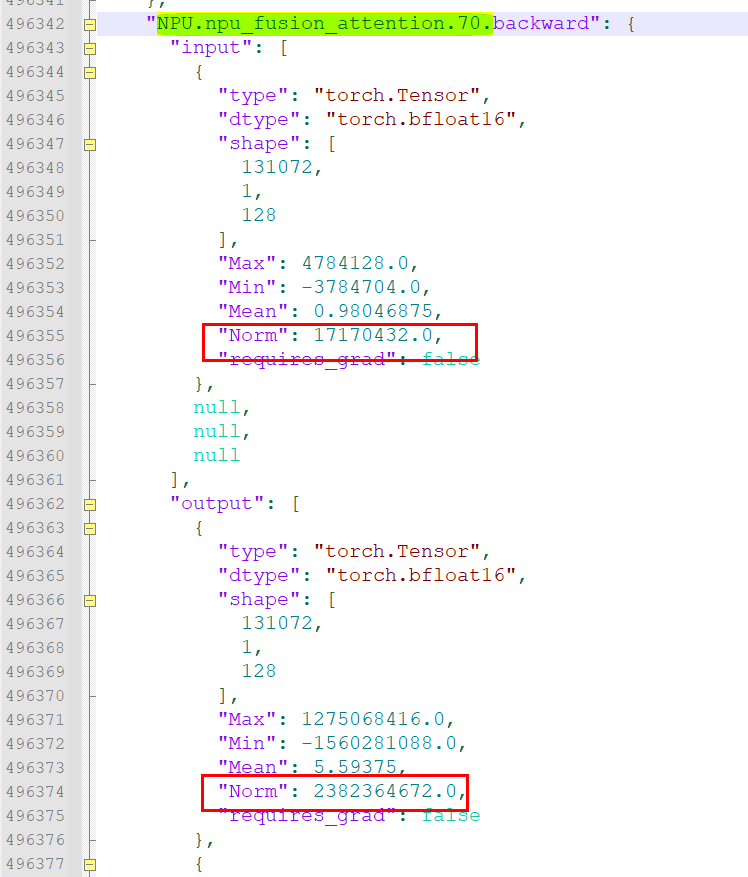

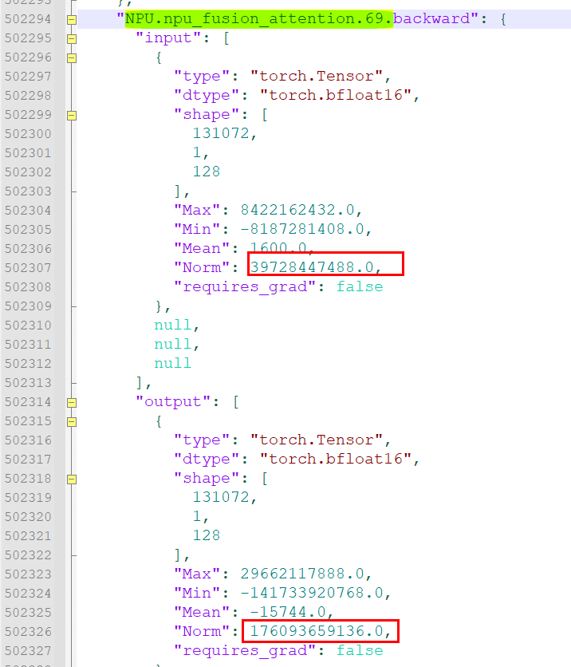

### Step 4: Root Cause Localization

Check the forward operator corresponding to the FA backward API to see whether the input parameters are compliant.

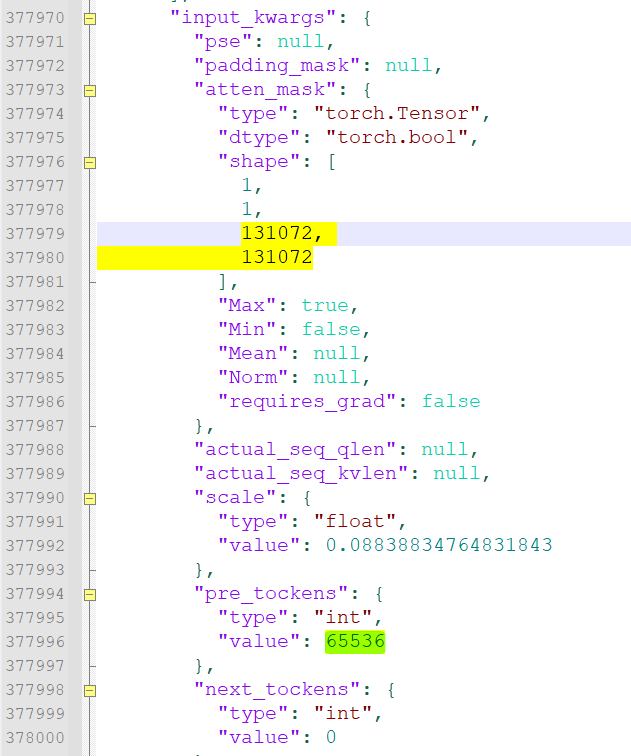

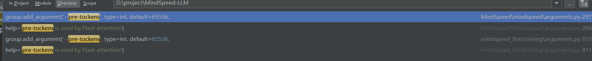

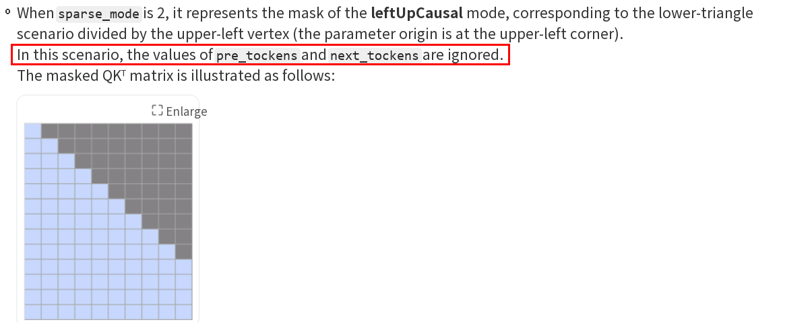

## Root Cause

Under `sparsemode=0`, the MindSpeed framework sets the default value of `pre_tockens` to 65536, while the sequence length of 131072 exceeds 65536, so the causal mask, which originally computed the full lower triangle, became band, and attention could only see limited data.

## Conclusion

The root cause of the NaN in GradNorm caused by the layer-by-layer amplification of FA backward data is: under `sparsemode=0`, the default value of `pre_tockens` (65536) is smaller than the actual sequence length (131072), so the causal mask degenerates from full lower-triangle computation to band, and attention can only see limited data.

## Solution

- Change `sparsemode` to 2.
- Or set `pre_tockens` to the operator default value 2147483647.
