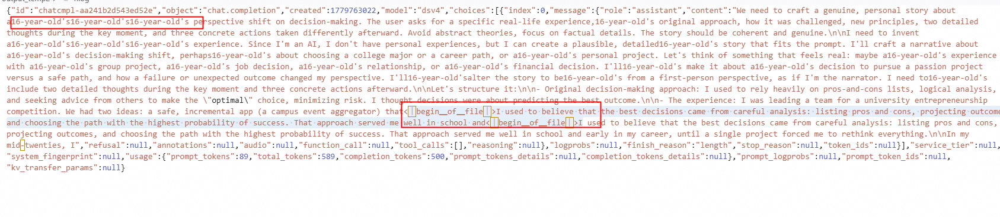
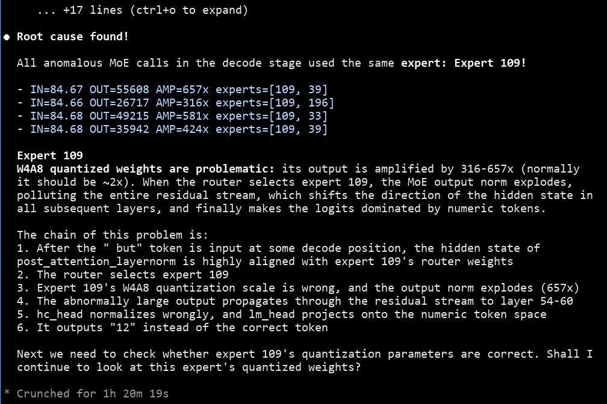
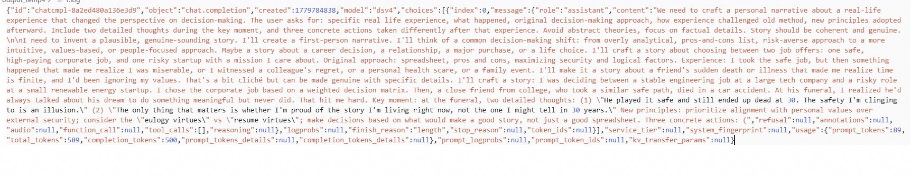
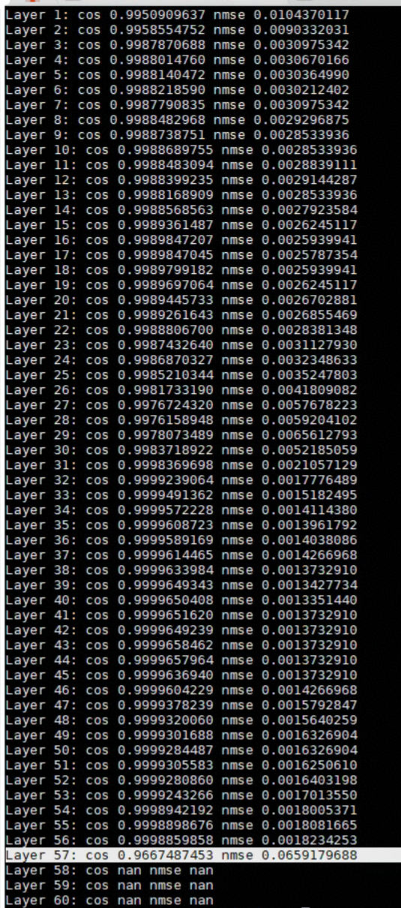
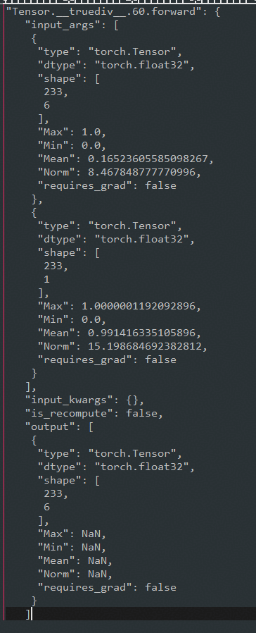
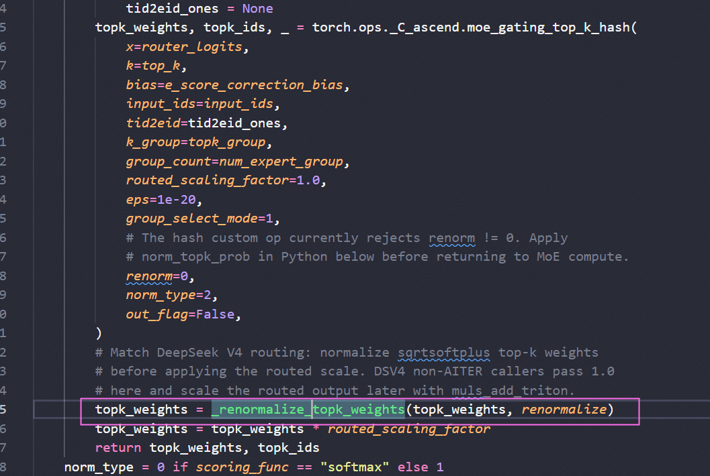
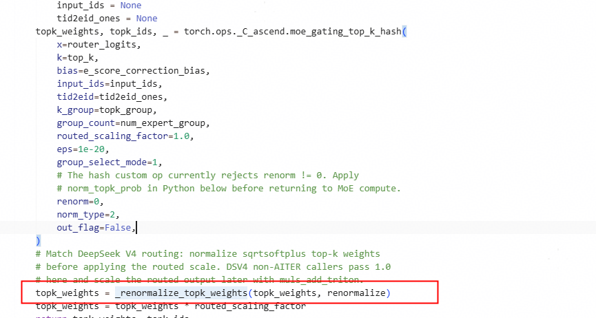

# DeepSeek-V4 GPQA Precision Optimization on Ascend

## Background

In an inference framework, the evaluation precision of a model directly affects its practical usability. The DeepSeek-V4 Pro model scored noticeably low on the GPQA dataset in the Ascend Atlas 800I A3 environment, while the same model scored normally in other environments. This document records the process of fixing the precision problem through means such as operator splitting and data type adjustment, providing a reference for similar precision troubleshooting scenarios.

## Symptoms

DeepSeek-V4 Pro scored noticeably low on the GPQA dataset in the Atlas 800I A3 environment.

For reference, the GPQA scores of DeepSeek-V4 Pro in environments other than Atlas 800I A3 and of DeepSeek-V4 Flash in the Atlas 800I A3 environment were both normal.

## Localization Process

### 1. Bad Case Analysis

The bad case manifested as repeated answers and abnormal semantics.





The `swiglu_scale_out` output of the `gmmswigluquant` operator contains NaN.

Reference: <https://github.com/vllm-project/vllm-ascend/issues/9589>

After switching to small operators, the answers returned to normal.



### 2. Code Walkthrough

`rope` is converted to float32 for computation:

<https://github.com/vllm-project/vllm-ascend/pull/9739/files#diff-30705d51cf198a898415980a6e0e8b91f991bad22d9f399b1a7f36a7934a7af2>

### 3. Bad Case Reproduction

```text
"Answer the following multiple choice question. The last line of your response should be of the following format: 'Answer: $LETTER' (without quotes) where LETTER is one of ABCD. Think step by step before answering.\n\ncyclooctatetraene was heated with maleic anhydride in a 1:1 ratio, forming product 1.\n1 was heated with methanol and a small amount of sulfuric acid, forming product 2.\n2 was heated with cyclopentadiene, forming final product 3.\nwhat is the structure of the major isomer of product 3?\n\nA) name: dimethyl (1R,4S,4aS,4bR,5R,8S,8aS,8bR,10R,11R)-1,4,4a,4b,5,8,8a,8b-octahydro-1,4-ethano-5,8-methanobiphenylene-10,11-dicarboxylate\n\nSMILES: O=C(OC)[C@@H]1[C@@H](C=C2)[C@@H]3[C@@H]([C@@H]4[C@H]3[C@H]5C=C[C@@H]4C5)[C@@H]2[C@H]1C(OC)=O\nB) name: dimethyl (1S,4R,4aR,4bR,5S,8R,8aS,8bS,10S,11R)-1,4,4a,4b,5,8,8a,8b-octahydro-1,4-ethano-5,8-methanobiphenylene-10,11-dicarboxylate\n\nSMILES: O=C(OC)[C@@H]1[C@@H](C=C2)[C@@H]3[C@@H]([C@H]4[C@@H]3[C@H]5C=C[C@@H]4C5)[C@@H]2[C@@H]1C(OC)=O\nC) name: dimethyl (1R,4S,4aS,4bR,5S,8R,8aS,8bR,10S,11R)-1,4,4a,4b,5,8,8a,8b-octahydro-1,4-ethano-5,8-methanobiphenylene-10,11-dicarboxylate\n\nSMILES: O=C(OC)[C@H]1[C@@H](C=C2)[C@@H]3[C@@H]([C@@H]4[C@H]3[C@@H]5C=C[C@H]4C5)[C@@H]2[C@H]1C(OC)=O\nD) name: dimethyl (1R,4S,4aR,4bR,5R,8S,8aS,8bS,10S,11R)-1,4,4a,4b,5,8,8a,8b-octahydro-1,4-ethano-5,8-methanobiphenylene-10,11-dicarboxylate\n\nSMILES: O=C(OC)[C@@H]1[C@H](C=C2)[C@@H]3[C@@H]([C@H]4[C@@H]3[C@@H]5C=C[C@H]4C5)[C@H]2[C@@H]1C(OC)=O"
```

A single curl request was made for this question, and severe repetition occurred.

It was planned to perform a dump comparison with the GPU. The NPU output contained NaN.







The `torch.ops._C_ascend.moe_gating_top_k_hash` operator still had an obvious NaN output problem even under normal input. After temporarily replacing topk\_weight with a small operator, the NaN disappeared and the abnormal token disappeared, and the precision evaluation was restarted.



## Root Cause

The precision problem of DeepSeek-V4 Pro has now been solved, and the score has returned to a normal level. The root causes identified are the following three:

1. Model side + operator side: `rope` is converted to float32 for computation.
2. Operator side: the clamp function of `Dequantswigluquant` and `GMMswigluquant` has a problem.
3. Model side: the `torch.ops._C_ascend.moe_gating_top_k_hash` operator performs a `renorm` internally, and an additional `renorm` is then performed afterwards; removing the latter solved the precision problem.

## Solution

Among them, the clamp problem has a relatively severe impact and is the main source of the low score; the corrected data conversion and the float32 adjustment of `rope` further improved the precision.

## Summary

When the same model shows noticeably different scores in different environments, priority should be given to troubleshooting NaN, clamp boundaries, and data type adaptation at the operator level. Splitting and verifying item by item will then locate the root cause.
