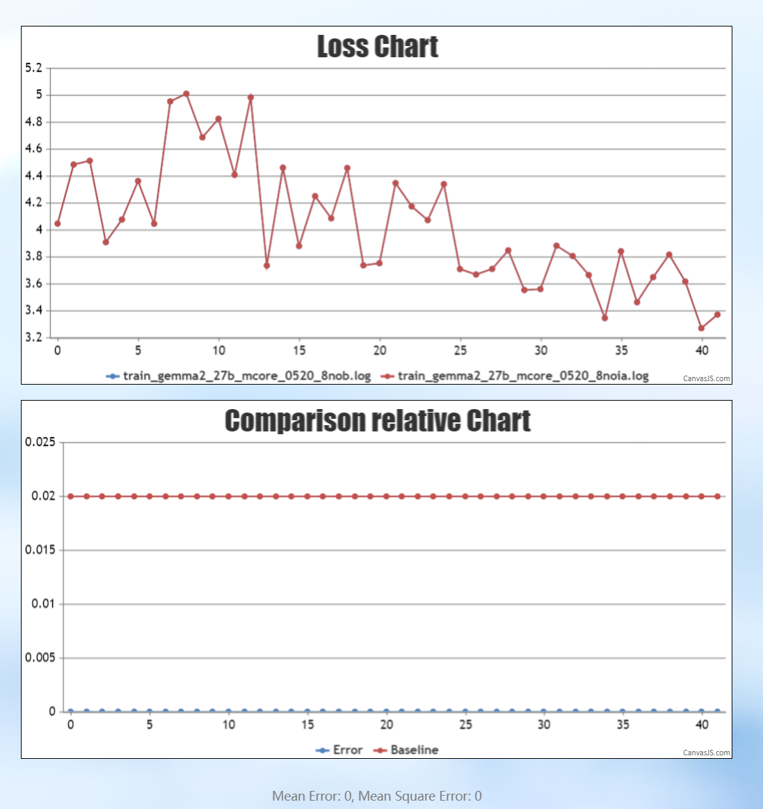
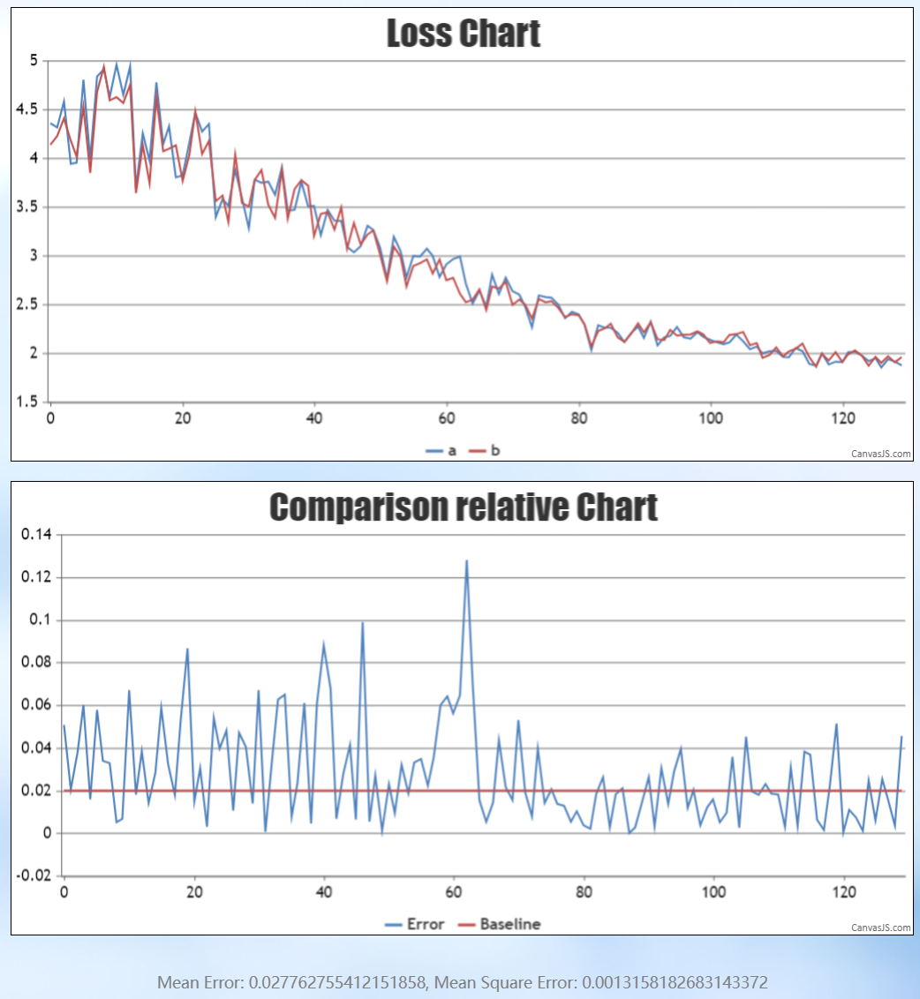
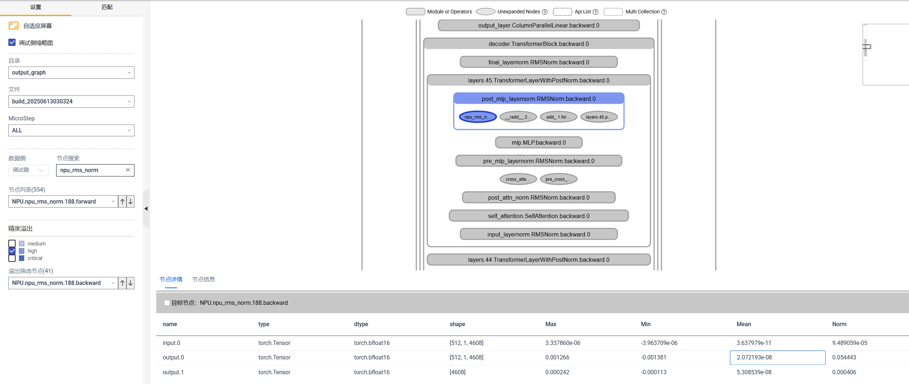
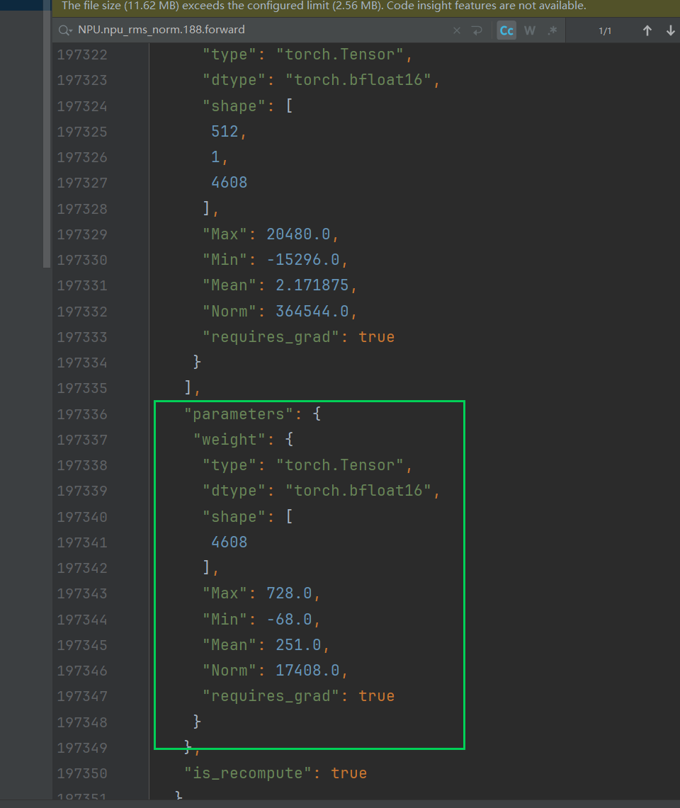
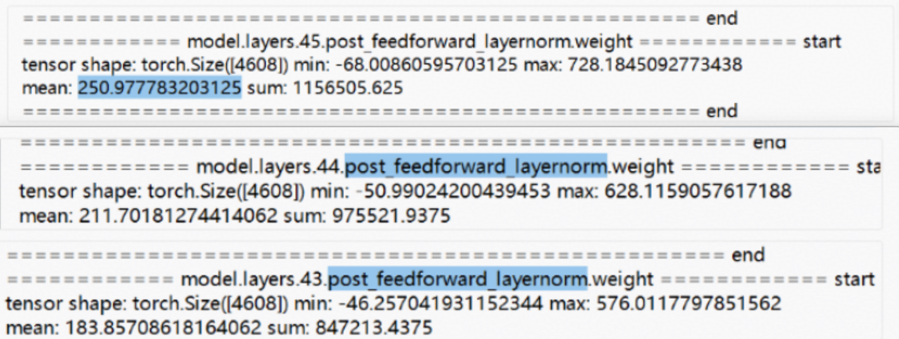
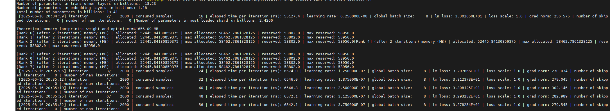
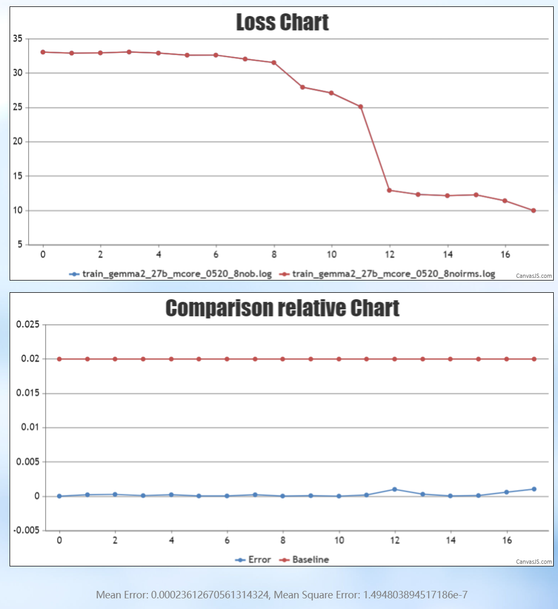

# Loss Difference Localization for Ascend-based Gemma Model Retraining

## Background

When training the Gemma model on the Ascend platform, training twice with the same weights and configuration sometimes produced a relatively large loss/grad_norm difference, which caused trouble for result stability and problem localization. This document records the complete troubleshooting process of this problem: through byte-granularity data dump and anomaly detection, the root cause was ultimately located as the abnormally amplified values of the loaded RMSNorm weights, rather than an Ascend software stack problem, providing troubleshooting ideas for similar "inconsistent retraining results" scenarios.

## Symptoms

- **Symptom 1**: When weights were randomly initialized, the loss of the two training runs aligned; when weights were loaded, the loss difference between the two runs was relatively large, but the weights loaded on both sides were indeed completely identical.
- **Symptom 2**: grad_norm was abnormally large.
- **Symptom 3**: After loading the weights and reducing the layers, the results aligned.
- **Symptom 4**: There was also a difference between training on the master branch and on the old branch.

**Symptom summary**: When determinism is not enabled, two runs with initialized weights can align, while two runs with loaded weights cannot; when determinism is enabled, two runs with loaded weights can align.

Initialized weights:

Loaded weights:

## Localization Process

The msProbe tool was used to dump one run of data for the training with determinism disabled and weights loaded. Through the overflow detection function of the visualization tool, the RMSNorm backward was seen at the high level; further viewing the corresponding forward process dump data revealed that the statistical values of the weights were very large.

In this model, the value ranges of the early RMSNorm were generally too large, which was abnormal. Comparing the RMSNorm weight data collected in other models, the values were mostly less than 1, playing a shrinking role; when randomly initialized, the initial value of the RMSNorm weight is all 1s.

From the symptoms, the values increased rapidly after each layer.

Specifically, the first few layers were still within the normal range, while for the later layers, the value magnitude was amplified by about a hundred times after each RMSNorm.

- The determinism difference is also related to the original values: the original RMSNorm weights were abnormal (amplified a hundredfold layer by layer), so the determinism difference was also relatively large (the error of multiplying small values is relatively small, while the error of multiplying large values is amplified).

## Root Cause

The values of the loaded RMSNorm weights were abnormally amplified, and the values were amplified by about a hundred times after each RMSNorm layer, which was especially severe in the deeper layers. This anomaly caused the relatively large loss/grad_norm difference between the two training runs and amplified the determinism computation error.

## Conclusion

It was finally confirmed that the problem was caused by the abnormally large values of the loaded RMSNorm weights, rather than an Ascend software stack problem.

## Solution

Simply randomly initializing the RMSNorm weights while loading other weights normally can effectively avoid this problem. The verification results are as follows:

- The grad_norm of the master branch decreased from an abnormally large magnitude to a normal level.

- When determinism is not enabled, the difference between the two runs was noticeably reduced, and the master branch successfully aligned with the old branch.

