# GLM-5 Adaptation and Train-Inference Consistency Optimization on Ascend

## Case Introduction

In large model reinforcement learning (RL) scenarios, the precision consistency between the training engine and the inference engine is a core difficulty determining the model convergence effect; a tiny numerical difference on either the training or the inference side will accumulate and amplify with the number of layers. This document records the complete process of adapting the GLM-5 model using the verl framework on the Ascend platform and carrying out training-inference consistency alignment with the help of the msProbe tool, including bringing up the full network, locating and fixing precision difference points, and optimizing long-run stability, providing a reference for similar large model RL adaptation practices.

## Preliminary Preparation

### Task Requirements

Use the RL framework verl to deliver the GLM-5 model. After training for a certain number of steps, in the long-sequence inference scenario, the evaluation scores on each evaluation dataset should not drop noticeably, training should not crash, and the evaluation scores should rise.

### Phased Planning

1. Get the vllm-ascend single-inference model running, with the precision meeting the requirements and the single-inference evaluation score reproducing the paper; clarify the vLLM and vllm-ascend versions.
2. Adapt MindSpeed-RL and Megatron-Bridge; clarify each version and the tokenizer version used by transformer.
3. Connect training and inference on the verl framework, get the reduced-layer end-to-end run working, and clarify the verl version.
4. Verify whether the weight saving and resumable training functions work properly.
5. Align the training-inference differences and verify the precision.
6. Verify training stability with a long run, check the step curves, and evaluate the weights.

The software versions determined in this document are as follows:

| Component | Version | Note (Commit) |
| --- | --- | --- |
| python | 3.11 | |
| PyTorch | 2.9.0 | |
| vLLM | v0.17.0 | commit b31e932 |
| vllm-ascend | v0.17.0rc1 | commit e20f0b1 |
| verl | 0.7.0 | commit 0c06358 |
| Megatron-LM | main | commit 1d462bd |
| Megatron-Bridge | main | commit 7cabf71 |
| MindSpeed | dev | commit 07056df5 |
| transformers | v5.4.0 | commit 276f140 |

### Model Weights

The Ascend NPU environment uniformly adopts BF16 as the baseline precision format, and the weights need to be aligned to BF16. Therefore, the [weights](https://huggingface.co/zai-org/GLM-5) used for the GLM-5 model adaptation in this document adopt the BF16 data type.

### Training Dataset

This document uses the [dapo-math-17k](https://huggingface.co/datasets/BytedTsinghua-SIA/DAPO-Math-17k/blob/main/data/dapo-math-17k.parquet) dataset, which verl already supports.

## GLM-5 Model Structure and Key Modules

### Partial Model Structure of the Training Engine and Inference Engine

Before the localization process - precision alignment - training-inference consistency troubleshooting, it is necessary to first understand the structures with which the training engine and the inference engine respectively implement the Attention module computation in the GLM-5 model.

#### Training-Side Megatron

```plain
(self_attention): MLASelfAttentionAbsorb(
             (core_attention): DSAttention(
               (indexer): DSAIndexer(
                 (rotary_pos_emb): YarnRotaryEmbedding()  # not using yarn
                 (linear_wq_b): TELinear()
                 (linear_wk): TELinear()
                 (k_norm): FusedLayerNorm()
                 (linear_weights_proj): TELinear()
               )
             )
             (rotary_pos_emb): YarnRotaryEmbedding()
             (linear_q_down_proj): TELinear()
             (linear_q_up_proj): MindSpeedTEColumnParallelLinear(in_features=2048, out_features=16384, bias=False, TP=8)
             (linear_kv_down_proj): TELinear()
             (linear_k_up_proj): MindSpeedTEColumnParallelLinear(in_features=512, out_features=12288, bias=False, TP=8)
             (linear_v_up_proj): MindSpeedTEColumnParallelLinear(in_features=512, out_features=16384, bias=False, TP=8)
             (linear_proj): RowParallelLinear(in_features=16384, out_features=6144, bias=False, TP=8)
             (q_layernorm): RMSNorm()
             (kv_layernorm): RMSNorm()
       )
```

#### Inference-Side vLLM

```plain
(self_attn): DeepseekV2MLAAttention(
           (fused_qkv_a_proj): DeepSeekV2FusedQkvAProj(in_features=6144, output_features=2624, bias=False, tp_size=1, gather_output=False)
           (q_a_layernorm): AscendRMSNorm(hidden_size=2048, eps=1e-05)
           (q_b_proj): AscendColumnParallelLinear(in_features=2048, output_features=256, bias=False, tp_size=64, gather_output=False)
           (kv_a_layernorm): AscendRMSNorm(hidden_size=512, eps=1e-05)
           (kv_b_proj): AscendColumnParallelLinear(in_features=512, output_features=448, bias=False, tp_size=64, gather_output=False)
           (o_proj): AscendRowParallelLinear(in_features=256, output_features=6144, bias=False, tp_size=64, reduce_results=True)
           (rotary_emb): AscendRotaryEmbedding(
             head_size=64, rotary_dim=64, max_position_embeddings=202752, base=1000000, is_neox_style=False
             (apply_rotary_emb): AscendApplyRotaryEmb(is_neox_style=False, enable_fp32_compute=False)
           )
           (indexer_rope_emb): AscendRotaryEmbedding(
             head_size=64, rotary_dim=64, max_position_embeddings=202752, base=1000000, is_neox_style=False
             (apply_rotary_emb): AscendApplyRotaryEmb(is_neox_style=False, enable_fp32_compute=False)
           )
           (indexer): Indexer(
             (wq_b): AscendReplicatedLinear(in_features=2048, output_features=4096, bias=False)
             (wk): AscendReplicatedLinear(in_features=6144, output_features=128, bias=False)
             (k_norm): LayerNorm()
             (weights_proj): AscendReplicatedLinear(in_features=6144, output_features=32, bias=False)
             (k_cache): None
             (indexer_op): SparseAttnIndexer(
               (k_cache): DeepseekV32IndexerCache()
             )
           )
           (mla_attn): AscendMultiHeadLatentAttention(
             (mla_attn): MLAAttention(
               (kv_b_proj): AscendColumnParallelLinear(in_features=512, output_features=448, bias=False, tp_size=64, gather_output=False)
               (indexer): IndexerWrapper(
                 (wq_b): AscendReplicatedLinear(in_features=2048, output_features=4096, bias=False)
                 (wk): AscendReplicatedLinear(in_features=6144, output_features=128, bias=False)
                 (weights_proj): AscendReplicatedLinear(in_features=6144, output_features=32, bias=False)
                 (k_norm): LayerNorm()
               )
               (_decode_concat_quant_fp8_op): _DecodeConcatQuantFP8()
             )
           )
         )
```

### Key Modules: MLA + DSA

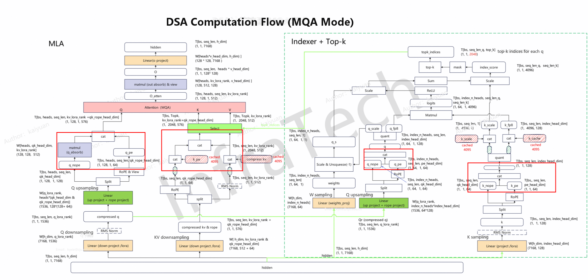

#### Dual-Branch Linkage of MLA + DSA

This figure shows the complete forward computation flow of the GLM-5 attention layer, which is divided into two major parts:

- Left: the Multi-head Latent Attention (MLA) main branch, which implements low-rank latent attention and is the core of the dense computation.
- Right: the Indexer + Top-k branch of DeepSeek Sparse Attention (DSA), which implements key token selection for long sequences and is the core of the sparse optimization. The two share the same input `hidden` and ultimately jointly affect the computation range and result of attention.

#### MLA Computation Flow

The core of MLA is low-rank compression + latent KV cache, and the whole process revolves around "compression → upsampling → attention computation".

**1. Input and Compression Stage**

```plain
hidden (T[bs, seq_len, h_dim])
    ↓
Linear(down project/lora) → compressed q/kv (low-rank representation)
    ↓
RMSNorm
```

- Input: the hidden state `hidden` of the model layer, with shape `(bs, seq_len, 7168)`.
- First step: perform low-rank downsampling through `Linear(down project/lora)` to obtain the compressed `compressed q` and `compressed kv`.
- Purpose: greatly reduce the dimension of the KV cache, reduce memory usage, and adapt to ultra-long sequences.

**2. Upsampling and RoPE Embedding**

Taking Query (Q) as an example, the flow is as follows:

```plain
compressed q → Linear(up project + rope project) → Q upsampling
    ↓
Split → q_nope (part without position information) + q_pe (position information part)
    ↓
q_pe → RoPE & View → rotary position embedding
```

- The compressed `compressed q` is upsampled through `Linear(up project + rope project)`, restoring it to the dimension matching the attention heads.
- After upsampling, it is split into two parts: `q_nope` (content features containing no position information, subsequently used for latent attention computation) and `q_pe` (position features used for RoPE rotary position embedding, with position embedding performed separately).

**3. KV-Side Processing and Cache Reuse**

The processing of Key (K) and Value (V) is symmetric to that of Q, and cache reuse is supported at the same time:

```plain
compressed kv → Linear(down project/lora) → KV downsampling
    ↓
Split → k_nope + k_pe
    ↓
k_pe → RoPE & View → rotary position embedding
    ↓
cat(k_nope, cached_compress_kv) → concatenate cache and new KV
    ↓
Select + cached_compress_kv → KV cache update
```

- During inference, `k_pe` and `k_nope` are concatenated with the historical `cached_compress_kv` to implement KV cache reuse, greatly reducing repeated computation.
- There is no cache during training; the `compressed kv` of the complete sequence is processed directly.

**4. Latent Attention Computation (MQA Mode)**

```plain
Q branch: q_nope → cat + q_rope_head_dim → q_absorb
K branch: k_nope → cat + k_rope_head_dim → k_absorb
    ↓
Attention(MQA) → O_attn
    ↓
matmul(out_absorb) & view → O
```

- The `q_nope` and `k_nope` are respectively concatenated with position-related features, and the latent attention computation is completed through `matmul(q_absorb)`.
- The `matmul` and `view` operations in this step are one of the keys to the implementation differences between the training side (Megatron) and the inference side (vLLM), directly affecting the output precision.

#### DSA (Indexer + Top-k) Computation Flow

The core of DSA is Indexer scoring + Top-k selection, which determines which tokens in a long sequence participate in the attention computation.

**1. Indexer Scoring Stage**

```plain
hidden → Linear(project/lora) → K sampling → k (bs, seq_len, 128)
hidden → Linear(weights_proj) → weights (bs, index_n_heads, seq_len, 1)
    ↓
k → Scale & UnSqueeze → k_s
    ↓
q (from compressed q) → quant → q_fp8 → q_scale
k → quant → k_fp8 → k_scale
    ↓
q_nope + q_pe → cat → fuse position and content features
k_nope + k_pe → cat → fuse position and content features
    ↓
Matmul(q, k) → index_score (bs, index_n_heads, seq_len_q, seq_len_k)
```

- The input `hidden` goes through two linear layers: `Linear(project/lora)` generates the K-side feature `k`; `Linear(weights_proj)` generates `weights`, which serves as the scoring parameter of the Indexer.
- `q` and `k` are respectively quantized (`quant`) and scaled, then the position and content features are concatenated, and the importance score `index_score` between tokens is computed through `Matmul`.

**2. Top-k Selection Stage**

```plain
index_score → Scale → logits
logits → ReLU → Sum → Scale → topk_indices
    ↓
topk + mask → select the top-k key tokens
```

- `index_score` undergoes a series of transformations `Scale → ReLU → Sum → Scale` to obtain the final importance score of each token.
- Through the `top-k` operator, the most important `topk_indices` in the sequence are selected, and a sparse attention mask is generated in combination with `mask`.
- The training side uses the deterministic `torch.topk`, while the inference side (native vLLM) may use a non-deterministic acceleration operator; this is the core source of the training-inference difference.

**3. Selection Result Returned to MLA**

```plain
topk_indices → Select → keep only the top-k tokens in the KV of MLA
    ↓
Only the selected tokens participate in the subsequent attention computation
```

- The selected `topk_indices` are returned to the `Select` module of MLA, so that MLA performs the attention computation only on the key tokens, filtering out redundant tokens and implementing sparse optimization.

## Localization Process: Full-Network Function Adaptation

After completing the separate adaptation and verification of the training engine and inference engine on the verl framework, configure the relevant training and inference parameters. Some adaptation problems were encountered when bringing up the full-network training task.

### Error: TO serve at least one request with the models's max seq len (202752)

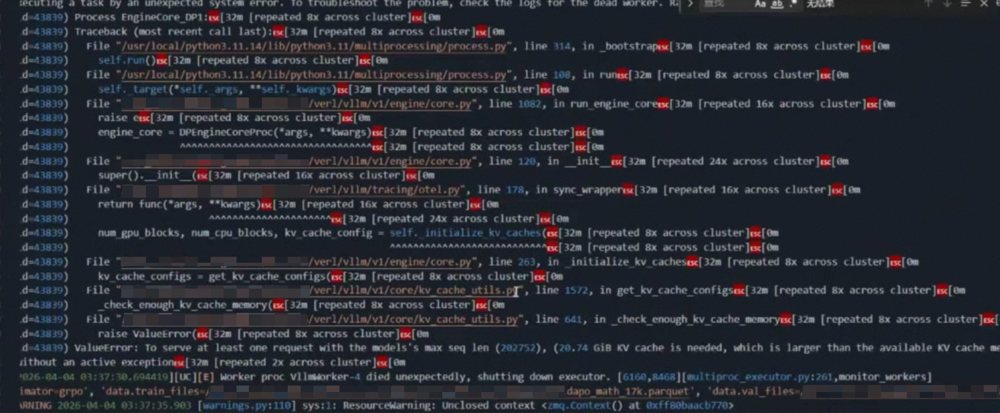

Normally, `max_seq_len` is obtained from `prompt_len` and `response_len`. Searching for 202752 in the framework-side code reveals `max_position_embeddings=202752`.

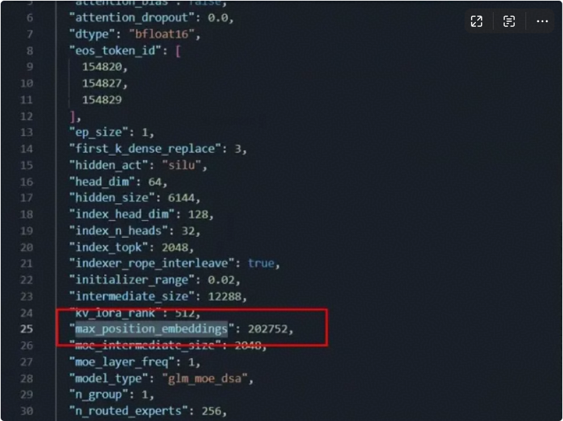

This is inconsistent with expectations. Checking the definition of `max_seq_len` in the source code, it was found that different versions define it with different logic: verl 0.7.1 defaults this parameter to `max_position_embeddings` when it is not set, whereas earlier verl versions default it to `prompt_len+response_len`. Finally, the verl training startup script was modified to add `rollout.max_model_len=$prompt_length+$response_length` to solve it.

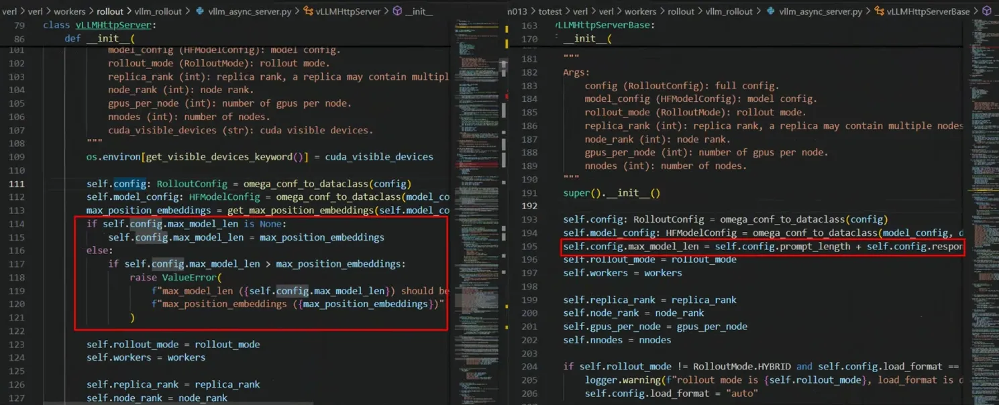

### AttributeError: 'NPUModelRunner' object has no attribute 'cudagraph_batch_sizes'

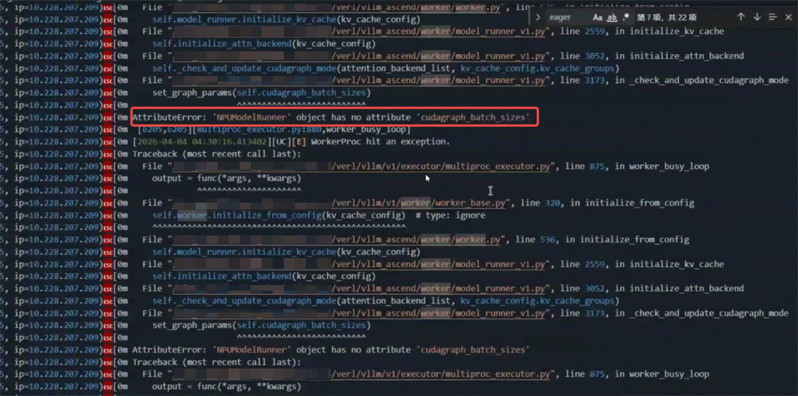

Checking the verl startup script, `cudagraph_batch_sizes` was not configured. Refer to the configuration of a previous project using graph mode with `FULL_DECODE_ONLY`:

```plain
"cudagraph_mode": "FULL_DECODE_ONLY",
"cudagraph_batch_sizes": [8,16,32,64,128,192,256,384]
```

After trying to add it, it was found that OOM occurred.

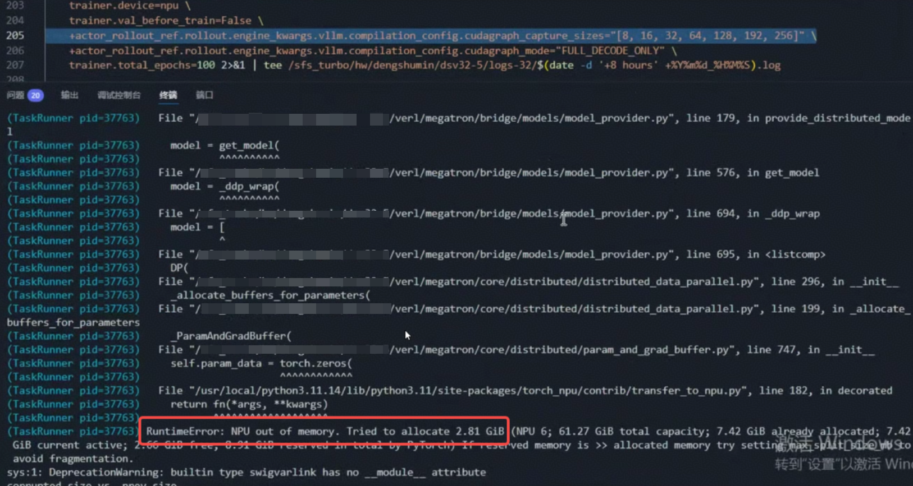

Considering the difference in model size, precompiling a graph with a large `batch_size` requires more memory; an attempt was made to change `cudagraph_batch_sizes` to [1,2,4], but OOM was still reported. Consulting the materials, it is considered possibly that the model itself is split too large, so that the static memory is already almost fully occupied.

Adjust model partitioning:

```plain
TP: 16 -> 8
DP: 4  -> 8
EP: 64 -> 64
```

It was found that under the new partitioning strategy, `"cudagraph_batch_sizes": [8,16,32,64,128,192,256,384]` can also fit normally.

### input_processor Type Error in vLLM: TypeError: '>' not supported between instance of 'str' and 'int'

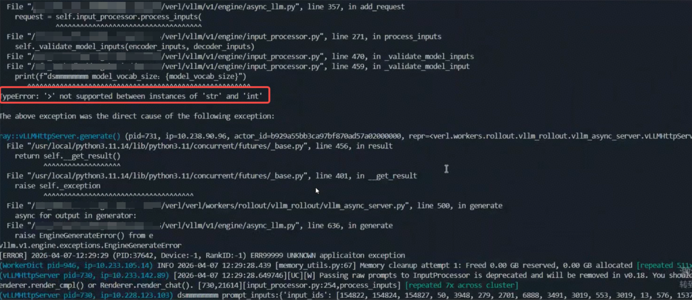

Print the `prompt_input` structure of the request passed to the vLLM side:

```plain
prompt:{
  'prompt_token_ids':{
        'input_ids':[xxx],
        'attention_mask':[xxx]
        },
  'multi_modal_data':xxx
  }
```

Comparing with the `prompt_input` structure of the request under the version previously verified locally, a difference was found:

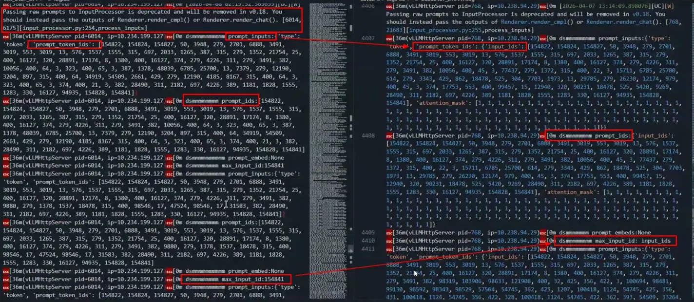

- vLLM 0.17.0 + verl 0.7.1: the structure matches and no error is reported.
- vLLM 0.17.0 + verl commit 0c06358: the structure changed and is incompatible.

This problem error appeared in two places: `vllm/v1/engine/input_processor.py` and `vllm/v1/engine/detokenizer.py`.

Later, comparing different transformers versions, it was found that this problem was caused by the iteration of the transformers version, but verl has made it compatible in the latest version 0.7.1. Therefore, under the incompatible `prompt_input` structure, `'input_ids'` and `'attention_mask'` were manually extracted.

## Localization Process: Precision Alignment—Training-Inference Consistency Troubleshooting

The precision problem localization chain of large model RL is complex, with many influencing factors. Based on the msProbe tool, precision alignment implementation practices and problem localization troubleshooting were carried out.

### Precision Monitoring Configuration

After the full network is running, configure precision monitoring parameters in the verl training startup script to calculate key metrics, and observe the training-inference consistency and training stability of each step during training.

```python
actor_rollout_ref.rollout.calculate_log_probs=True
```

```python
training/rollout_probs_diff_mean: the average diff of the logprob of the rollout forward between training and inference
training/rollout_probs_diff_max: the maximum diff of the logprob of the rollout forward between training and inference
training/rollout_actor_probs_pearson_corr: the Pearson correlation coefficient of the probabilities of rollout and actor
```

```python
critic/rewards_mean: the average of the scores of the answers of all inputs at each step after being scored by the reward scorer
actor/grad_norm: judges the model convergence trend
actor/entropy: policy entropy, the randomness of the model rollout; if this value is too large, the rollout generation may contain garbled text
```

In addition, configure `rollout_data_dir` to save the results generated by rollout during training, which can be used to check whether the rollout generation has anomalies such as garbled text or repeated characters.

### msProbe Data Collection

By observing the training-inference consistency metric `training/rollout_probs_diff_mean`, the initial value after the full network is running is relatively large, indicating a relatively large difference between the training and inference implementations. Combining this metric with the single-inference evaluation results, the msProbe tool needs to be used to collect data from the training and inference stages for analysis.

First, unify the partitioning strategy of training and inference: TP=64, DP=1, EP=64, with the model reduced to 5 layers (3 Dense + 2 MoE); the other relevant settings are as follows:

```python
n_gpus_per_node=16
train_batch_size=1
n_resp_per_prompt=1
ppo_mini_batch_size=1
max_prompt_length=448
max_response_length=1
use_dynamic_bsz=False

actor_rollout_ref.actor.ppo_micro_batch_size_per_gpu=1 \
actor_rollout_ref.ref.log_prob_micro_batch_size_per_gpu=1 \
actor_rollout_ref.rollout.log_prob_micro_batch_size_per_gpu=1 \
```

Refer to [Training-Side Data Collection Under msProbe-verl Megatron](../user_guide/dump/verl_megatron_consistency_preprocess_dump.md) to modify the training code, adjusting the training input to a single prompt. The inference-side tool enabling has been integrated into the official vllm-ascend repository and can be used directly. Then, unify the inputs of the training and inference stages, and modify the configuration at the same time to ensure that the data in the prefill stage is comparable.

Training side: `verl/workers/actor/megatron_actor.py`

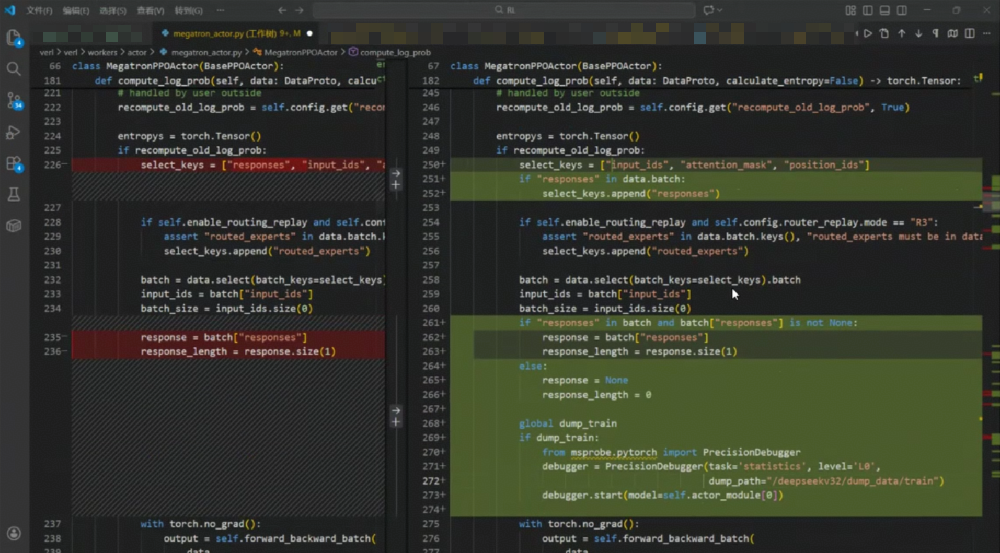

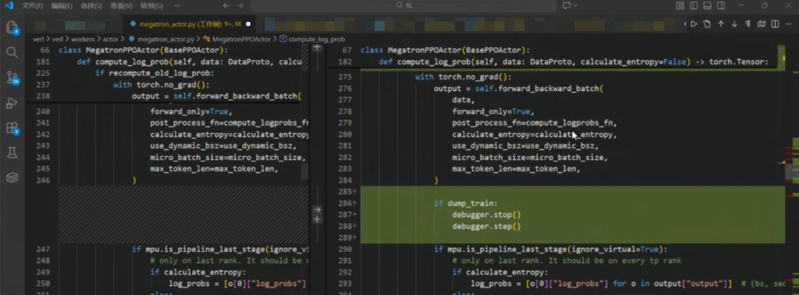

### Training-Inference Difference Troubleshooting

Thoughts on troubleshooting and localization based on the msProbe tool:

After completing data collection, the benchmark for comparison must first be determined. After serving startup of vllm-ascend connected to the GLM-5 model is completed, a single-inference evaluation task is performed on the aime2025 dataset, benchmarking the output conditions of the GLM-5 paper, showing that single inference has no major precision problem and can temporarily serve as the benchmark for the training side, but ultimately the authoritative source code and technical report shall prevail.

Read the `construction.json` file for module-level data comparison. First ensure that the input data of `layer.0.input_layernorm` is completely identical, then verify module by module and layer by layer, and locate the position where the training and inference outputs first become inconsistent.

For large models, tiny numerical differences accumulate and amplify layer by layer, resulting in noticeable differences between the training and inference (rollout) results; there may even be a phenomenon where the training and inference output probabilities of the same token are 0 and 1, respectively. Therefore, it is necessary to align every difference to be completely equal as much as possible. After locating a difference node, adapting the modification scheme is likewise a key difficulty.

#### Difference 1: Inconsistent Framework Implementation of the FFN Activation Function

Comparing the data collected by msProbe in order of operator execution, the activation function output of the MLP module of `layers.0` was found to be inconsistent.

Inference side:

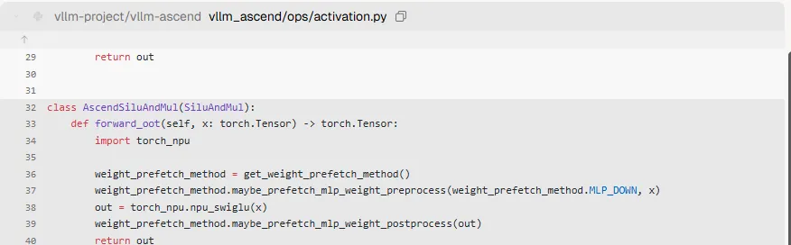

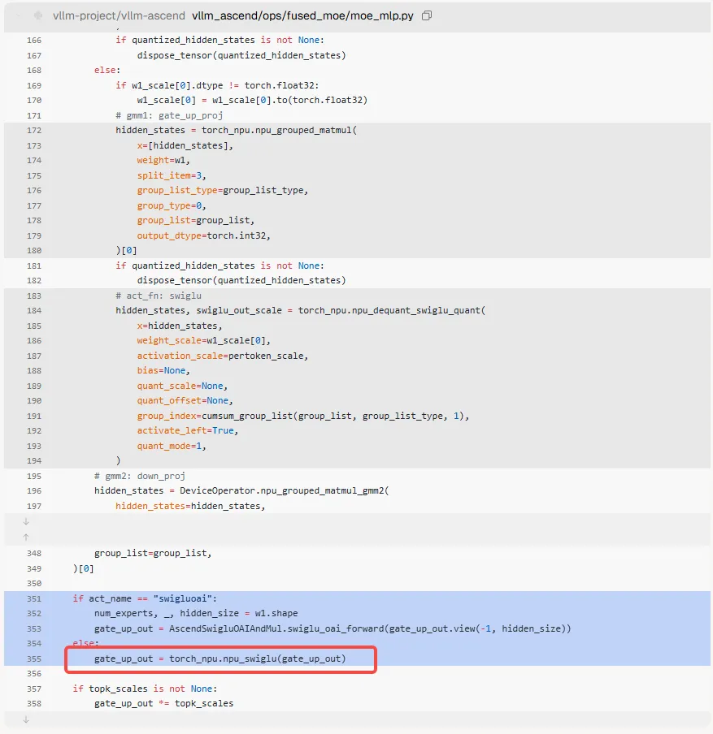

Training side:

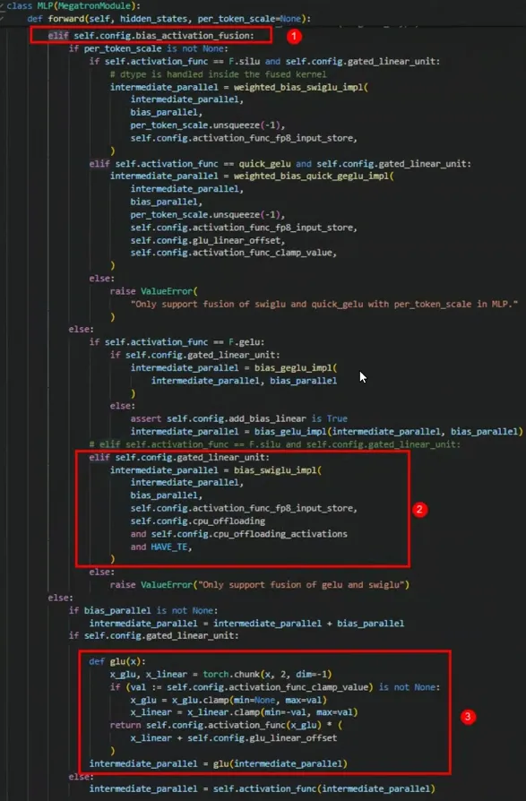

After checking the stack call chain and inspecting the code, it was clarified that the `act_fn` of the private experts and shared experts of the Dense layer and the MoE layer at the MLP position differs. The inference side implements it with the `npu_swiglu` fusion operator, while the training side implements the glu small-operator because the MindSpeed patch did not take effect, although the swiglu enabling parameter had already been added to the verl parameters.

```python
+actor_rollout_ref.actor.megatron.override_transformer_config.swiglu=True \
+actor_rollout_ref.actor.megatron.override_transformer_config.use_fused_swiglu=True \
```

After troubleshooting, it was confirmed that when adapting the Megatron-Bridge PR, `provider.bias_activation_fusion=True` was not set directly, so the small-operator implementation was used instead of `bias_swiglu_impl`. After adding this configuration in the Bridge, the corresponding path was successfully entered, was successfully patched by MindSpeed, and called the `npu_swiglu` fusion operator implementation. After the modification, `training/rollout_probs_diff_mean` dropped noticeably, but was still relatively large, requiring continued troubleshooting.

#### Difference 2: indexer_k_norm

Continuing the troubleshooting, it was found that the inference side's `indexer_k_norm` upcast to FP32 and then downcast to BF16, whereas the training side used a BF16 implementation.

Inference side:

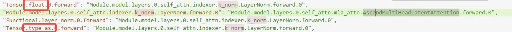

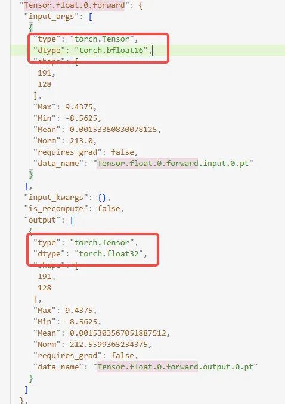

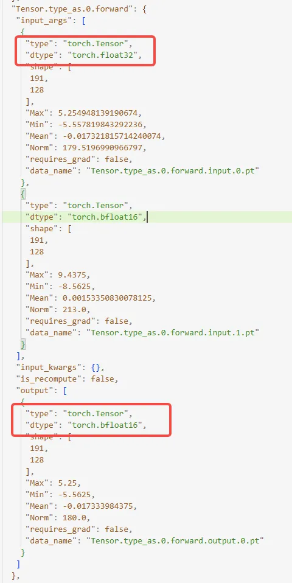

Training side:

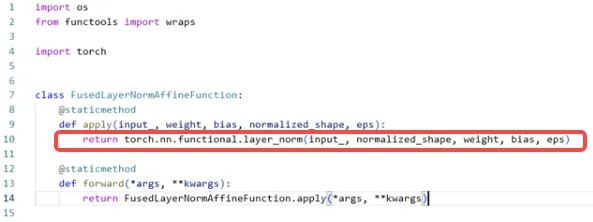

Modify to:

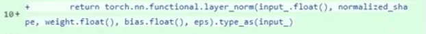

At the same time, it was found that the `eps` input parameter of `k_norm` is inconsistent: the inference side is 1e-6, while the training side is 1e-5; referring to the GLM-5 technical report, 1e-5 was adopted for alignment. After the modification, the training experiment was rerun, and the metric `training/rollout_probs_diff_mean` was observed to drop further.

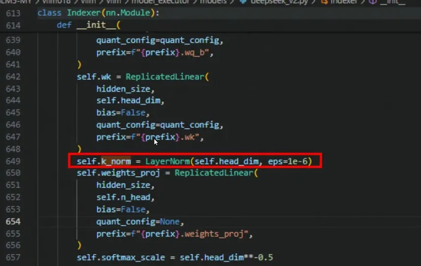

#### Difference 3: RoPE Mode—Half/Interleave

On the inference side, Lightning Index RoPE adopts a Half precision fusion implementation, while the training side uses a native interleave small-operator implementation; the two modes are inconsistent. Because the public Triton-Ascend implementation could not be obtained during the GLM-5 adaptation development stage, `HAS_TRITON=False` was manually configured during adaptation. Moreover, GLM-5 and DeepSeek-V3.2 reuse the `sfa_v1.py` file, which causes the RoPE logic of the Indexer to default to the half precision branch, inconsistent with the interleave implementation specification specified in the technical report. After confirmation from multiple parties, the inference side's q and k were replaced with the `torch_npu.npu_interleave_rope(x, cos, sin)` implementation; after verification, the output was completely identical to the Megatron small-operator result. After the modification, the training experiment was rerun, and the metric `training/rollout_probs_diff_mean` was observed to drop further.

Training side (small-operator implementation of the interleave format):

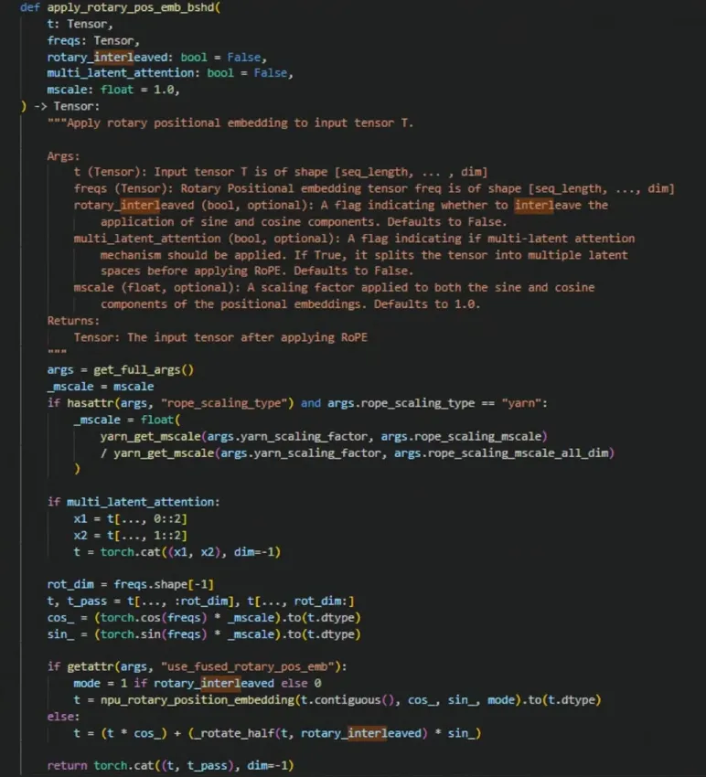

Inference side (fusion operator, half mode by default):

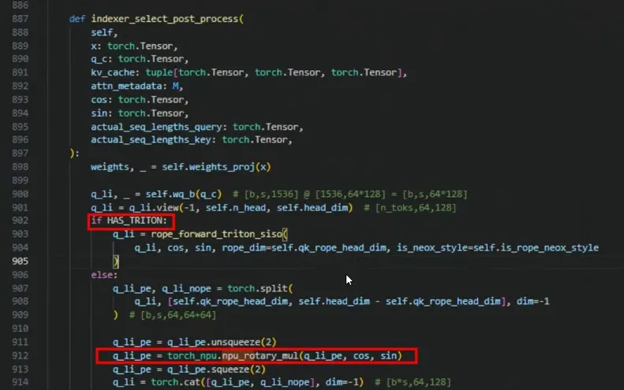

The GLM-5 configuration file adopts interleave mode:

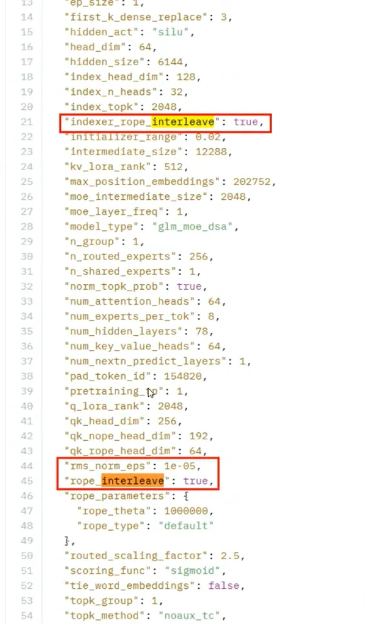

#### Difference 4: Align torch_npu.npu_add_rms_norm and add + torch_npu.npu_rms_norm to the Training Small Operators

The inference side used `torch_npu.npu_add_rms_norm`, while the training side used `torch_npu.npu_rms_norm`; comparison and verification of the output data of the two operators showed inconsistency.

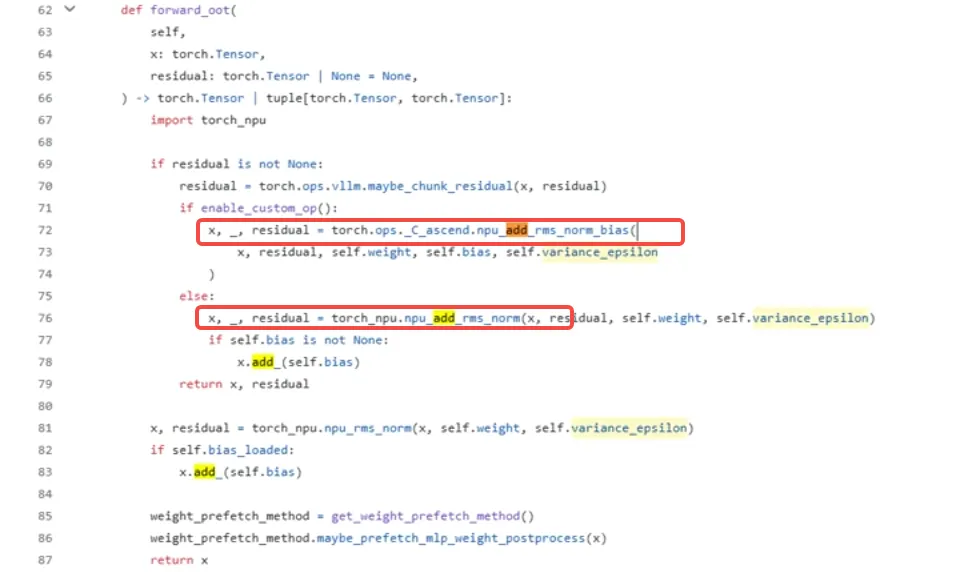

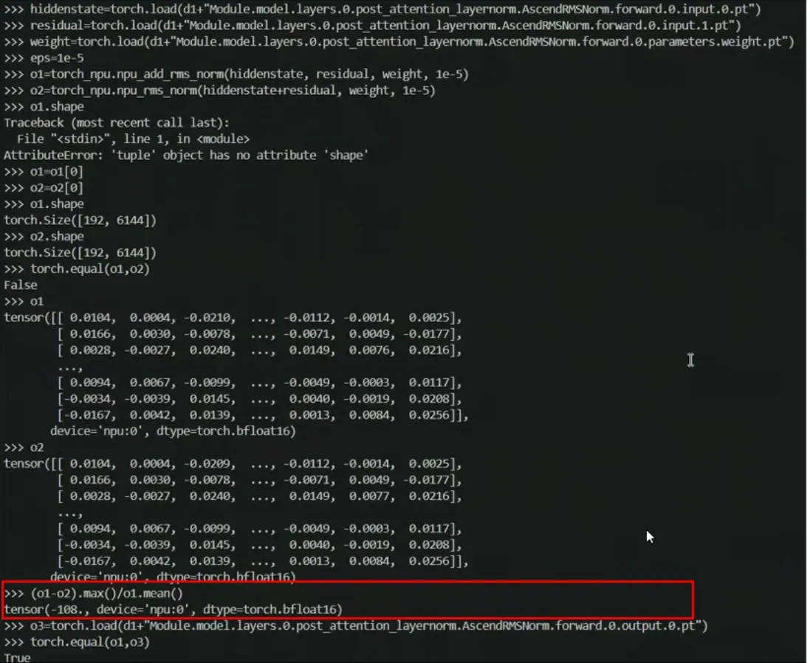

The inference side's `torch_npu.npu_add_rms_norm` was replaced with a small-operator implementation (addition basic operator + `torch_npu.npu_rms_norm`), and the outputs were verified to be consistent. After the modification, the training experiment was rerun, and `training/rollout_probs_diff_mean` was observed to continue dropping.

### MSAgent Practice

Data: the L0 data collected by 5-layer GLM-5 (3 Dense + 2 MoE) on the verl framework.

Agent analysis:

In the training and inference data, the `gate_up` and `linear_fc1` outputs of the MLP of the corresponding module are still aligned, but afterward rollout goes through `mlp.act_fn.AscendSiluAndMul.forward.0` computation while training does not, causing the module inputs and outputs of subsequent training and rollout to be misaligned.

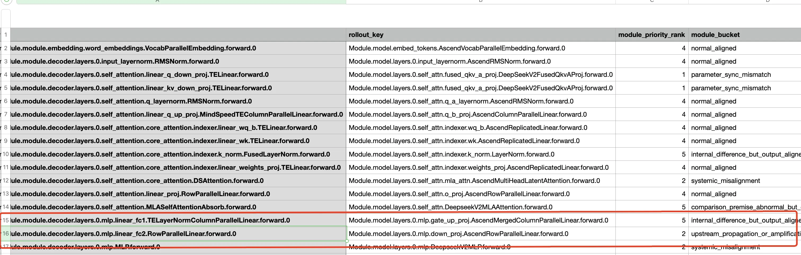

Manual localization:

The implementation of `act_fn` is inconsistent between training and inference; the vLLM side goes through the swiglu fusion operator of vllm_ascend, while Megatron goes through the gelu of Megatron. Here verl was configured to use swiglu, but the parameter was not set correctly on Megatron Bridge, so it did not take effect.

Summary: Through L0-level data, the scope determined by manual localization and by Agent localization is about the same. However, due to the limitation of the L0 level and the fact that the Agent cannot obtain the actual framework implementation code, the accuracy with which the final root cause can be determined is inconsistent. If the site allows it, you can try connecting the Agent to the workspace to obtain the actual framework implementation code, and at the same time read the dumped tensor data for automated comparison.

## Training Long-Run Metric Monitoring

### Training Long-Run Stability Optimization

After basically aligning the implementations of the training and inference stages in the RL task, a long-run experiment was conducted, and the initial curve chart was obtained. By observing the curve trends of the training stability metrics:

1. Critic/rewards_mean: there is no obvious upward trend during training.
2. Response length_mean and response length clip ratio: during training, the length of the rollout becomes longer and longer, and at the same time the proportion of rollout results being truncated becomes higher and higher.
3. Observing the answers generated by rollout, it was found that most answers were too long, with a phenomenon of repeated think, and did not stop normally after outputting eos.

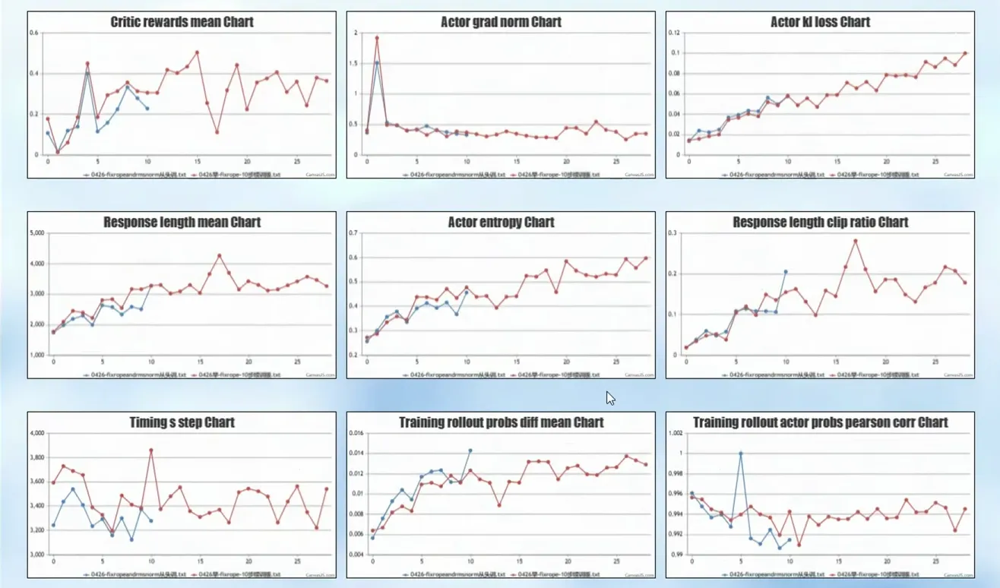

Considering that the token sequence generated in think mode is relatively long and may directly reach a relatively long level, an ablation experiment of disabling think was attempted. It can be observed that disabling think is indeed helpful for reward growth, the growth rate of the inference output length is also relatively gentle, and thus the proportion of truncated rollout generation results also decreased.

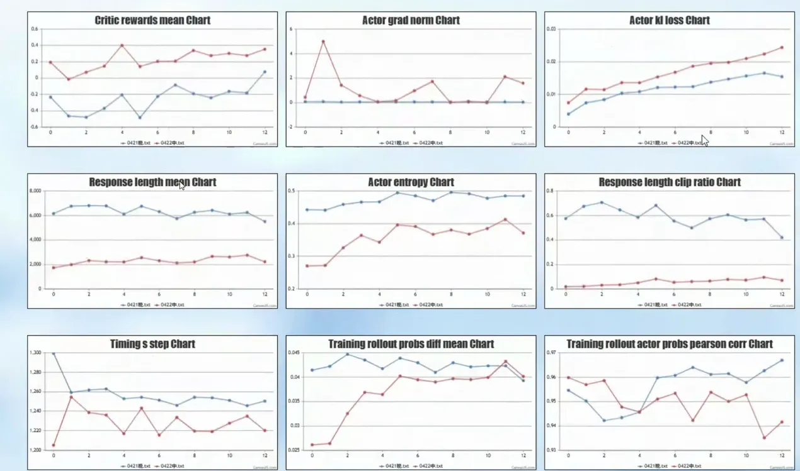

After disabling think mode, it was found that there is still a phenomenon of repeated characters: in the rollout generation results, the `eos_token` was output but the answer did not stop. It is guessed that the `eos_token` did not take effect. Checking `config.json` in the model weights, it was found that the `eos_token_id` value set is inconsistent with the original model. Localization revealed that verl overwrites `config.json`, causing `eos_token_id` to be overwritten and leaving only one `token_id`, thereby causing the problem that the answer does not stop after the `eos_token` is output in the rollout generation results.

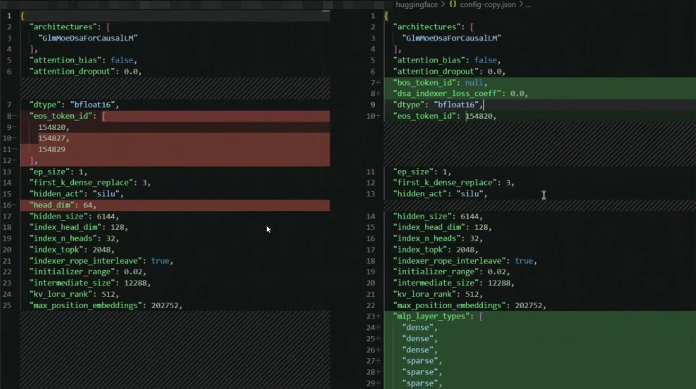

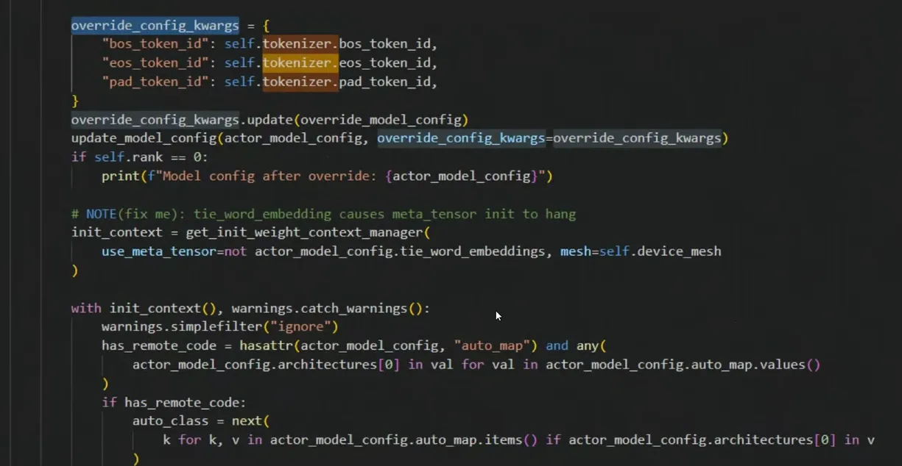

The long output does have a relatively large impact on the math dataset math-17k, limiting the model's capability, but this conforms to the actual business requirements. To avoid the model being unable to learn the complete correct answer due to truncation, it was considered to modify the reward scorer rules and try adding a length penalty to the reward rules. Conducting a long-run experiment, it was found that compared with not enabling the length penalty, enabling the length penalty makes `response_length_mean` rise more slowly and with a smaller magnitude, while the rollout truncation ratio is noticeably smaller, and the reward curve trend is about the same; therefore, the length penalty condition was added to the long-run experiment.

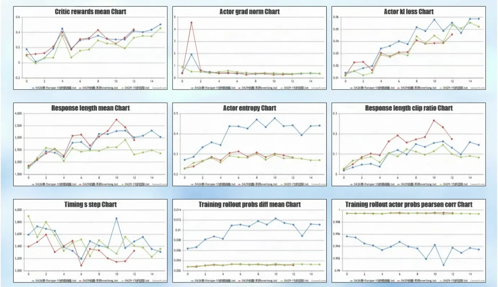

## Summary

In RL scenarios, training-inference consistency is a core difficulty, and training-inference data difference comparison is the core means of resolving this problem. With the advantages of a complete collection scope and high collection efficiency, the msProbe tool lays a solid foundation for troubleshooting training-inference differences, and at the same time, relying on its automated precision comparison capability, it greatly improves the efficiency of problem localization and rectification.

Combining with the actual implementation and usage scenarios of the project, three tool optimization suggestions are proposed:

1. The tool's operator collection allowlist has not yet included some custom fusion operators, so operator registration currently needs to be completed manually, making the usage process cumbersome.
2. The existing operator-level train-inference difference comparison function still has shortcomings in cross-model generality and comparison accuracy. At present, MSAgent can only achieve preliminary problem localization; it is recommended to upgrade and optimize the Agent capability so that accurate operator-level train-inference difference localization can be fully automated based solely on Dump data.
3. Add new monitoring capabilities to support real-time perception and monitoring of changes to model weight configuration files, train-inference engine runtime parameters, and framework-level hyperparameters.
