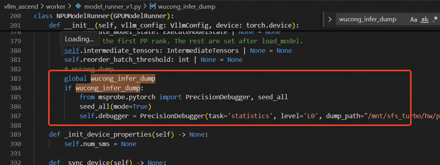
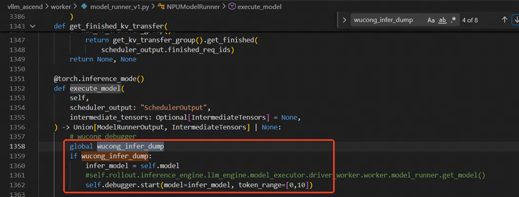
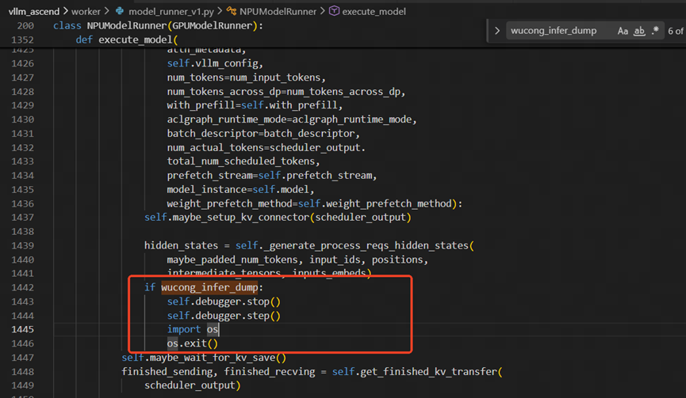
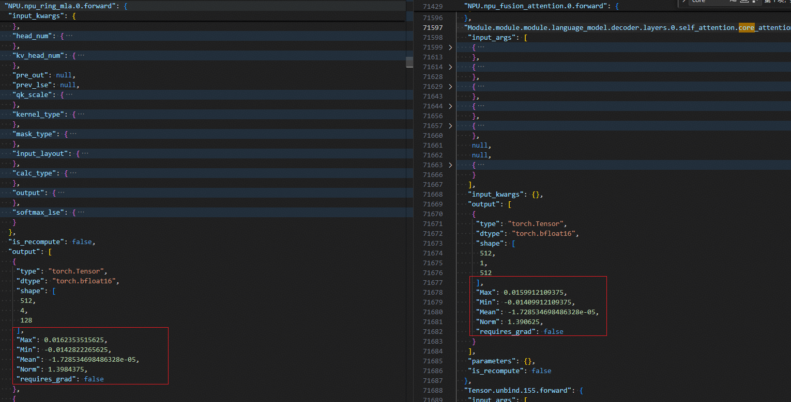
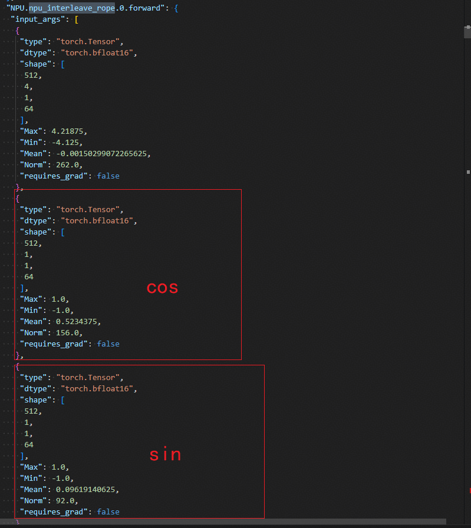
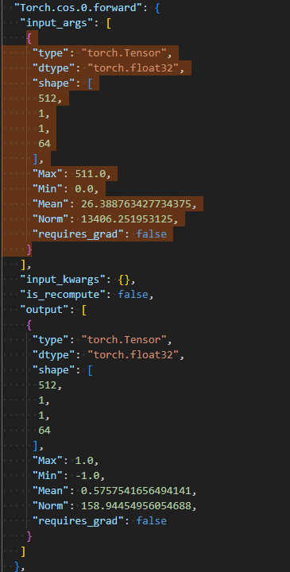
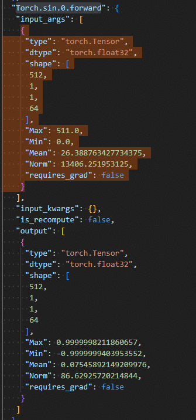
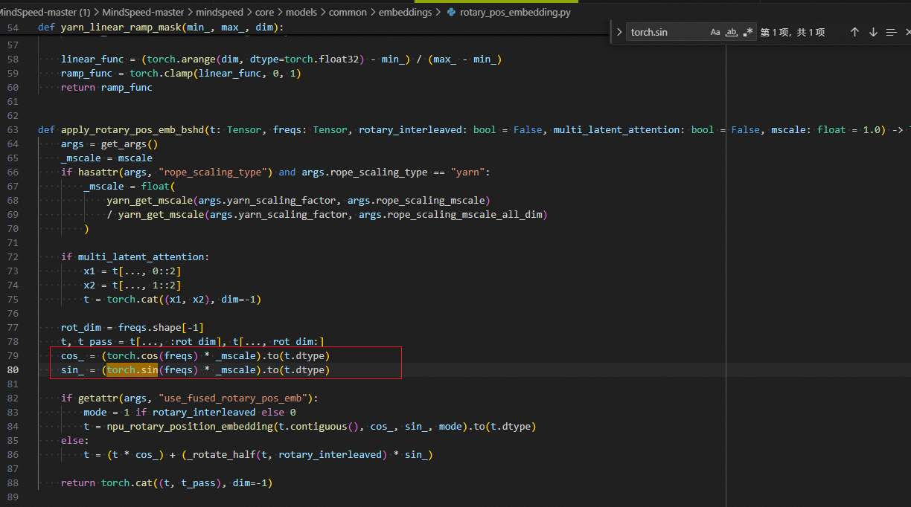
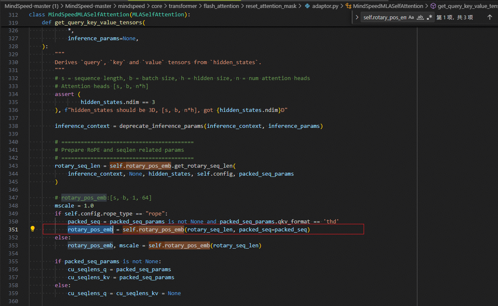
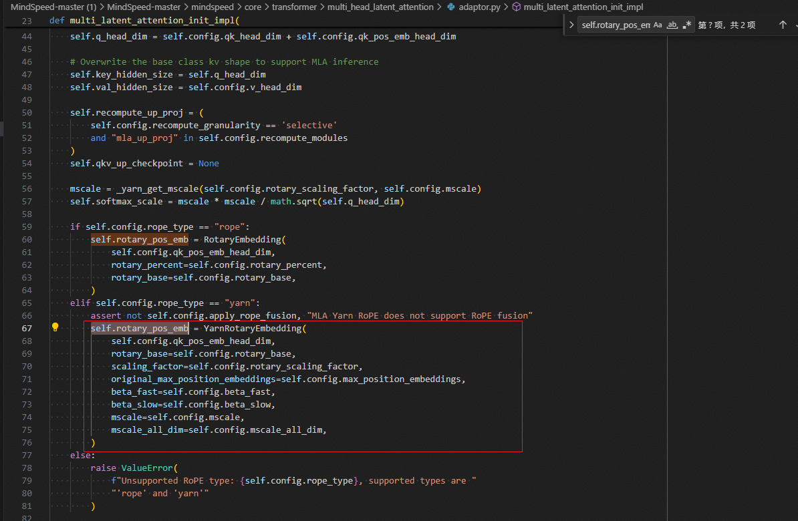

# Kimi2.5 Training-Inference Consistency Optimization on Ascend

## Background

In reinforcement learning training, the degree of alignment between the training stage and the inference stage directly determines the training precision and stability. When the Kimi2.5 model was trained on Ascend, the `log_prob` metric showed an excessively large difference, exceeding the expected range. This document records the process of locating the root cause and completing the alignment through layer-by-layer comparison of training and inference dumps, providing a reference for similar training-inference inconsistency scenarios.

## Symptoms

The Kimi2.5 model showed a relatively large difference in the `log_prob` metric at the first step. For reinforcement learning, this metric is usually required to be controlled within a very small range.

Based on this symptom, a training precision problem caused by training-inference inconsistency was suspected first.

## Localization Process

Overall approach:

1. Reproduce at a reduced scale: at the overall scale of hundreds of ranks, the `log_prob` metric difference was relatively large; after reducing to a two-node multi-rank test, the difference was still obvious.
2. Execute the training and inference stages separately with the same input, and collect dump data.
3. First try reducing layers and check the dense layers first, reducing each of the training and inference sides to 1 layer; after ensuring the dense layers are aligned, add layers to compare the MoE layers and complete the training-inference alignment.

### Inference-Stage Dump

1. In the `NPUModelRunner.__init__` method of the file `vllm_ascend/worker/model_runner_v1.py`, add tool initialization code, and also add a determinism switch.

    

2. When the `execute_model` method starts executing, perform `debugger start` (start dump).

    

3. In the `execute_model` method, after `_generate_process_reqs_hidden_states` finishes executing, perform `stop` (end dump).

    

### Training-Stage Dump

1. In the `MegatronPPOActor.compute_log_prob` method of the file `verl/workers/actor/megatron_actor.py`, add tool initialization and a dump switch before and after calling `forward_backward_batch`.

### Training-Inference Comparison

After the above operations, two files, `train_dump.json` and `infer_dump.json`, are obtained, and they can be compared layer by layer directly.

## Root Cause

1. The first inconsistent module is the MLA output.

    

2. Trace back.

    Inference side:

    

    Training side:

    

    

    Training code implementation:

    

3. Both the cos and sin computations come from `freqs`; trace back to the source of `freqs`.

    

    

4. Print the input parameters of `YarnRotaryEmbedding` and compare with inference. It was found that `original_max_position_embeddings=1024`, while the actual outer configuration was 4096.

## Solution

After fixing the configuration, the difference in the `log_prob` metric at the first step dropped noticeably to the expected range, and the reward showed a steady upward trend after continued training.
