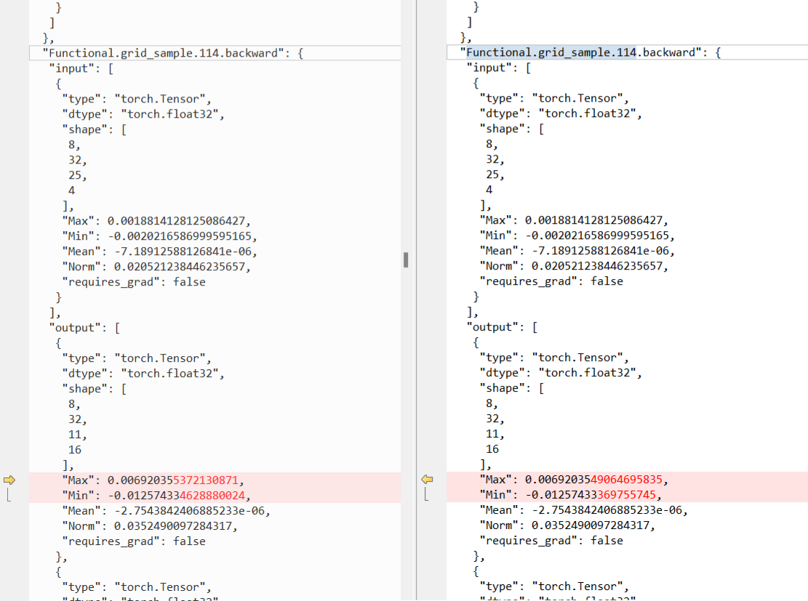
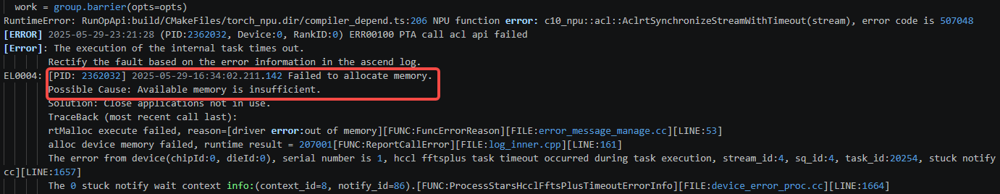
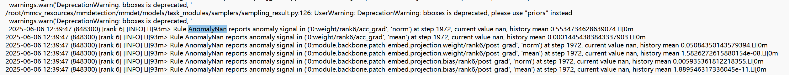
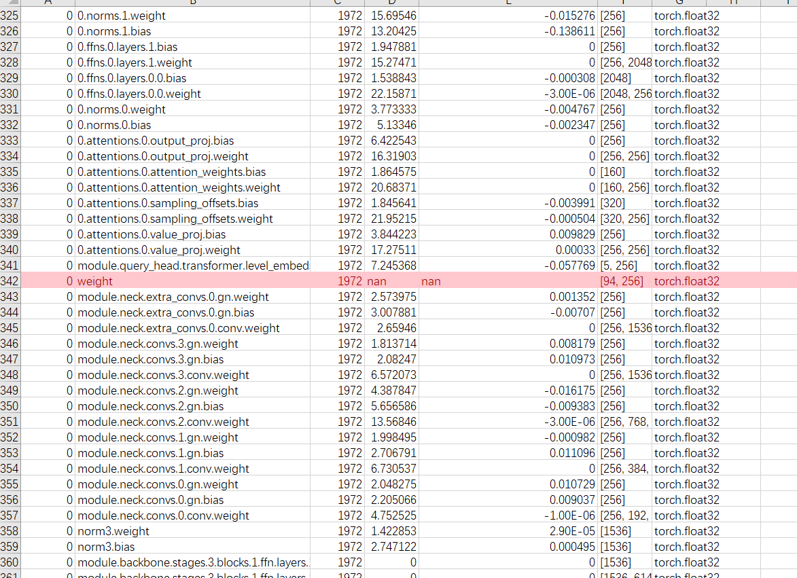
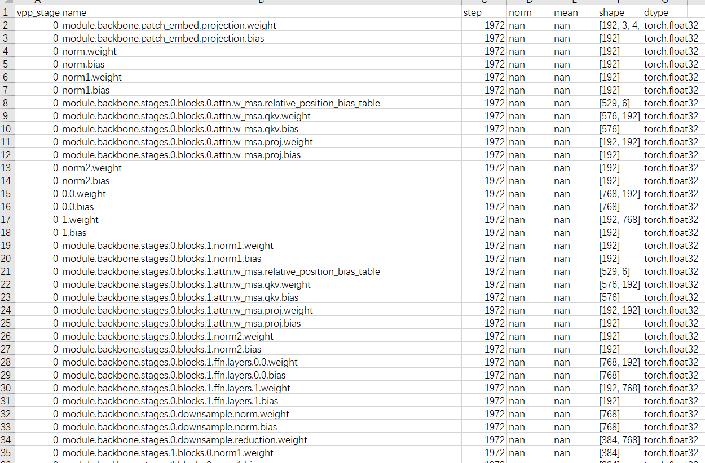
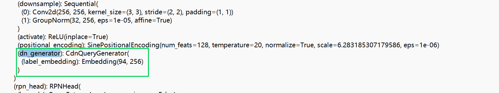
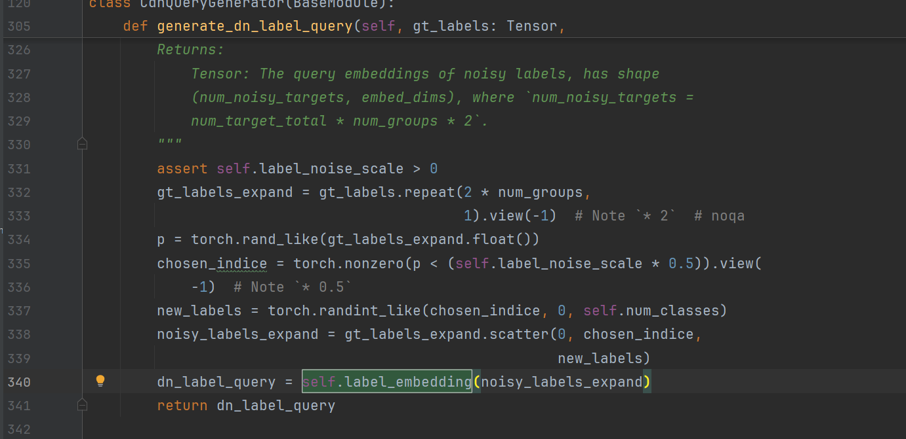
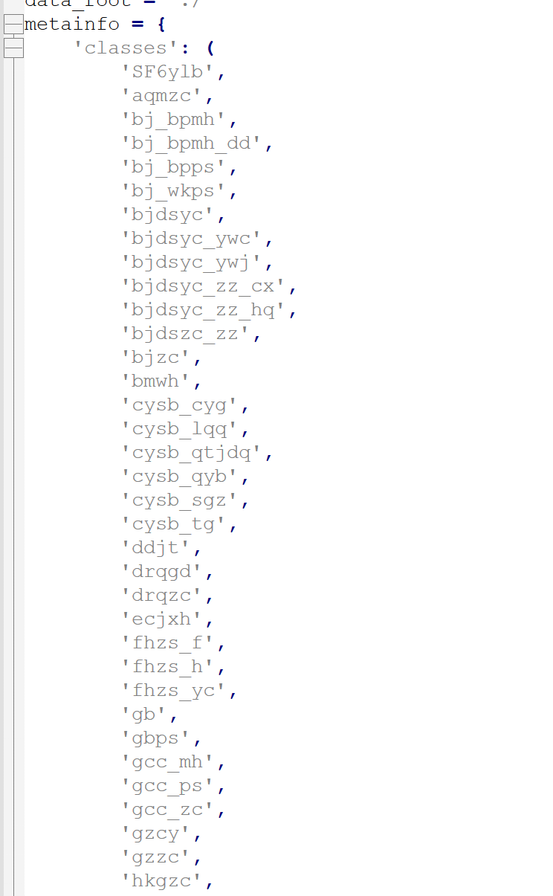
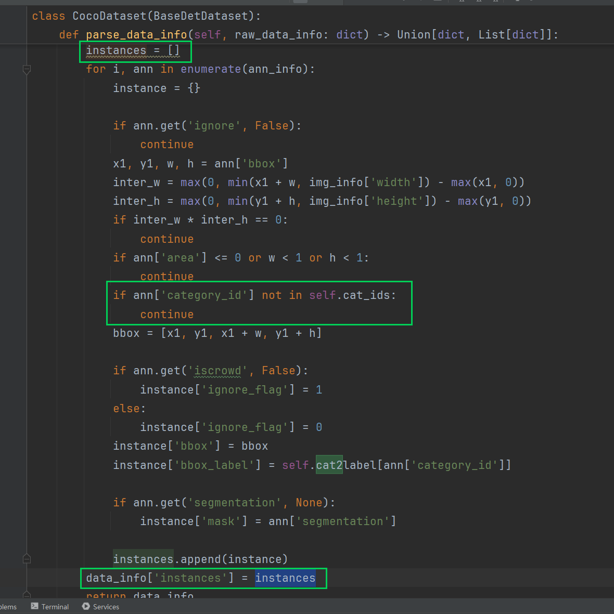

# NaN Problem Localization for Ascend-based MMDetection Training

## Background

In the training of computer vision detection models, a numerical anomaly (NaN) appearing after switching to a new dataset is a common troubleshooting challenge. After switching to a new dataset, the MMDetection model showed NaN when trained on Ascend NPU, and there was no benchmark for comparison. This document records the process of gradually locating the root cause through determinism control, communication troubleshooting, and data flow analysis, providing a reference for similar training anomaly troubleshooting.

## Symptoms

Training the MMDetection model with 8 ranks, with precision aligned on the old dataset, NaN appeared after switching to the new dataset, while there was no benchmark for comparison on the new dataset.

A preliminary evaluation was done first:

1. Check the dataset and data preprocessing code: The service side believed there was no problem with the dataset, as it could be trained normally when placed in other models.
2. Adjust the expectations and localization approach under the no-benchmark condition.

The number of steps for NaN reproduction varies, but an error is bound to occur within a certain number of epochs.

## Localization Process

### Attempt to Fix Randomness and Determinism

Fix the dataset randomness (there is random resize in the dataset, so first try fixing resize) + seed_all + stream synchronization enabling, and there is no NaN after a complete training.

Restoring the random resize + seed_all + stream synchronization enabling, NaN is reproduced in a later epoch. The dump data reveals a difference in the `grid_sample` backward.



After `grid_sample` is moved to the CPU, the determinism of the first few steps is fixed.

An example of the code for the move-to-CPU operation is as follows:

```diff
value_l_ = value_list[level].flatten(2).transpose(1, 2).reshape(
-      bs * num_heads, embed_dims, H_, W_).to('cpu')
+      bs * num_heads, embed_dims, H_, W_)
# bs, num_queries, num_heads, num_points, 2 ->
# bs, num_heads, num_queries, num_points, 2 ->
# bs*num_heads, num_queries, num_points, 2
sampling_grid_l_ = sampling_grids[:, :, :,
-                                    level].transpose(1, 2).flatten(0, 1).to('cpu')
+                                    level].transpose(1, 2).flatten(0, 1)
# bs*num_heads, embed_dims, num_queries, num_points
sampling_value_l_ = F.grid_sample(
-    value_l_,
+    value_l_.to('cpu'),
-    sampling_grid_l_,
+    sampling_grid_l_.to('cpu'),
    mode='bilinear',
    padding_mode='zeros',
-    align_corners=False)
+    align_corners=False).to(value_l_.device)
sampling_value_list.append(sampling_value_l_)
```

### Starting a Long Run to Wait for NaN

After several hours of a long run, a communication + memory overflow phenomenon appears.



First try increasing the timeout with environment variables and rerun:

```bash
export HCCL_CONNECT_TIMEOUT=3600
export HCCL_EXEC_TIMEOUT=3600
```

The same error was still reported. Looking carefully at the logs, the memory overflow occurred in the val stage. To solve this problem, directly turn off val, which does not affect the training weights.

### Resolving the Memory Overflow Problem and Starting a Long Run Again

After the long run resumed, even with the debugging tool turned off, the training speed was still noticeably degraded. After checking the seed_all configuration, the performance bottleneck was located as being caused by `grid_sample` executing on the CPU. After evaluation, there is currently no equivalent fast replacement.

It is currently in a long run (reducing the next wait by saving a checkpoint every epoch), and after running for a relatively long time, the NaN position has still not been encountered.

### Collection Data via monitor

To speed up localization, collect data via monitor under the condition of determinism being disabled. With the help of the timely NaN warning function of monitor, the position where NaN first appears can be seen directly in the log:



According to the warning, the corresponding dumped data was found (`unreduce` in rank 6 of a certain step); NaN appeared for the first time, and subsequent post grad values were all NaN.





From the shape, what corresponds to the NaN is the embedding.





### Analysis

From the NaN situation, it may be caused by the input of `label_embedding` being empty, corresponding to lines 334 and 335 of the code.

When every value of the randomly generated `p` is greater than `self.label_noise_scale * 0.5`, an empty `chosen_indices` is obtained, which causes the embedding forward input to be empty.

There has been a previously known problem: early CANN versions (before 8.0.0) would cause a backward NaN when the embedding input shape is 0.

It was later confirmed that the problem has been fixed after upgrading to a new CANN version, so the upgrade confirmation was awaited. By printing the shape, it was indeed found that the input was empty.

But the situation was reversed: the `noisy_labels_expand` generated by the `scatter` interface in the screenshot code above does not change the shape, so it can be confirmed that `gt_labels` was originally an empty shape. Looking at the dataset generation code may find the reason.





When the classification annotation in the dataset is not within the specified range (`data_info['instances'] = []`), and subsequently in `pipeline -> pack_inputs -> DetDataSample.gt_instances.labels`, `gt_labels` is empty.

> `DetDataSample` class definition: the `gt_instances` attribute is defined in `mmdet/structures/det_data_sample.py` (implemented through a setter getter). Regardless of whether the instance is empty, as long as you pass it an `InstanceData()`, it exists, and `gt_instances.labels` can be safely accessed (it may be an empty tensor).

Data printing further confirmed this judgment:

```python
gt_labels_expand = noisy_labels_expand > torch.tensor([], device="npu:4", dtype=torch.int64)
gt_labels_expand > torch.tensor([], device="npu:4", dtype=torch.int64)
```

## Root Cause

The final root cause is that the `gt_labels` input is empty, which causes the embedding input to be empty, which in turn triggers the NaN problem of early CANN (before 8.0.0) during the embedding backward.

## Conclusion

This also indirectly verified the initial conjecture: the open-source dataset could be trained normally, while the annotation quality of this dataset may have been insufficient.

## Solution

- Upgrade to a new CANN version (8.0.0 and above): early CANN versions cause a backward NaN when the embedding input shape is 0, and the new CANN version has fixed this problem.
- Fix the dataset annotation quality: a classification annotation in the dataset that is not within the specified range causes `gt_labels` to be empty, so the dataset annotations need to be corrected to fall within the specified range.
