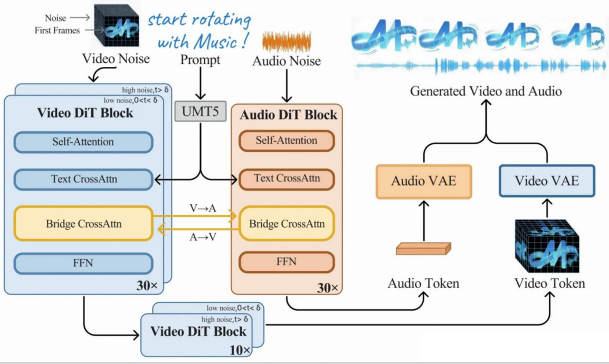
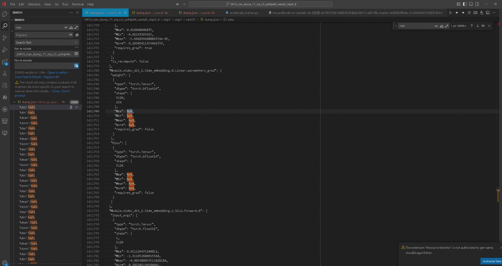
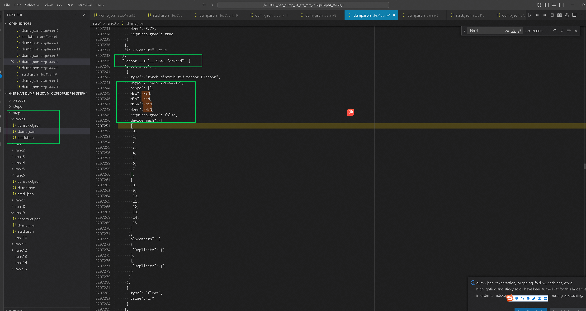
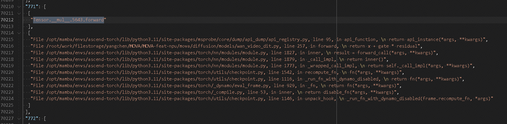
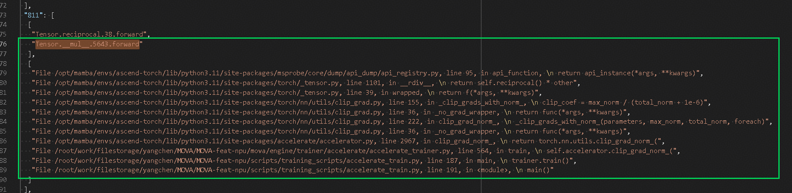
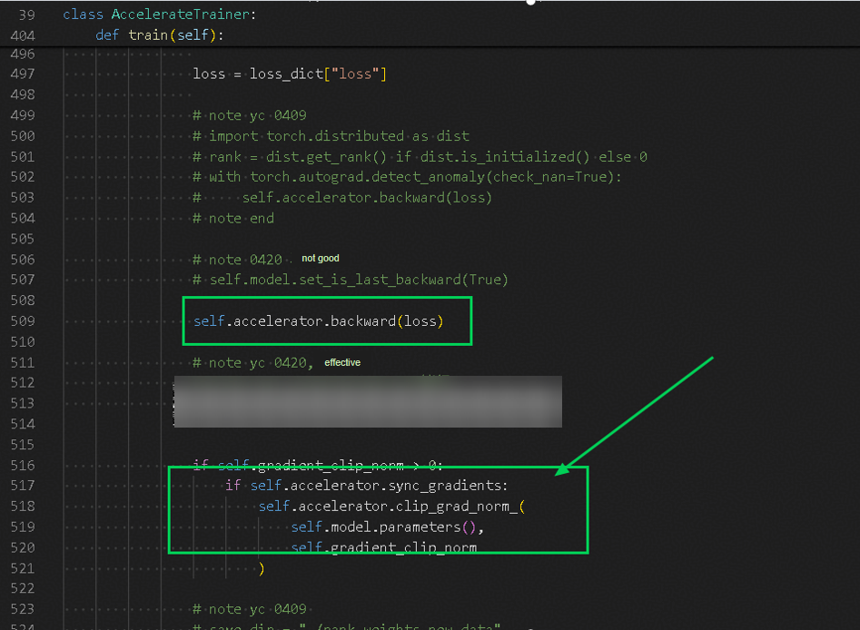
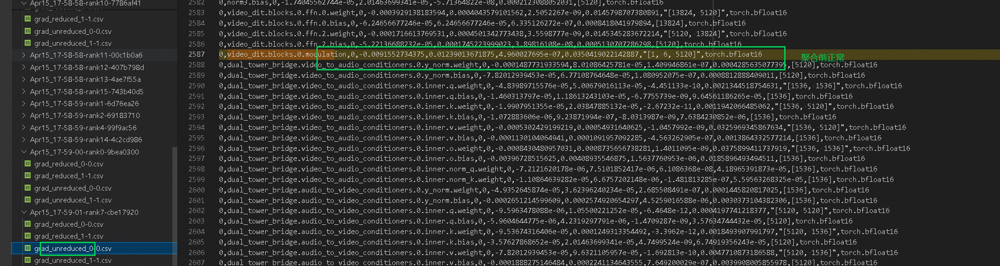
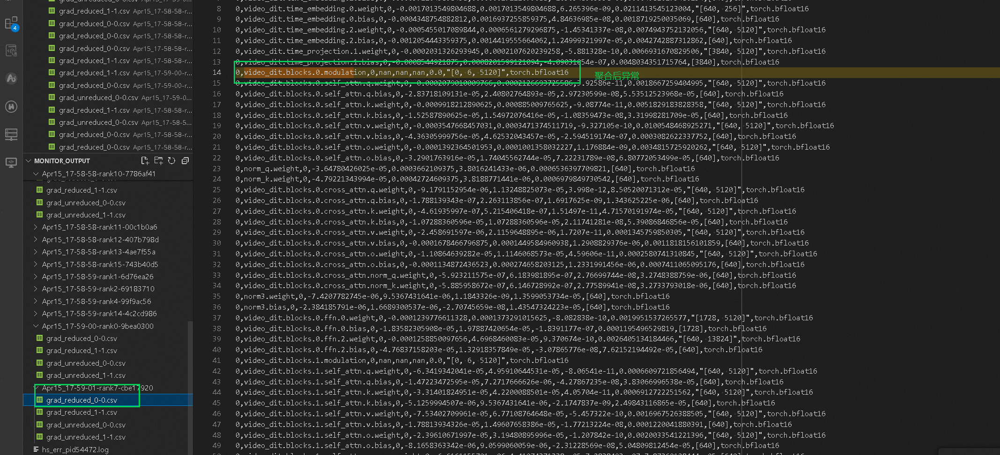
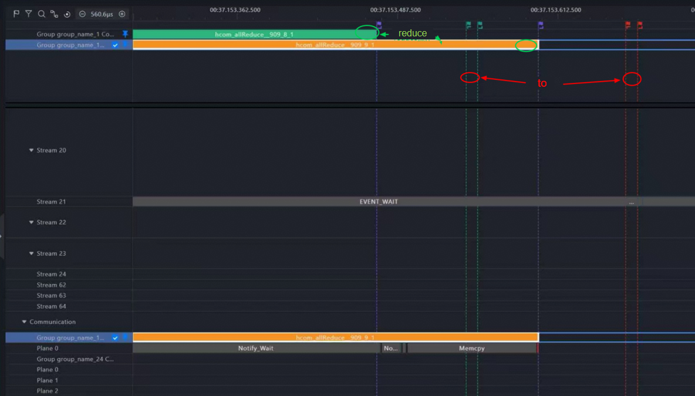
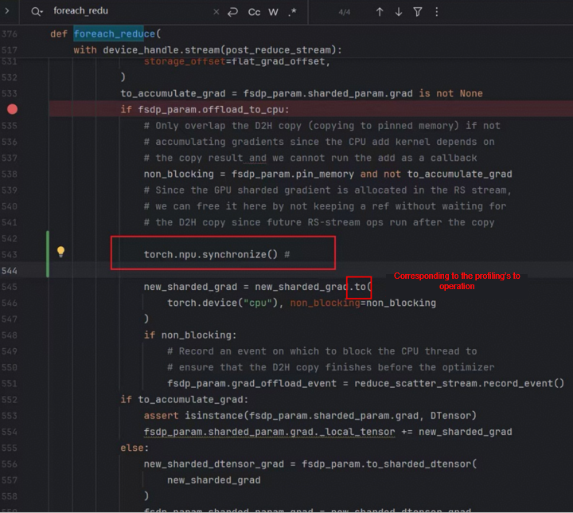

# NaN Problem Localization and Analysis for the Ascend-based MOVA Model

# Background

## Model Introduction



MOVA uses a **bidirectional bridging module**. From the code execution flow, the overall process is **first computing the video branch, then computing the audio branch, and finally communicating and interacting through the bridging module**.

# Localization Scheme

Since `NaN` appears during training, the overall localization approach is relatively clear:

1. First perform a preliminary analysis through the **L0 dump of msProbe** to quickly confirm the general stage in which `NaN` appears.
2. Then use the **mix dump** to focus on troubleshooting the suspicious positions.
3. Because mix collection takes a long time, to avoid interference caused by the collection itself, **manually print weights, gradients, and key intermediate values** in between for cross-validation.
4. After locating the specific stage, further analyze the root cause in combination with the **monitor** and **profiling** tools.

---

## L0 Collection

The phenomena preliminarily collected at L0 are as follows.



* At **step 1**, neither the forward nor the backward of the module shows `NaN`, but the weight gradient shows `NaN` first.
* By **step 2**, the weights used in the module forward also become `NaN`.

Therefore, the initial focus was on:

> **A problem occurred during the weight update process after the backward of step 1 ended, which in turn caused the NaN in the forward computation of step 2.**

The preliminary judgment at that time was: the problem occurred probably in the **parameter update stage of step 1**.

Because the mix dump takes a long time, **weights and weight gradients were manually printed** first for verification, to reduce the interference of tool collection on the conclusion.

---

## Verification via Manual Printing

After setting the DDP domain to 2, the problem could be reproduced stably. Initially the weights and weight gradients were printed, but because the **print positions were not selected accurately enough**, the following phenomenon occurred for a time:

* At some moments the **weights showed an anomaly first**.
* But the corresponding **weight gradients were still normal, without NaN**.

This led to a misjudgment for a time, so **loading the saved weights for verification** was further performed.

After readjusting the print positions later, the results gradually became consistent:

* A small amount of gradient anomaly occasionally appeared in **DDP domain 1**.
* The anomaly then gradually propagated to other domains.

But this also made the results remain in doubt and impossible to conclude (a lot was printed during this period, and no screenshots or logs were kept).

At this point only a preliminary guess could still be obtained, and the anomaly chain could not be fully confirmed, so **mix collection** was continued.

---

## mix Collection

### Global NaN Search

In the mix dump results, the method of globally searching for `NaN` was first adopted for localization.

The first 12 occurrences of `NaN` all appeared at positions related to `all_gather` and `reduce_scatter`, whose manifestation was:

* The input is `NaN`.
* The output is normal.

This part does not need in-depth analysis for the time being. The reasons are:

* Older versions of the tool would collect such operators.
* Before calling `all_gather` and `reduce_scatter`, a tensor with an initial value of `NaN` is first created via `empty`.
* This tensor is then passed into the communication operator.
* Such `empty`-related operators interfere with the judgment.

The new tool has now removed such invalid interference items, so this part can be excluded first.

### The Actual First NaN



The first `NaN` appeared at:

```python
__mul__.5643.forward
```

The phenomenon at this position:

* The input already shows `NaN`.
* The output is also `NaN`.

In other words, the `NaN` here is not "newly produced" by the current multiplication computation; it is more likely that **the upstream input has already been corrupted**.

---

## Call Stack Analysis

When continuing to view the call stack of `__mul__.5643.forward`, a problem was found:

> In `stack.json`, `__mul__.5643.forward` appears twice.

The two corresponding call positions are respectively:

### First



```python
return x + gate * residual
```

This call stack contains `recompute_fn`, indicating that it belongs to the **recomputation path**.

Semantically, the input here should be the multiplication of two tensors:

* `x`: the main branch output, with shape generally `[B, S, H]` or `[B, H]`
* `residual`: the residual branch tensor, with shape usually consistent with `x`
* `gate`: the gate coefficient, which may be:

  * a tensor with the same shape as `residual`
  * or a tensor that can be broadcast to `residual`

Therefore, the multiplication input here should usually manifest as **tensor × tensor**.

---

### Second



```python
reciprocal() * other
```

This position is located in the `clip_grad_norm` process, and is essentially computing the **clip coefficient**.

Combining with the code logic, it can be seen that:

* `reciprocal() * other` corresponds to the coefficient computation in gradient clipping.
* `clip_grad_norm` involves **communication operations** and this point can correspond to the `device_mesh` information in `dump.json`.

When actually viewing the input of `__mul__.5643.forward`, it was found to be:

> a **2.7 scalar × 1**

This is inconsistent with the expected input form of `gate * residual` at the first position.
Because if it were `gate * residual`, it should usually be **tensor × tensor**, rather than a scalar multiplication.

Therefore, the final judgment was:

> **The second call stack, namely `reciprocal() * other` in `clip_grad_norm`, is the correct problem position**.

To further exclude the interference of the recomputation path and to facilitate confirming the conclusion, **recomputation** was disabled and the dump was redone; the problem could still be reproduced stably.

The corresponding code position is after `loss.backward()`:



---

## monitor Monitoring Results

The **monitor** tool was then used to further monitor the key parameters.

The following abnormal phenomenon was found:

* Except for **card 0 and card 8**
* After aggregation on the other cards, the shape of `video_dit.block.0.modulation` changed from

```python
[1, 6, 5120]
```

to

```python
[0, 6, 5120]
```

Its values also became `NaN`.





To further confirm, the **manual printing** method was used again for verification, and the conclusion obtained was basically consistent.

---

## Key Position Confirmation

Manual printing clearly showed:

> In the **post_backward stage of FSDP**, before and after `foreach_reduce`, the parameter changed from a normal constant value to `NaN`.

This means the problem position is basically clear:

> **The anomaly occurs near the FSDP post_backward, and is closely related to the foreach_reduce/gradient reduction stage**.

---

## Root Cause Analysis

After locating the anomaly point, the next step is to analyze the root cause.

### Phenomenon 1: The Problem Disappears After Adding Synchronization

After synchronization was added at the suspicious position, the problem disappeared, so it was preliminarily suspected to be a **stream synchronization problem**.

### Phenomenon 2: profiling Observes Abnormal Timing of Communication and Movement



The **profiling** tool was then used to observe the operator execution timing, and it was found that:

* The `all_reduce` on different ranks does not finish in strict synchronization.
* The timing of executing `.to()` for data movement is also inconsistent.

Although the possibility of observation error of the profiling tool itself could not be completely ruled out at that time, it at least shows that there is obvious timing uncertainty in this stage.

### Phenomenon 3: The Problem Disappears After Adding Stream Synchronization Before `.to()`



Furthermore, the `.to()` operation was located in the call stack, and stream synchronization was added before it. The results show that the **problem disappears**.

Therefore, it can finally be basically confirmed that this problem is related to the following factors:

* `accelerate` enables `offload`.
* **Data movement exists between the NPU and the CPU** during FSDP training.
* In some scenarios, the **stream synchronization is not completed correctly**.
* Subsequent use of data whose movement or reduction has not been completed, ultimately causing `NaN`.

---

## Conclusion

The localization chain of this MOVA model `NaN` problem is as follows:

1. **L0 dump** found that the forward weights of `step 2` were already `NaN`.
2. It was preliminarily suspected that the weight update process of `step 1` was abnormal.
3. After correcting the observation position through **manual printing**, it was found that the anomaly propagated in the DDP domain.
4. **mix dump** was used to locate `__mul__.5643.forward`.
5. Combining with the call stack analysis, the `gate * residual` path was excluded, and the problem point was confirmed to be at:

   * `clip_grad_norm`
   * `reciprocal() * other`
6. Using **monitor**, it was observed that the shape of `video_dit.block.0.modulation` after aggregation was abnormal, and the values became `NaN`.
7. Manual printing confirmed that the problem occurred at:

   * **FSDP post_backward**
   * **before and after foreach_reduce**
8. Finally, through verification by adding synchronization, the root cause was confirmed to be closely related to:

   * **the stream synchronization problem in the offload scenario**
   * **the abnormal data movement timing before and after `.to()`**

---

## Recommendations

1. Focus on checking the synchronization mechanism in the accelerate + FSDP + offload scenario.
2. If conditions permit, further source-level analysis of the accelerate wrapper chain can be performed to confirm the exact location of the synchronization anomaly in the offload scenario.
