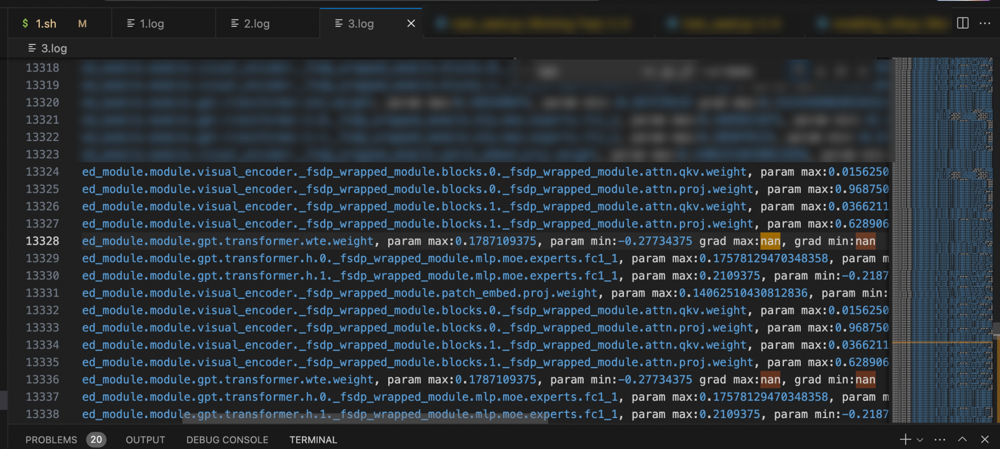
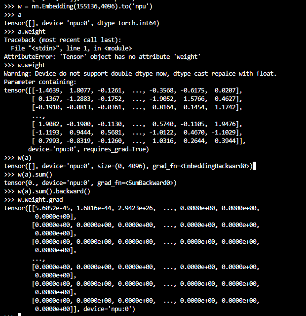

# NaN Problem Localization for Ascend-based Multimodal Understanding Training

## Background

In large model fine-tuning training, a NaN in the loss is a common failure, and its root cause is often hidden in distributed parallelism features and operator boundary behavior. This document records the process of locating a loss NaN problem that occurred during FSDP full-parameter fine-tuning of a multimodal understanding model. The root cause is ultimately located as a boundary problem where uninitialized data is returned when the embedding backward input is empty, and a fix is provided, providing a reference for similar gradient NaN troubleshooting.

## Symptoms

The model is a multimodal understanding model, undergoing FSDP full-parameter fine-tuning, and a loss NaN occurred. Printing the grad information, the first NaN appeared in the wte layer:

The following experiments were attempted:

- If `requires_grad` of the embedding is disabled, the NaN problem disappears, indicating that it is most likely a backward gradient update problem.
- Enabling `LAUNCH_BLOCKING=1` does not change the problem, indicating that it is not a synchronization problem.

## Localization Process

### Dumping Embedding Tensor Data

When the embed grad showed NaN, it was found that the input on one of the ranks was empty, with shape: [0], the corresponding backward input shape was [0, 4096], and the output was suspected to be uninitialized data. The dsp (distributed sequence parallel) feature enabled by the model training splits the input, which may leave no token input on a certain rank. Random data has a chance of reproducing it:

When the input of `aclnnEmbeddingDenseBackward` is empty, the return value is the value in the default memory, because an empty tensor is not processed at all.

### Modifying the aclnnEmbeddingDenseBackward Logic

If the backward input is empty, return a gradient of 0, then repackage and verify. After the modification, the backward output is 0.

## Root Cause

When the embedding backward input is empty, uninitialized data was returned.

## Conclusion

The root cause of the loss NaN during FSDP full-parameter fine-tuning of the multimodal understanding model is: after the distributed sequence parallel (DSP) feature is enabled, some ranks have no token input, the embedding backward input is empty, and `aclnnEmbeddingDenseBackward` returns the uninitialized data in the default memory.

## Solution

Modify the `aclnnEmbeddingDenseBackward` logic as follows: return a 0 gradient when the backward input is empty, and after repackaging and verification the backward output is 0.
