# Determinism Troubleshooting for the Ascend-based Qwen2.5-omni Model

## Background

In deep learning training, the reproducibility (determinism) of results is directly related to problem localization and the credibility of experiments. This document records the troubleshooting process of inconsistent loss and grad_norm during repeated training of the Qwen2.5-omni model on the Ascend platform. Through means such as Dump comparison, single-operator reproduction, and plog analysis, the scope was narrowed layer by layer, and the problem was ultimately located as the repeated setting of the random seed in the service code causing determinism to fail, providing troubleshooting ideas for similar reproducibility problems.

## Symptoms

When repeatedly training the Qwen2.5-omni model on the NPU, the obtained loss and grad_norm were inconsistent.

## Localization Process

### Step 1: Dump Data Twice for Comparison

The comparison revealed a determinism problem in cross_entropy.

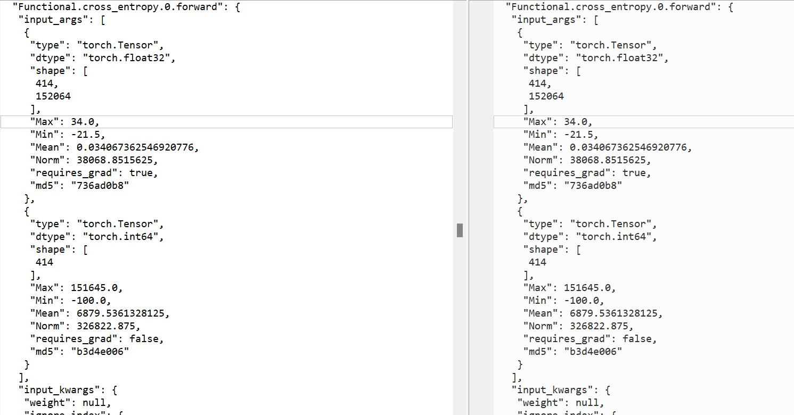

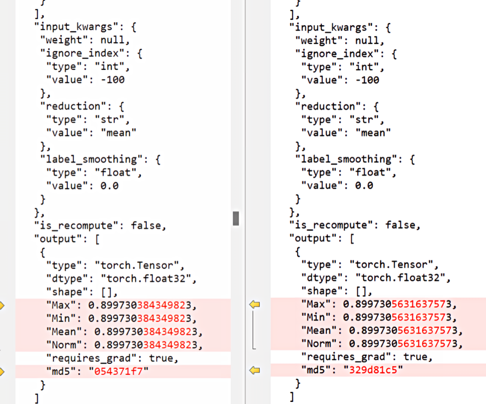

An attempt was made to align after moving to the CPU. After moving to the CPU, the loss of the first step was consistent, grad_norm still occasionally showed inconsistency, and after several steps it accumulated into inconsistent loss.

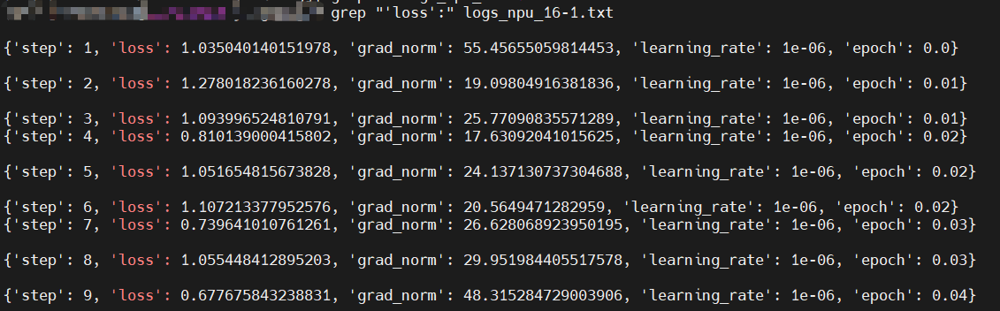

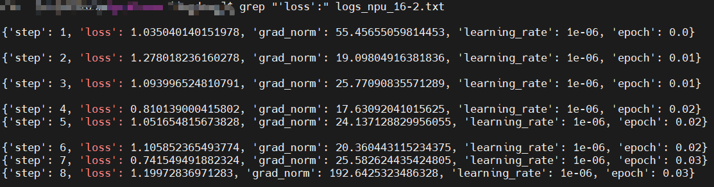

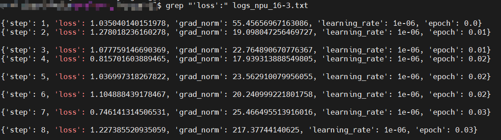

Continuing the analysis, it was found that the source of the grad_norm difference was the occasional difference in the embed_token backward on rank3 at step 0, while the forward was completely consistent.

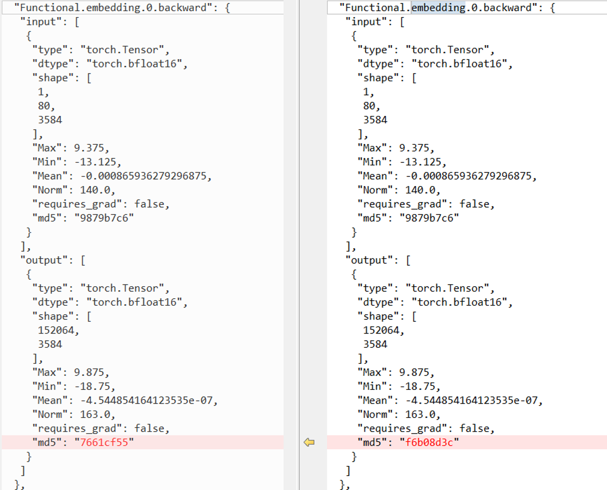

### Step 2: Collect the Tensor Data of embed_token Multiple Times Until Two Different Ones Are Collected

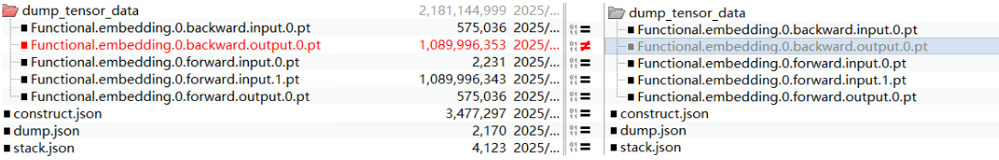

### Step 3: Perform Single-Operator Reproduction

Reproduction script:

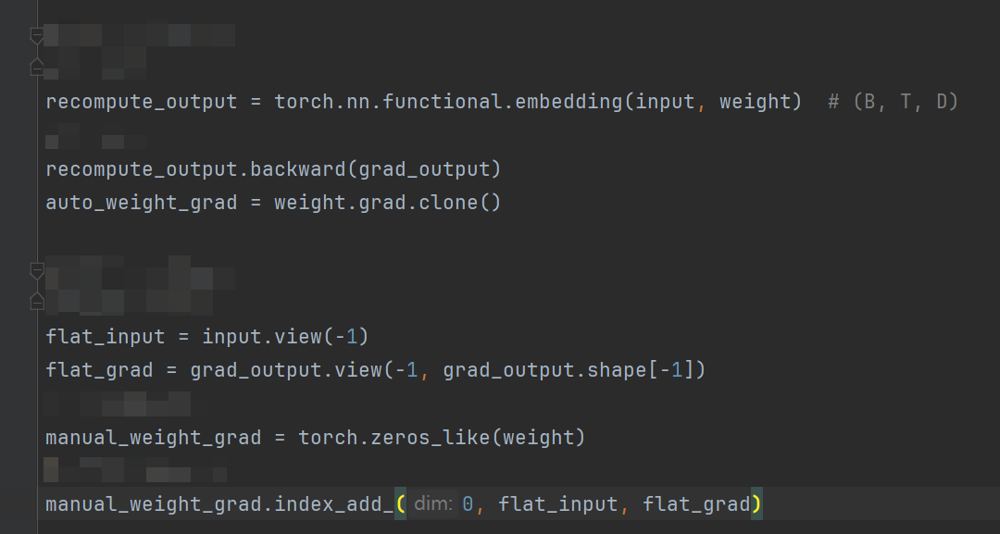

Single-operator result: the single-operator reproduction and the full-network training results were inconsistent. Running the full network several times, the embedding backward result changed probabilistically, while running the local single operator many times produced no change. Among the 2 results collected by the full network, 1 was consistent with the single operator's automatic backward, and 1 was consistent with the single operator's manual gradient computation.

### Step 4: Suspect Other Interference, Troubleshoot Plog

In plog, the deterministic of the underlying aclnn operator is 0; among the intermediate operations, some are 1 and some are 0, confirming that 1 was changed to 0 in the middle.

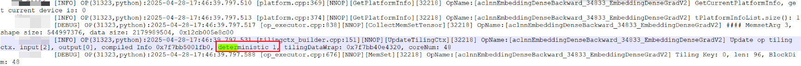

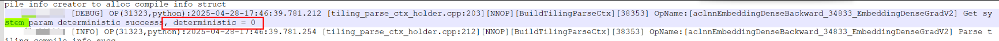

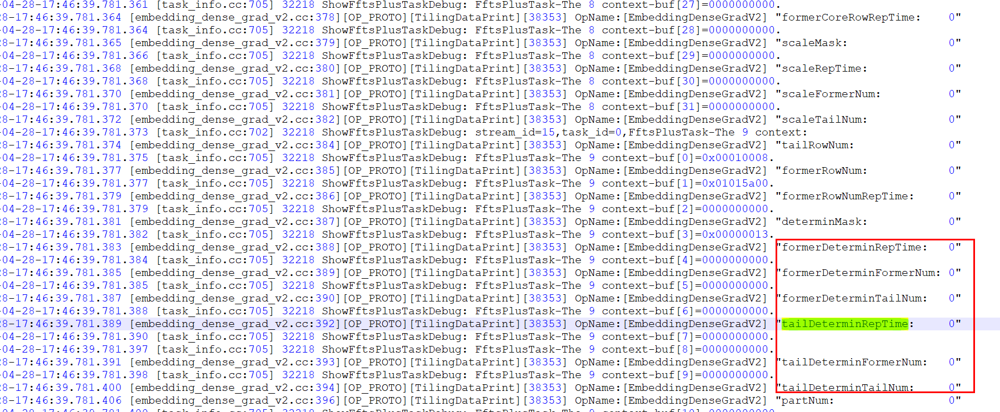

### Step 5: Check the Fixed Code

Globally searching for torch.use_deterministic_algorithms in the project, it is used in only this one place.

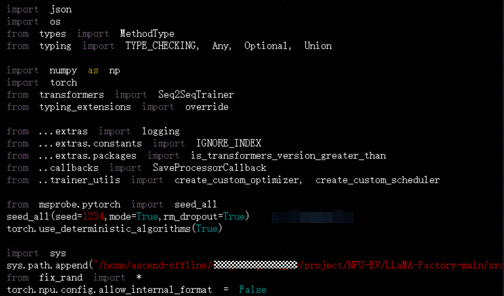

It was found that there is a fix_randn at line 40. Opening it, it can be seen that in addition to seed_all(mode=True) in the trainer, the service code customizes fix_randn to decoratively wrap the randn interface, and inside this wrap seed_all() is repeatedly called without mode.

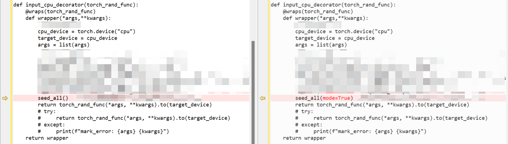

After changing it to seed_all(mode=True), the determinism was successfully fixed.

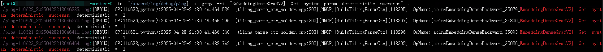

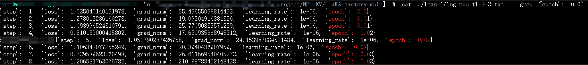

## Root Cause

The service code customizes fix_randn to decoratively wrap the randn interface, and inside this wrap seed_all() is repeatedly called without mode, overriding the environment variables and causing the determinism to be unfixable.

## Conclusion

1. The failure to reproduce the loss and grad_norm of this Qwen2.5-omni training is **not a non-deterministic defect of the Ascend operator itself**, but an occasional problem caused by the upper-layer service code logic breaking the determinism switch state.
2. When `seed_all()` is called without `mode=True`, it does not enable the PyTorch deterministic algorithm switch `torch.use_deterministic_algorithms(True)`; the service decorator `fix_randn` repeatedly calls the parameterless `seed_all()` during execution, which resets the determinism switch that has been set to `True` back to `False`, propagating to the underlying CANN and causing the `aclnn` operator deterministic flag to change from 1 to 0, with the operator switching to a non-deterministic execution path.

## Solution

Modify the internal call of the `fix_randn` decorator in the upper-layer service code, changing `seed_all()` to `seed_all(mode=True)`, to ensure that each time the random seed is set, the `torch.use_deterministic_algorithms(True)` determinism switch is maintained in the on state at the same time, avoiding the switch being accidentally reset.
