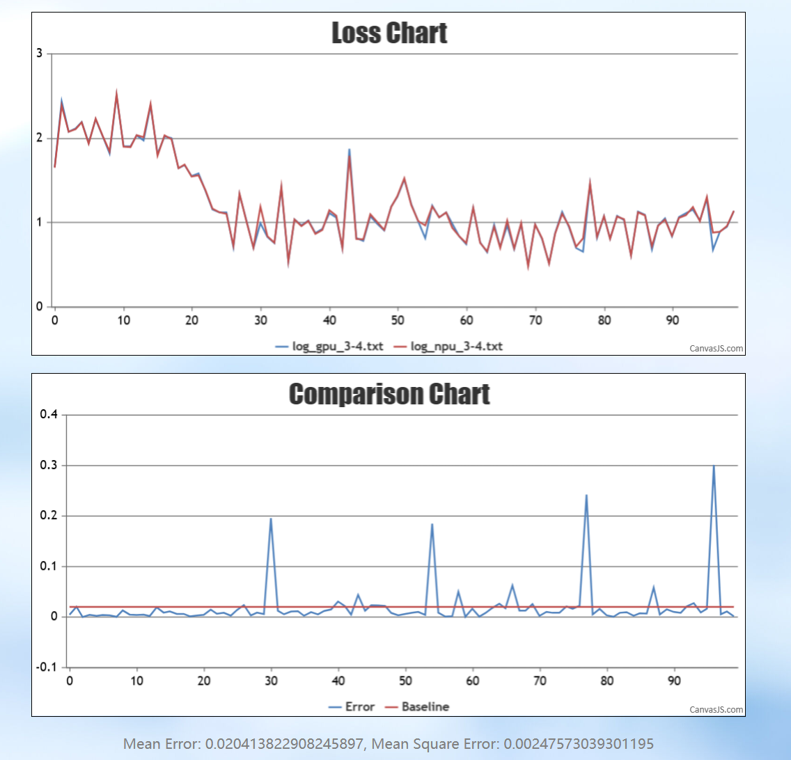
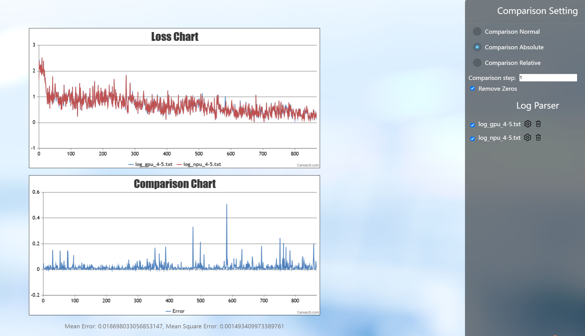
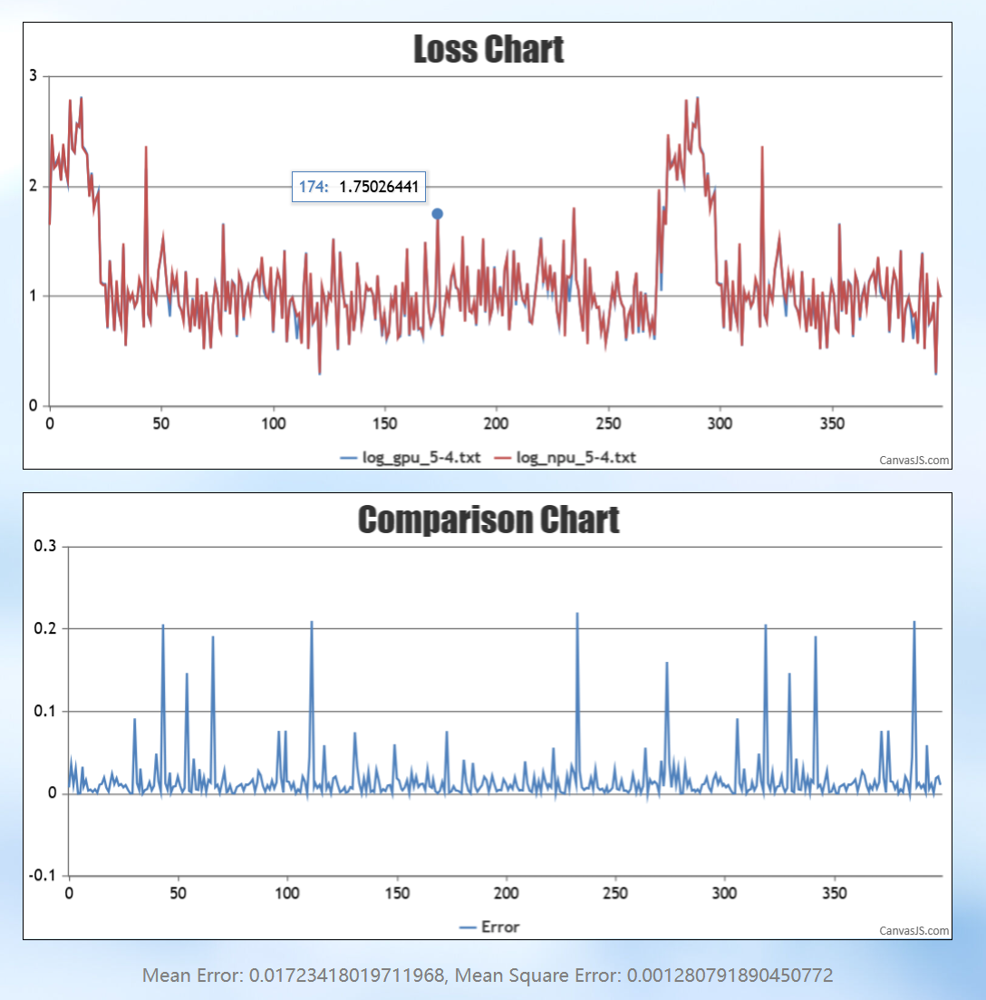
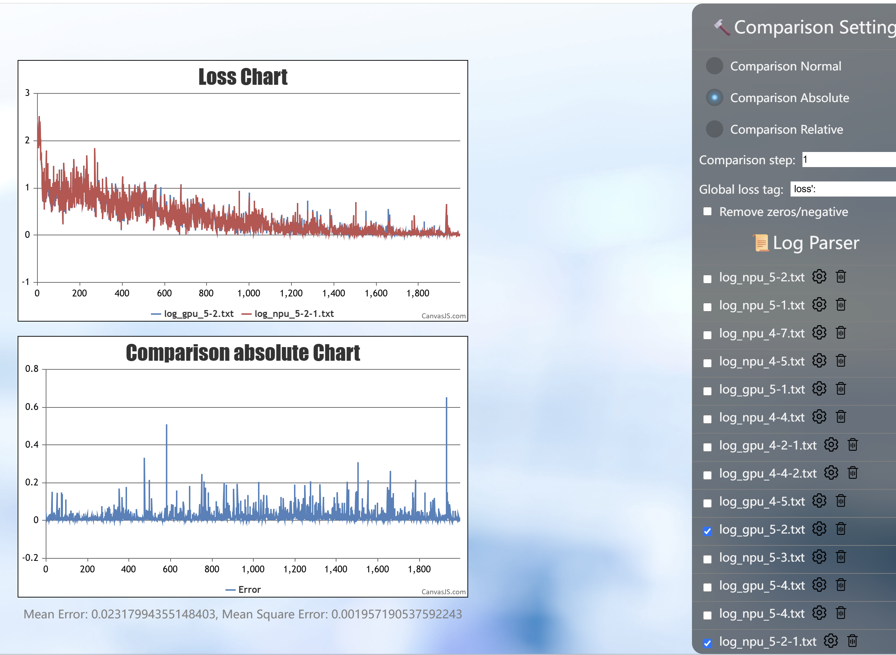
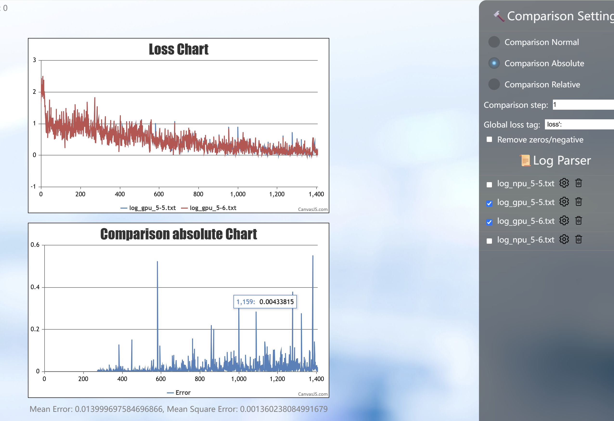

# Loss Difference Localization for Qwen2.5-omni Framework Migration on Ascend

## Background

When migrating the Qwen2.5-omni training service based on the LLaMA-Factory framework from the GPU to the Ascend platform, the problem of misaligned Loss and training result errors under the same framework is encountered. Such cross-platform precision differences directly affect the effect evaluation after model migration. This document records the systematic troubleshooting process of this problem: by gradually excluding factors such as LayerNorm, GELU, and learning rate, it was finally confirmed that the cause is the network's sensitivity to subtle accumulated errors, rather than an Ascend software stack problem, providing a reference for precision alignment troubleshooting in similar framework migrations.

## Symptoms

Migrating the same LLaMA-Factory framework from the GPU to the NPU for training, after training for a certain number of steps, the relative error was obvious.

## Localization Process

The first Loss difference was in the thousandths place, but the overall relative error was noticeably too large, and the absolute error also did not meet expectations (hoping the absolute error converges to a small range).

At step 0, it was seen that the statistical value difference appeared from nothing at the three places of LayerNorm, linear, and GELU.

**Background**: determinism was already fixed, and the linear staggering strategy was disabled.

**Attempt 1**: move LayerNorm and GELU to the CPU → no improvement, basically no change.

**Attempt 2**: disable the learning rate to determine whether the forward or the backward problem is severe → the forward problem is severe; under the same weights, it is more sensitive to data.

**Attempt 3**: view the downstream tasks → what is trained is the base model, with no downstream tasks for the time being.

**Attempt 4**: run long for more steps and observe whether the absolute error has a convergence trend → basically the same as before.

**Attempt 5**: after moving GELU and norm to the CPU and dumping, continue to check other differences besides linear → basically remained consistent.

**Attempt 6**: disable determinism on the GPU side to see how large the loss curve difference is; if the GPU's difference also exceeds the threshold after disabling determinism, the judgment standard needs to be re-evaluated → no determinism problem.

Among them, a phenomenon was observed in attempt 5: after the GPU's LayerNorm was moved to the CPU, the difference also exceeded the threshold.

## Root Cause and Summary

**Conclusion**: not an Ascend software stack problem.

1. After the GPU's LayerNorm is moved to the CPU as an absolute benchmark, the Loss difference still exists and exceeds the threshold, indicating that the network is relatively sensitive to subtle accumulated errors (from attempt 5).
2. After the learning rates of the NPU and GPU are set to 0, the weights are not updated, and with different input data the loss difference also fluctuates relatively largely, indicating that the network is also relatively sensitive to the input (from attempt 2).
3. The loss difference between the GPU and the NPU goes up and down, and it is not that the GPU's loss is overall smaller than the NPU's; if you do not look at the absolute error but look at the normalized error with signs, the difference is at a very small magnitude, indicating that the mean lines are at the same level (from the long-run result of more steps).
