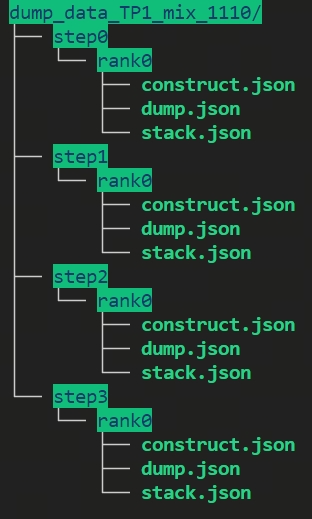
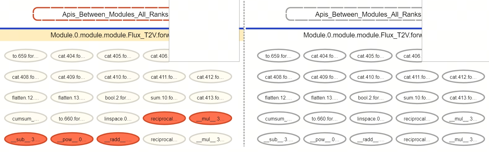
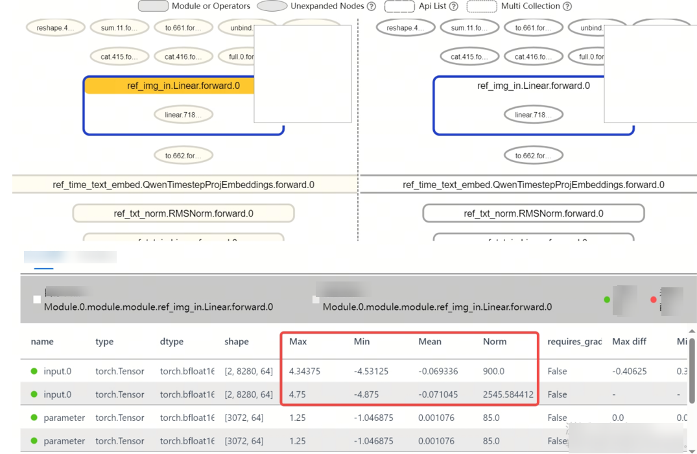
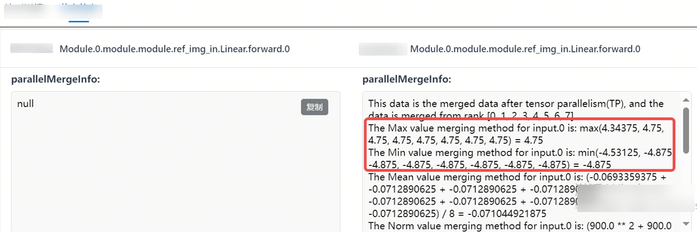
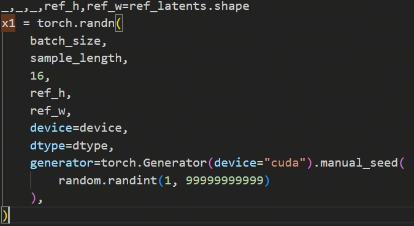

# TP8 Distorted Image Problem Localization for the Ascend-based Qwen-Image-Edit Model

## Background

On the Ascend platform, when performing multi-rank parallel adaptation of the Qwen-Image-Edit image editing model based on Megatron and using it for data synthesis, using tensor parallelism (TP) inference will produce an abnormal generated image (commonly known as a "distorted image") blocking problem at relatively high parallelism. This document records the complete localization process of this problem: through msProbe hierarchical visualization comparison of the operator precision differences between single-rank and multi-rank, the root cause was ultimately located as inconsistent random seeds within the parallel group, and a synchronization broadcast fix is given, providing troubleshooting ideas for similar multi-rank inference precision difference problems.

## Problem Symptoms

Adapting the Qwen-Image-Edit model on the NPU based on Megatron, mainly used for data synthesis and as training input for subsequent other models. The following blocking problems are currently encountered:

1. At TP=8, when running multiple requests, the third generated image is bound to be distorted.
2. At TP=1, running 100 instances of low-resolution inference found no distorted-image problem.

## Localization Process

According to the symptoms, different configurations on the NPU cause the problem, so TP1 and TP8 were compared on the NPU first to locate the cause of the model precision difference. The tool used is msProbe (the toolkit of the precision debugging part under the MindStudio toolchain, mainly including functions such as precision collection, precision comparison, and visualization analysis; it currently adapts the [PyTorch](https://gitee.com/link?target=https%3A%2F%2Fpytorch.org%2F) and [MindSpore](https://gitee.com/link?target=https%3A%2F%2Fwww.mindspore.cn%2F) frameworks).

The problem localization process is as follows: data collection → hierarchical visualization graph comparison → code localization and solution.

### Step 1: Collect TP1 and TP8 Data

The msprobe tool mainly adds a dump interface within the training and inference script, specifically using the PrecisionDebugger function for data collection. After training ends, the tool saves the dumped data in the directory specified by dump_path, with the following directory structure:



### Step 2: Hierarchical Visualization Split-Merge Comparison

The hierarchical visualization graph supports data comparison of different split configurations, so the following command was used to compare TP8 and TP1 data:

```bash
msprobe graph_visualize -tp tp8_data -gp tp1_data -o output_path
```

The execution process varies with the model size; a relatively large-scale model takes about several minutes to build the graph. After it ends, an XXX.vis.db file is generated under the output folder, and then TensorBoard is used for visual comparison:

```bash
tensorboard --logdir out_path --bind_all --port [optional, port number]
```



In the figure above, it can be seen that Module.0.module.module.Flux_T2V.forward contains all the modules of the entire nn part (rectangular border), displayed in a hierarchical structure: a first-level module contains multiple second-level modules, and at the same time the APIs between multiple second-level modules are also displayed with elliptical borders. It can be seen that the first nn.Module (Linear) already shows a precision inconsistency problem, so the comparison details of Linear started to be checked.



Through comparison, it was found that among the input data of Linear, multiple statistical values are different, indicating that the data was already different before entering the first module. Because the two data files involve single-rank and multi-rank comparison, the node information needs to be further checked to analyze which specific rank shows the anomaly.



Because the multi-rank configuration is TP=8, DP is not used for data splitting, and this layer is a non-row-split, non-column-split layer. From the shape, it can be seen that it is the original structure without TP splitting, and the statistical values between multiple ranks should be completely identical. As can be found from the red box in the figure, the data of rank 0 here is obviously different from that of the other ranks.

### Step 3: Code Backtracking

The next step is to return to the code and analyze the data transmission trajectory sent to the first module.



This scenario is a Diffusion-based image generation model, and random numbers need to be generated in the initial stage of the model. After analysis, it was located that the `random.randint` here behaves differently on rank 0 than on the other ranks. It is expected that within the same step all ranks have the same random seed, but in fact rank 0 differs from ranks 1—7, causing the subsequent model outputs to differ, and after finally concatenating into a complete image, the distorted-image problem appeared.

## Fix and Root Cause

**Fix**:

It is recommended to add a synchronization broadcast mechanism here, that is, after the random seed is generated, the primary rank broadcasts it to the secondary ranks for synchronization, ensuring that all ranks obtain the same random seed.

**Result verification**:

After a long-stability test, image generation was normal with no distorted-image phenomenon. The root cause of the problem lies in a code defect where the random seed is not synchronized in the parallel scenario; after fixing the code, the distorted-image phenomenon no longer appeared in the long-stability test.

**Root cause summary**:

When using TP8, the inputs of different ranks within the same TP group were not controlled to be consistent, relying solely on the initial random seed for control. In fact, because rank 0 serves as the communication primary rank, the number of random calls on it is not consistent with that on the other TP ranks, causing the distorted image.
