# Inference Difference Localization for the Ascend-based Tora Model

## Background

**Model structure:** Tora model + vLLM (vllm-ascend) inference framework

**Symptoms:** unified dataset inference; the downstream score of NPU (54.4 points) is noticeably worse than that of GPU (80.6 points).
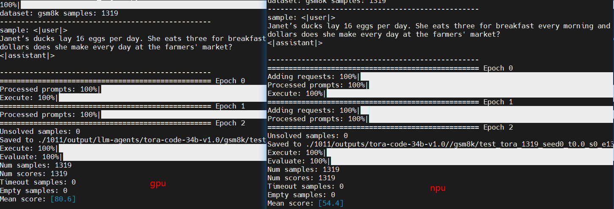
**Bad case details**:

prompt:
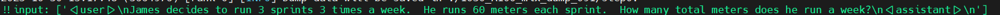
GPU inference result is 540 (correct answer):

NPU inference result is 1260 (wrong answer):
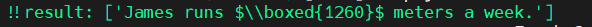

## Localization Process

### Step 1: Troubleshoot Environment Differences

Troubleshooting the versions revealed a relatively large difference between GPU and NPU:

* The GPU vLLM version is 0.1.4 (relatively old) and uses graph mode, with mode V0.
* The NPU vLLM and vllm-ascend versions are 0.9.1 and use `enforce_eager=True`, with mode V0.

Because the GPU version is relatively old, it was first upgraded to version 0.8.1 using `enforce_eager=True` to enable single-operator mode, namely aligned with NPU.

It was found that with GPU changed to version 0.9.1 + single-operator mode, the wrong answer also exists:

Single-case evaluation (version 0.1.4 scores 100, version 0.9.1 scores 0):
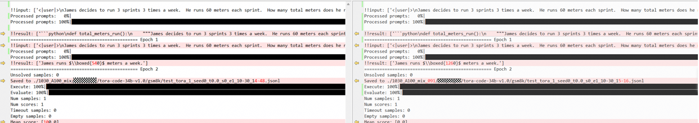

Therefore, the difference between GPU and NPU was now narrowed down to a vLLM version difference.

### Step 2: Detailed Comparison

Because the scope was narrowed in step 1, vLLM data of different versions can be directly collected on the same GPU machine for comparison.

#### Difference 1

After collecting the data, the input shapes of the two versions are inconsistent; 014 pads the `input_token` to a multiple of 8 (not only prefill, but each subsequent decode is also padded to 8).
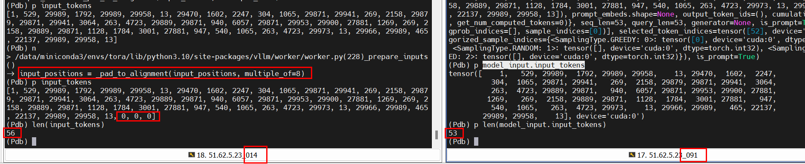

#### Difference 2

When 014 loads the embedding weight (32064,8192), the (32000:,:) part is filled with random values (which may have extremely large values and NaN), while 091 fills it with 0.
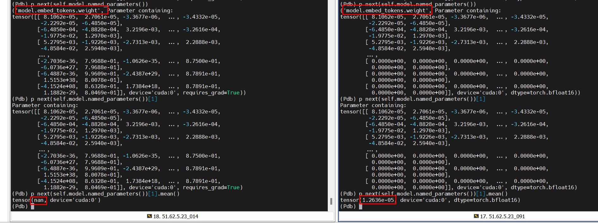
The unknown weight initialization of 014:
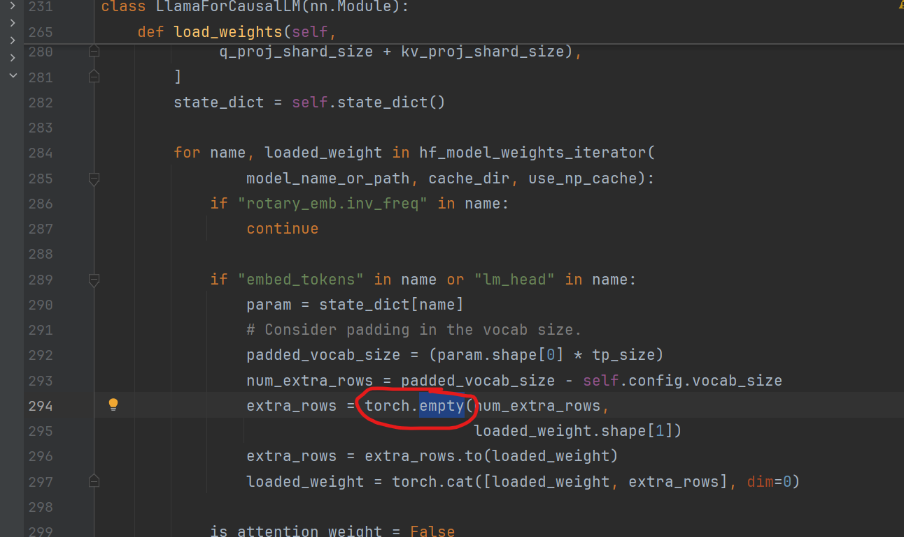

The above two problems cause the dump data comparison of statistical values to be affected by the shape and random values, and cannot be directly compared.

Solution: first comment out the `pad` of 014 and change `empty` to `zeros`, to ensure the two sides are consistent and comparable.

Here it is found that the above operations do not affect the evaluation result; 014 still reaches the precision standard, which clarifies that the above 2 problems are not the root cause.

#### Difference 3

After aligning the `pad` and `empty` operations of differences 1 and 2, the real data comparison can begin.

During comparison, it is found that the output of rotary+attention differs; the input collection is locally missing, but the previous module's output before this module is consistent, so this module was analyzed in depth
014 Attention:

```python
qkv, _ = self.qkv_proj(hidden_states)
q, k, v = qkv.split([self.q_size, self.kv_size, self.kv_size], dim=-1)
k_cache, v_cache = kv_cache
attn_output = self.attn(positions, q, k, v, k_cache, v_cache, input_metadata, cache_event)  # PagedAttentionWithRoPE
    pos_encoding_ops.rotary_embedding_neox(
            positions,
            query,
            key,
            self.head_size,
            self.cos_sin_cache,
    )
    super().forward()
        query = query.view(-1, self.num_heads, self.head_size)
        key = key.view(-1, self.num_kv_heads, self.head_size)
        value = value.view(-1, self.num_kv_heads, self.head_size)
        # multi_query_kv_attention
        key = torch.repeat_interleave(key, self.num_queries_per_kv, dim=1)
        value = torch.repeat_interleave(value, self.num_queries_per_kv, dim=1)
        out = xops.memory_efficient_attention_forward(
                query.unsqueeze(0),
                key.unsqueeze(0),
                value.unsqueeze(0),
                attn_bias=input_metadata.attn_bias[0],
                p=0.0,
                scale=self.scale,
                op=self.attn_op,
            )
        output.copy_(out.squeeze(0))
output, _ = self.o_proj(attn_output)

```

091 Attention:

```python
qkv, _ = self.qkv_proj(hidden_states)
q, k, v = qkv.split([self.q_size, self.kv_size, self.kv_size], dim=-1)
q, k = self.rotary_emb(positions, q, k)  # self_attn.rotary_emb.RotaryEmbedding.forward
    torch.ops._C.rotary_embedding
attn_output = self.attn(q, k, v)  # Attention
    torch.ops._C_cache_ops.reshape_and_cache_flash(
            key,
            value,
            kv_cache[0],
            kv_cache[1],
            updated_slot_mapping.flatten(),  # type: ignore[union-attr]
            kv_cache_dtype,
            layer._k_scale,
            layer._v_scale,
        )
    flash_attn_varlen_func(  # directly calls torch.ops._vllm_fa2_C.varlen_fwd or torch.ops._vllm_fa3_C.fwd
            q=query,
            k=key,
            v=value,
            cu_seqlens_q=q_seq_start_loc,
            cu_seqlens_k=k_seq_start_loc,
            max_seqlen_q=q_seq_len,
            max_seqlen_k=k_seq_len,
            softmax_scale=softmax_scale,
            causal=_get_causal_option(attn_type),
            window_size=window_size,
            alibi_slopes=alibi_slopes,
            softcap=logits_soft_cap,
            out=prefill_output,
            fa_version=self.vllm_flash_attn_version,
            q_descale=layer._q_scale.expand(descale_shape),
            k_descale=layer._k_scale.expand(descale_shape),
            v_descale=layer._v_scale.expand(descale_shape),
        )
output, _ = self.o_proj(attn_output)
```

* 091 enters `torch.ops._C.rotary_embedding` of `Attention`.
* 014 enters `pos_encoding_ops.rotary_embedding_neox` of `PagedAttentionWithRoPE`.

The left figure shows 014 Attention, and the right figure shows 091 Attention.
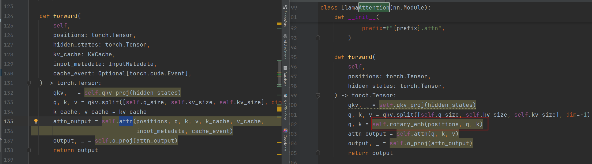
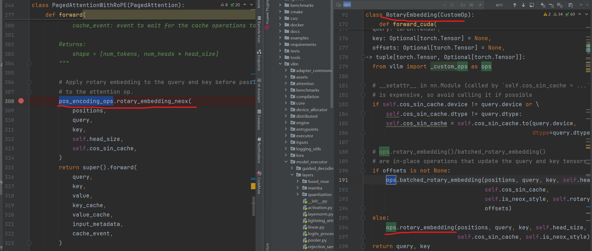

**Manually print the inputs:**

Consistent `qk`:
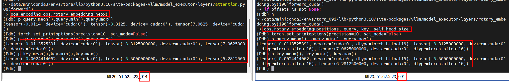
Inconsistent `cos_sin_cache`:
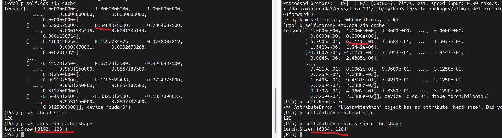
Inconsistent output:
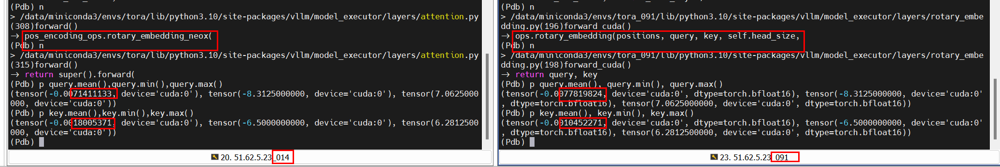

Check the generation of `cos_sin_cache`, and it is found that there is a `max_position_embeddings` parameter specifying the length. 014 uses the default 8192, while 091 passes in 16384 from the outer layer.

014 uses the default `max_position`, with value 8192:

```python
inv_freq = 1.0 / (base**(torch.arange(0, rotary_dim, 2) / rotary_dim))
t = torch.arange(max_position).float()
freqs = torch.einsum("i,j -> ij", t, inv_freq.float())
cos = freqs.cos()
sin = freqs.sin()
cache = torch.cat((cos, sin), dim=-1)
```

091 uses the externally passed `self.base` and `self.max_position_embeddings` configuration:

```python
inv_freq = 1.0 / (self.base**(torch.arange(0, self.rotary_dim, 2, dtype=torch.float) / self.rotary_dim))
t = torch.arange(self.max_position_embeddings, dtype=torch.float)
freqs = torch.einsum("i,j -> ij", t, inv_freq)
cos = freqs.cos()
sin = freqs.sin()
cache = torch.cat((cos, sin), dim=-1)
```

It is found that the `max_position_embeddings` value and the `base` value differ between the two versions.

## Fix and Root Cause

**Fix:**

In the model file, change the following attributes of `hf config.json`:

* Change the value of `max_position_embeddings` in `hf config.json` from 16384 to 8192.
* Change the value of `rope_theta` in `hf config.json` from 1000000 to 100000.
  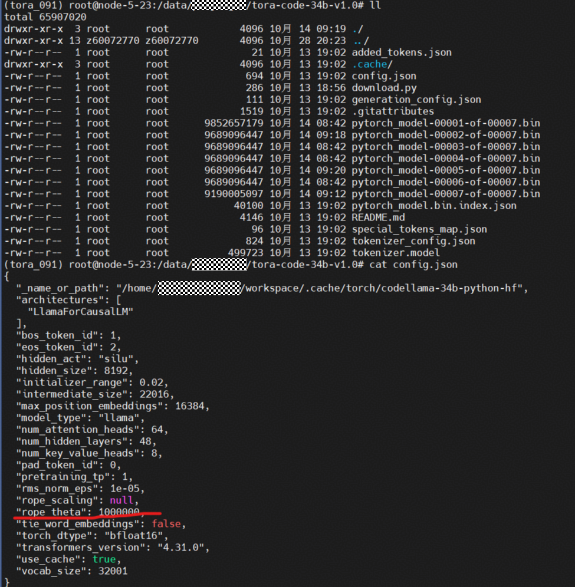

**Result verification:**

After changing the configuration, the evaluation precision of GPU version 091 reaches the standard:
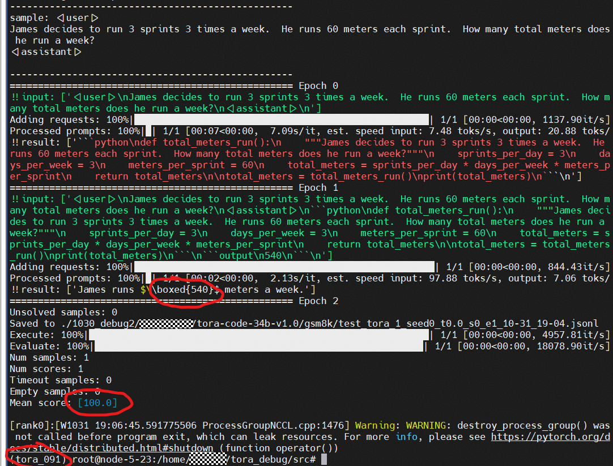
NPU performs bad case verification, and the precision reaches the standard:
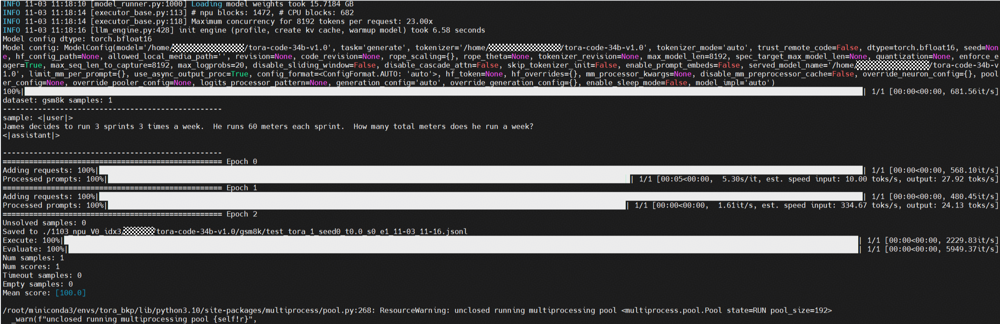

Full dataset score reaches the standard:
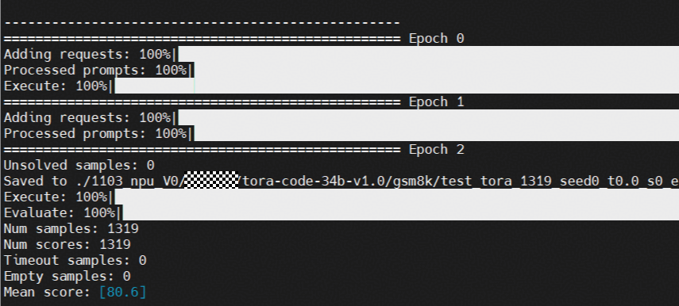

**Root cause summary:**

When initializing `cos_sin_cache` for computing `rotary_embedding`, there is a difference, causing the `rotary_embedding output` to be inconsistent:

* `max_position_embeddings` differs: `014` is `8192` (not passed in, defaulting to `8192`), `091` is `16384` (automatically assigned according to the `max_position_embeddings` in the hf model path)
* `base` differs: `014` is `10000` (not passed in, defaulting to `10000`), `091` is `100000` (automatically assigned according to the `rope_theta` in the hf model path)
