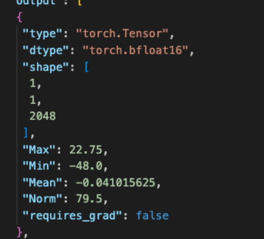
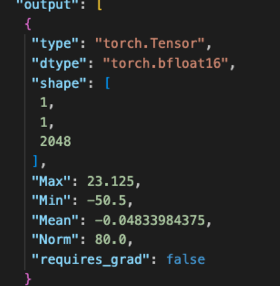
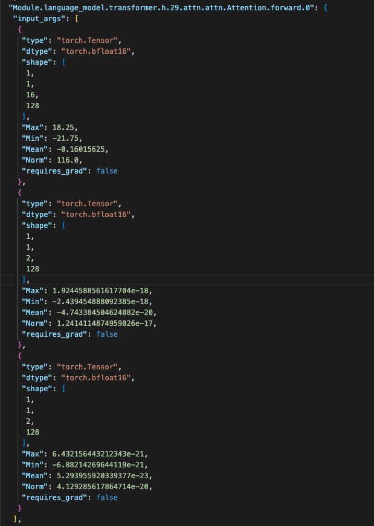
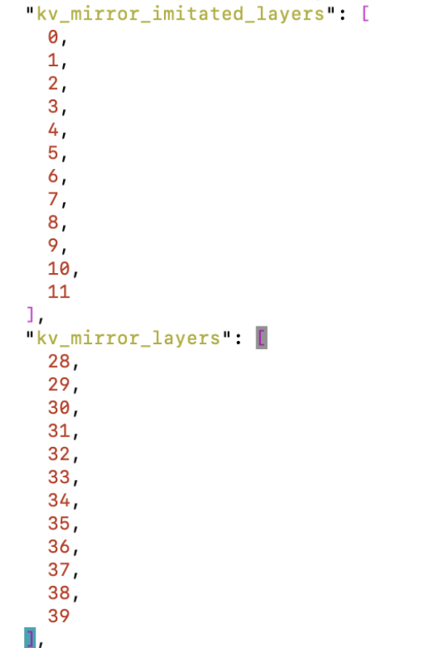

# Precision Problem of Ascend-based VL Model Migration to vLLM

## Background

When migrating a vision-language (VL) model to the Ascend vLLM inference platform, the precision alignment of the inference results with the reference platform is the key to determining whether the migration succeeds. After a certain VL model is migrated from the transformers inference framework to Ascend vLLM, it is found that from the 7th token onward the inference results do not match the reference output, and garbled text appears afterward. This document records the process of locating the missing Attention module migration problem through layer-by-layer comparison, providing a reference for similar model migration.

## Symptoms

After the VL model was migrated from the H20 + transformers inference framework to the Ascend + vLLM inference framework, it was found that from the 7th token onward the NPU inference results did not match the GPU, and garbled text also appeared afterward.

## Localization Process

### Precision Alignment

| Confirmation Item | Result |
| --------------------------------- | ------------------------------------------------------------------------------------------------------------------------------- |
| transformers version troubleshooting | The transformers version on the NPU is different from the GPU version; the vLLM version on the NPU requires transformers to be greater than a specified version, so the NPU-side version cannot be lowered. |
| Rotary position embedding error | After rotary position embedding the cosine similarity is close to 1, so the priority is low. |
| sliding_window confirmation | Confirmed that this feature is not used. |
| decode_layer comparison (Att and MLP) | The cosine similarity of each layer is close to 1; the statistical information of msProbe cannot find a difference, so tensor needs to be collected further. |
| Model configuration comparison between GPU and NPU | Confirmed to be consistent. |
| NPU + transformers inference compared with GPU | Low priority. |
| Tow NPUs using the H20 inputs_embeds | The result improves, with no garbled text, but the content still differs from H20. |

### Forward Localization: Look Backward from the `logits` of the 7th Token

Further analyzing the data of step 6 on the GPU and NPU sides, it is found that in the output of `Module.language_model.transformer.h.29.DecoderLayer.forward.0` the difference between GPU and NPU is relatively large.

GPU output:

NPU output:

Looking backward, further analysis shows that the values of `k` and `v` in `Module.language_model.transformer.h.29.attn.attn.Attention.forward.0` on the NPU are very small: because there is no Attention module on the GPU side, the NPU side shows the same problem at layer 28 as well, while layers 27 and earlier are normal.

Looking at the model configuration file, it contains the following configuration, which is mainly used in `KVMirrorManagerHook` and `KVMirrorManager`, and these two modules were not ported to the vLLM model, causing the above difference. The function of these two functions is to save `key_states` and `value_states` in `kv_mirror_imitated_layers`, and to retrieve the corresponding `key_states` and `value_states` in `kv_mirror_layers`. Because the parameter values of `k` and `v` on the layer corresponding to `kv_mirror_layers` are very small, without this processing the values of `key_states` and `value_states` would also be very small, ultimately causing the `key_states` and `value_states` passed to the attention computation to be abnormally small values.

## Root Cause

During model migration, the `KVMirrorManagerHook` and `KVMirrorManager` of the Attention module were not migrated, causing the `k` and `v` values obtained after layer 28 to be abnormal and impossible to align with the GPU.

## Conclusion

The root cause of the VL model's inference results not matching the GPU from the 7th token onward and the subsequent garbled text is: after the model was migrated to Ascend vLLM, the two modules `KVMirrorManagerHook` and `KVMirrorManager` were not migrated along with the model, so the `key_states` and `value_states` saved by the `kv_mirror_imitated_layers` layers cannot be properly retrieved at the `kv_mirror_layers` layers, causing the `k` and `v` values after layer 28 to be abnormal.

## Solution

In the vLLM model, complete the porting of the two modules `KVMirrorManagerHook` and `KVMirrorManager`, so that the save and retrieval logic of `key_states` and `value_states` is consistent with the GPU side.
