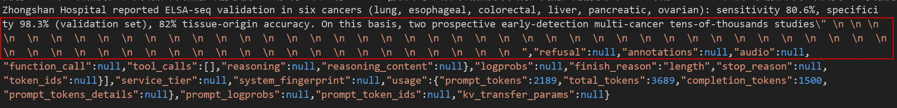
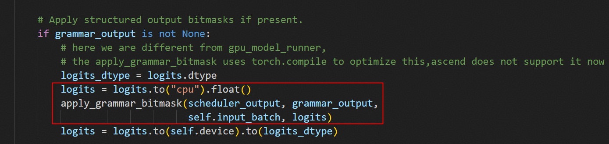
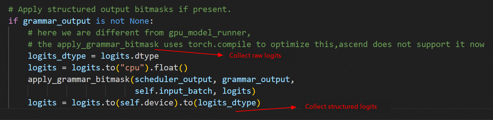
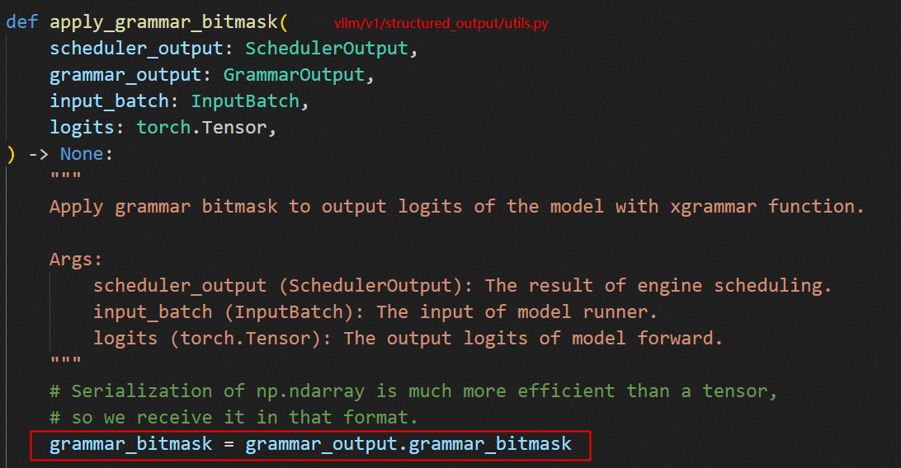
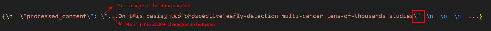

# Inference Response Repetition Problem of the Qwen2.5 Model

## Case Introduction

In a service based on the vLLM inference framework, a model that does not terminate its response and continuously outputs newline characters will severely affect service availability. This document records the complete localization process of the occasional "response not terminated" problem encountered when deploying the Qwen2.5-7B-Instruct model in the Ascend environment. By gradually excluding links such as eager mode, sampling parameters, and structured output, it is finally confirmed that the problem stems from the conflict between the JSON-constrained decoding of structured output (xgrammar) and the completeness of the model response content, and a general solution is given, providing a reference for similar inference problems.

## Symptoms

In the Ascend environment, after deploying the Qwen2.5-7B-Instruct model based on the vLLM inference framework, a certain inference use case occasionally showed the problem of continuously outputting "\n" and a non-terminating response. The problematic response is shown in the figure below.



The model deployment configuration when the problem first occurred is as follows:

```shell
# FlashComm1
export VLLM_ASCEND_ENABLE_DENSE_OPTIMIZE=1
export VLLM_ASCEND_ENABLE_FLASHCOMM=1

export VLLM_SERVER_DEV_MODE=1
export VLLM_ASCEND_ENABLE_NZ=0
export TASK_QUEUE_ENABLE=1

export VLLM_USE_V1=1
export VLLM_VERSION=0.11.0
export VLLM_EXECUTE_MODEL_TIMEOUT_SECONDS=380
```

The inference request used a system prompt, requiring the model to output the processing result of the specified medical article in JSON format; the request also enabled the `response_format` structured output function. The request content (excerpt) is as follows:

```json
{
    "messages": [
        {
            "role": "system",
            "content": "As a medical text processing engine, please receive a WeChat official account article for processing and output strictly in JSON format, such as {processed_content: \"<processed body content>\"}"
        },
        {
            "role": "user",
            "content": "**Text to be modified**: <a medical science article body>"
        }
    ],
    "temperature": 0.3,
    "top_p": 0.8,
    "top_k": 20,
    "max_tokens": 20480,
    "ignore_eos": false,
    "response_format": {"type": "json_object"}
}
```

## Localization Process

### Localization Environment

Experiments found that on vLLM versions 0.11.0, 0.12.0, 0.13.0, and 0.14.0, the problem exists even with single-rank deployment, and the symptom is consistent. The actual localization environment is as follows:

```bash
NPU: Atlas 800I A2
CANN: 8.3.RC2
vllm_ascend: 0.13.0rc1
Parallel configuration: single rank, no parallelism
```

### Eager Mode Verification

After enabling eager mode, the problem still exists, excluding `AclGraph`-related problems.

### Sampling Parameter Verification

After setting the `temperature` parameter in the request to 0, the problem disappeared, so it was suspected that there was a problem with sampling.

### Structured Output Configuration Verification

Observing the request parameters of the test case, it was found that the request carried the `response_format` parameter, enabling the structured output function of vLLM to specify a JSON-format reply.

The implementation principle of structured output is to use the decoding backend to perform constrained decoding on the model's raw `logits` output, and this process happens exactly in the sampling stage.

Remove the `response_format` parameter while keeping the other parameters unchanged, to verify whether structured output caused the problem. The main sampling parameters are as follows:

```json
"temperature": 0.3,
"top_p": 0.8,
"top_k": 20,
"max_tokens": 20480,
"ignore_eos": false
```

The verification result is: when structured output is not set, the problem disappears.

### Hardware Exclusion

Because the core operation of structured output is independent of the hardware environment, the implementation code is in `vllm/v1/structured_output/utils.py`, and the computation happens on the CPU, it is inferred that the same problem would also occur on the GPU platform, unrelated to Ascend hardware or software.



Performing the same experiment in a GPU environment (SGLang+GPU), it is found that the non-terminating response problem also occurs, proving that the occurrence of this problem is unrelated to the hardware environment.

### Root Cause Exploration

Observing the difference between the normal response and the abnormal response, it is found that the first significant output difference occurs after the "tens-of-thousands studies" phrase.

```bash
# Normal response
{\n  \"processed_content\": \"...On this basis, two prospective early-detection multi-cancer tens-of-thousands studies \\\"PREDICT\\\" and \\\"PRESCIENT\\\" have been launched one after another and are progressing in an orderly manner.\"\n}
# Abnormal response
{\n  \"processed_content\": \"...On this basis, two prospective early-detection multi-cancer tens-of-thousands studies\"  \n  \n  \n  ...}
```

Collect the raw `logits` and the structured `logits` of the two tokens after "tens-of-thousands studies".



The collected `logits` data shows: when outputting the 1st token, there is no obvious difference between the normal response and the abnormal response in either the raw `logits` or the structured `logits`; but when outputting the 2nd token, the raw `logits` difference is small, while the structured `logits` difference is huge.

Focus on the 2nd token in the abnormal response. Its raw `logits` satisfy the output expectation (Pxx), indicating that the Qwen2.5 model itself infers normally, but in the structured `logits` the content of the valid character `P` is lost, becoming meaningless tokens such as `" "` and `"\n"`. This again confirms that the problem is caused by structured output.

Next, the `apply_grammar_bitmask` function was analyzed. From the code, it can be seen that the essence of structuring is to use the `grammar_bitmask` NumPy array to perform a mask operation on the raw `logits`. Therefore, the `grammar_bitmask` data of several tokens after "tens-of-thousands studies" was collected.

The source code of the `apply_grammar_bitmask` function is as follows:



The key code for collecting `grammar_bitmask` data is as follows:

```python
# vllm-ascend/vllm_ascend/worker/model_runner_v1.py

class NPUModelRunner(GPUModelRunner):

    def __init__(self, vllm_config: VllmConfig, device: torch.device):
        ......
        self.debug_enable = False
        self.debug_tokens_num = 0
        self.dumped_tokens_num = 0
        self.last_valid_sampled_token_ids = [[0]]
    ......
    @torch.inference_mode
    def sample_tokens(
        self, grammar_output: "GrammarOutput | None"
    ) -> ModelRunnerOutput | AsyncModelRunnerOutput | IntermediateTensors:
        kv_connector_output = self.kv_connector_output
        self.kv_connector_output = None
        ......
        # Apply structured output bitmasks if present.
        if grammar_output is not None:
            logits_dtype = logits.dtype

            self.debug_tokens_num += 1
            if self.debug_enable:
                np.save(f'/xxx/grammar_bitmask_{self.debug_tokens_num}', grammar_output.grammar_bitmask)
                self.dumped_tokens_num += 1

            logits = logits.to("cpu").float()
            apply_grammar_bitmask(scheduler_output, grammar_output,
                                  self.input_batch, logits)
            logits = logits.to(self.device).to(logits_dtype)
        ......
        if valid_sampled_token_ids == [[102266]] and self.last_valid_sampled_token_ids == [[86402]]:
            self.debug_enable = True
        self.last_valid_sampled_token_ids = valid_sampled_token_ids
        if self.dumped_tokens_num >= 15:
            self.debug_enable = False
            self.dumped_tokens_num = 0
```

In the collected `grammar_bitmask` data, it can be found that before and after outputting "\"", the value of `grammar_bitmask` changed, indicating that the decoding backend considers the reply output to have entered a new JSON state. Therefore, it can be imagined that the decoding backend may have treated "\"" as the closing marker of some string rather than an ordinary token output.

Searching for "\"" in the response, it was found that the "\"" in "tens-of-thousands studies\"" is indeed the first "\"" in the content of the string variable processed_content, and according to the JSON format standard it should be regarded as the closing marker of the string variable.



This finding exactly explains the following two phenomena:

| Problem Symptom | Explanation |
| --- | --- |
| When the 1st token after "tens-of-thousands studies" is "\\\"", rather than "\"", the response is normal | When defining a string, "\\\"" can appear as an ordinary character between "..." and does not represent the closing of the string |
| When the 1st token after "tens-of-thousands studies" is "\"", the "P" content in the raw logits of the 2nd token is lost after structuring | In a JSON string, after key: value there should be characters such as ",", """, "}", " ", "\n", "\t", and not the illegal character "P" |

To verify the above conjecture, "\"" in the prompt was changed to "'" (single quotation mark), and an inference request experiment was conducted; the result was that the problem did not reproduce, proving the conjecture correct.

## Root Cause

When the "\\\"" token in the expected output "tens of thousands study\\\"PREDICT\\\" and..." is replaced by "\"" due to sampling randomness, the decoding backend (xgrammar) considers the string variable to be closed and masks the output of "PREDICT...", to ensure the reply content is a legal JSON string. However, from the perspective of Qwen2.5 model inference, there is still a large amount of meaningful content after "tens of thousands study" in the prompt, so inference should not stop.

The conflict between JSON format legality (xgrammar) and response content completeness (Qwen2.5-7B-Instruct) causes the phenomenon of continuously outputting "\n" and a non-terminating response.

## Solution

Replace "\"" in the content to be formatted in the prompt with a single quotation mark or Chinese double quotation mark, to avoid conflict with characters that have special meaning in the JSON format.

## Summary of Experience

The whole inference process can be roughly divided into three stages: "input preprocessing → model forward execution → data post-processing". When localizing a problem, you can first determine the boundary, clarify which stage the problem occurs in, and then do an in-depth analysis. For example, in this localization process, by first modifying the request parameters it was determined that the problem occurred in the sampling stage after the model forward execution ended (data post-processing), thereby achieving rapid localization of the problem.
