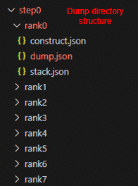
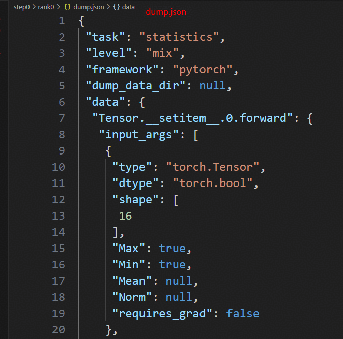
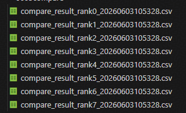
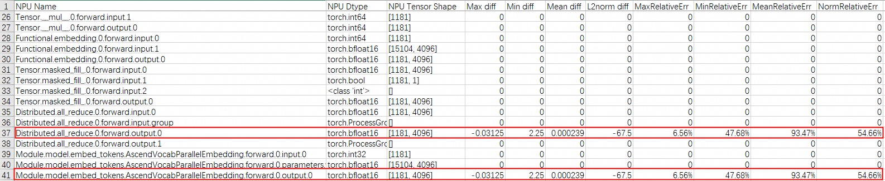
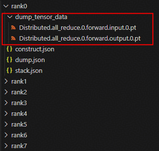
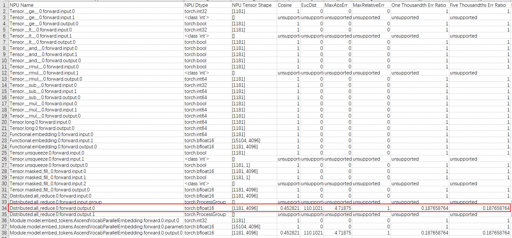
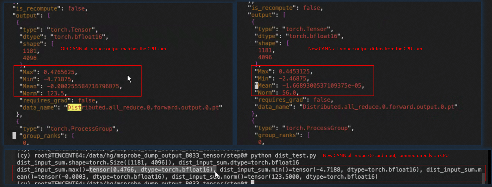
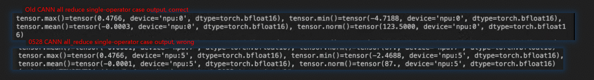

# Garbled Inference Response Problem After CANN Version Upgrade

## Case Introduction

In large model inference services, precision anomalies such as garbled responses may appear after a CANN version upgrade, affecting the availability of online services. This document introduces a systematic localization method based on the msProbe tool. Through the process of "Dump → Compare → Single-operator reproduction", the full-network precision problem is gradually narrowed down to a numerical deviation problem of a single operator. This method is applicable to the vLLM Ascend inference scenario and provides a reusable reference for troubleshooting precision problems after a CANN upgrade.

## Problem Symptoms

After upgrading the CANN version, a certain model showed a garbled-response precision problem. After rolling back the CANN version, the problem disappeared.

| Scenario | CANN Version | Request Response |
| --- | --- | --- |
| Normal scenario | 9.0.0 | The following are the five most important milestone events in the history of artificial intelligence and their corresponding significance |
| Abnormal scenario | 9.1.0 | Garbled data |

## Localization Process

### Localization Environment

- NPU model: Ascend 950 PR
- CANN version: 9.1.0, 9.0.0

This problem is a typical precision anomaly that appears after a CANN version upgrade. Because the model structure, API call logic, and other aspects did not change before and after the upgrade, the problem can be narrowed down to operators whose numerical behavior changed in the new CANN version. Normally, the msProbe precision tool can be used to clarify the problem operator through the localization process of "Dump → Compare → Single-operator reproduction".

### Tool Installation

For detailed installation steps, see *[msProbe Tool Installation Guide](../install_guide/msprobe_install_guide.md)*. Because this problem occurs in the vLLM inference scenario, installing the basic toolkit is sufficient.

### First Dump and Comparison

For the dump steps, see *[vLLM Inference Data Collection](../user_guide/dump/vllm_dump_instruct.md)*; for the comparison steps, see *[vLLM Inference Precision Data Comparison](../user_guide/accuracy_compare/pytorch_accuracy_compare_instruct.md)*.

Perform the first dump and comparison to preliminarily troubleshoot the point where the problem occurs.

First, the appropriate dump configuration parameters need to be determined according to the problem symptoms. Because the first token is garbled, it is sufficient to collect the full-network data of the first forward; the dump configuration (for details, see *[Configuration File Introduction](../user_guide/dump/config_json_introduct.md)*) is as follows:

```json
{
    "task": "statistics",
    "dump_path": "./dump_data",
    "rank": [],
    "step": [0],
    "level": "mix",
    "statistics": {
        "scope": [],
        "list": [],
        "data_mode": ["all"],
        "summary_mode": "statistics"
    }
}
```

Next, in the vLLM service startup script, add the `--additional-config '{"dump_config_path": "/xxx/msprobe_config.json"}'` parameter to pass in the dump configuration file path.

Finally, start the vLLM service and send a request. After the response ends, check the dump directory to confirm whether the Dump succeeded; the directory structure and the `dump.json` content are shown in the figure below.

 

Repeat the above steps to separately dump the first-token full-network precision data when using the new version and the old version of CANN. Then execute the following comparison command to perform the precision data comparison.

```bash
msprobe compare -tp [new_cann_dump_data]/step0 -gp  [old_cann_dump_data]/step0 -o ./output
```

The comparison results will be saved as a csv file in the output directory.



Opening the rank 0 comparison result table, it can be quickly found that the first difference point is the output of the all_reduce API, and at the same time, because of its output difference, the total output of the embedding layer also has the same difference.



The possible reasons for the inconsistent all_reduce API output on rank 0 are:

1. The all_reduce input of some ranks among ranks 1—7 is different.
2. The input of the rank 0 all_reduce API is identical only in statistical metrics, but the element-by-element comparison result is different.
3. The all_reduce operator has a numerical deviation.

The verification of reasons 2 and 3 requires collecting the real input/output Tensors of the all_reduce API, so first confirm whether reason 1 exists by looking at the comparison result tables of ranks 1—7.

After looking at the comparison result tables, it was found that, the same as the rank 0 situation, the all_reduce API inputs of ranks 1—7 show no difference in statistical metrics before and after the CANN version upgrade, while the outputs differ noticeably. Therefore, reason 1 is excluded.

### Second Dump and Comparison

After locking down the all_reduce API through the first dump comparison, a fine-grained second dump was performed to verify whether the all_reduce operator has a numerical deviation.

Dump the real input/output data of all APIs in the embedding layer.

- Dumping only the embedding layer is to reduce the data collection volume and reduce the Dump time.
- Dumping all APIs in the embedding layer is to collect the upstream APIs of all_reduce and check whether the all_reduce difference comes from the propagation of upstream API differences.
- Dumping real tensor data (rather than statistics) is to accurately compare the input/output differences of the APIs under the old and new CANN and to provide input for the subsequent single-operator reproduction.

The configuration used for the second Dump is as follows; the main difference from the first Dump configuration is in the "task" and "list" fields.

```json
{
    "task": "tensor",
    "dump_path": "./dump_data_tensor",
    "rank": [],
    "step": [0],
    "level": "mix",
    "tensor": {
        "scope": [],
        "list": ["Module.model.embed_tokens.AscendVocabParallelEmbedding.forward.0"],
        "data_mode": ["all"],
        "summary_mode": "statistics"
    }
}
```

The dump and comparison steps after modifying the configuration file are exactly the same as the first dump. The finally obtained dump data is as follows; compared with the first dump, an additional `dump_tensor_data` folder is created to store the input/output Tensor data.



The comparison results are as follows:



It can be seen that the output of the all_reduce API still differs first, so there is sufficient reason to suspect that the all_reduce operator has a numerical deviation.

### Single-Operator Reproduction

The purpose of the single-operator reproduction is to provide conclusive evidence for the numerical deviation of the all_reduce operator in the new CANN version, so as to feed it back to the operator development team and drive a solution.

First, according to the implementation principle of all_reduce, calculate the expected output under the same input. The calculation script is as follows:

```python
import torch

dist_input_rank0 = torch.load("./rank0/dump_tensor_data/Distributed.all_reduce.0.forward.input.0.pt", "cpu")
dist_input_rank1 = torch.load("./rank1/dump_tensor_data/Distributed.all_reduce.0.forward.input.0.pt", "cpu")
dist_input_rank2 = torch.load("./rank2/dump_tensor_data/Distributed.all_reduce.0.forward.input.0.pt", "cpu")
dist_input_rank3 = torch.load("./rank3/dump_tensor_data/Distributed.all_reduce.0.forward.input.0.pt", "cpu")
dist_input_rank4 = torch.load("./rank4/dump_tensor_data/Distributed.all_reduce.0.forward.input.0.pt", "cpu")
dist_input_rank5 = torch.load("./rank5/dump_tensor_data/Distributed.all_reduce.0.forward.input.0.pt", "cpu")
dist_input_rank6 = torch.load("./rank6/dump_tensor_data/Distributed.all_reduce.0.forward.input.0.pt", "cpu")
dist_input_rank7 = torch.load("./rank7/dump_tensor_data/Distributed.all_reduce.0.forward.input.0.pt", "cpu")

dist_input_sum = dist_input_rank0 + dist_input_rank1 + dist_input_rank2 + dist_input_rank3 + dist_input_rank4 + dist_input_rank5 + dist_input_rank6 + dist_input_rank7

print(f'{dist_input_sum.shape=}, {dist_input_sum.dtype=}')
print(f'{dist_input_sum.max()=}, {dist_input_sum.min()=}, {dist_input_sum.mean()=}, {dist_input_sum.norm()=}')
```

The calculation result is as follows:



The calculation result is consistent with the all_reduce operator output collected in the full network under the old CANN version, and differs noticeably from the new version's output, indicating that in the full network the all_reduce output of the new CANN version has a deviation.

Then, use the following single-operator script to obtain the all_reduce output of the old and new CANN versions in the single-operator scenario.

```python
import torch
import torch.distributed as dist
import torch.multiprocessing as mp
import os

# ----------------------
# NPU distributed environment initialization
# ----------------------
def setup_distributed(rank, world_size):
    """
    rank: current NPU index (0~7)
    world_size: total number of NPUs
    """
    # Must be configured for single-machine multi-NPU
    os.environ['MASTER_ADDR'] = 'localhost'
    os.environ['MASTER_PORT'] = '12345'

    # ========== NPU key: backend = hccl ==========
    dist.init_process_group(
        backend="hccl",  # NPU must use HCCL
        rank=rank,
        world_size=world_size
    )

    # Bind the current process to the corresponding NPU
    torch.npu.set_device(rank)

# ----------------------
# NPU all_reduce core demonstration
# ----------------------
def run_all_reduce_demo(rank, world_size):
    # 1. Initialize distributed
    setup_distributed(rank, world_size)
    device = torch.device(f"npu:{rank}")  # NPU device

    # 2. Each NPU loads a different tensor
    tensor = torch.load(f"./rank{rank}/dump_tensor_data/Distributed.all_reduce.0.forward.input.0.pt", "cpu")
    tensor = tensor.to(device)
    #print(f"NPU {rank} | before reduction: {tensor.item()}")

    # 3. Execute all_reduce on the NPU
    dist.all_reduce(tensor=tensor)

    # 4. All NPUs will get the same result
    print(f'{tensor.max()=}, {tensor.min()=}, {tensor.mean()=}, {tensor.norm()=}')

    # Cleanup
    dist.barrier()
    dist.destroy_process_group()

# ----------------------
# Start 8-card NPU processes
# ----------------------
if __name__ == "__main__":
    WORLD_SIZE = 8  # 8 NPUs
    mp.set_start_method("spawn")

    processes = []
    for rank in range(WORLD_SIZE):
        p = mp.Process(
            target=run_all_reduce_demo,
            args=(rank, WORLD_SIZE)
        )
        p.start()
        processes.append(p)

    for p in processes:
        p.join()
```

The execution result is as follows:



At this point, the full-network precision problem has been successfully converted into a single-operator numerical deviation problem.

## Solution

Upgrade the CANN environment to version 9.1.0 B037, in which the all_reduce operator numerical deviation has been fixed.

## Summary

Precision anomaly problems that appear after a version upgrade can be quickly localized using the msProbe precision tool.
