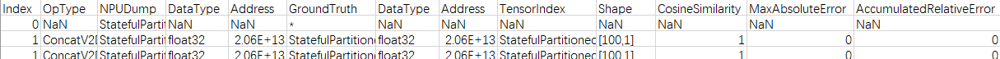
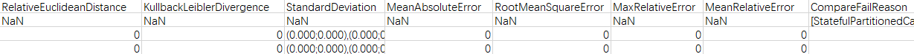

# Comparison of Dump Data Precision for Offline Models

## Overview

This section mainly describes the precision comparison tool for traditional small-model scenarios. The tool can be used for comparison before and after ATC model conversion of ONNX and TensorFlow framework models, comparison in TensorFlow training scenarios, and comparison between different versions of offline models.

## Preparations

**Environment Setup**

- Install msProbe by referring to the [*msProbe Installation Guide*](../../install_guide/msprobe_install_guide.md).
- Install the CANN Toolkit development package and ops operator package of the matching version, and configure CANN environment variables. For details, see [CANN Quick Installation](https://www.hiascend.com/en/cann/download).

**Constraints**

Offline dump data of Caffe, ONNX, TensorFlow, and OM models is supported.

## Function Description

**Function**

Compare the data dumped by offline models for precision.

**Precautions**

None

**Syntax**

```shell
msprobe compare -m offline_data -tp <target_path> -gp <golden_path> [-fr <fusion_rule_file>] [-cfr <close_fusion_rule_file>] [-qfr <quant_fusion_rule_file>] [-mgf <model_graph_file>] [-o <output_path>]
```

**Parameters**

| Parameter                | Mandatory (Yes/No)| Description                                                                                                                                            |
|---------------------|------------------------------------------------------------------------------------------------------------------------------------------------|------|
| -m | Yes| Comparison mode. The value **offline_data** indicates the offline data comparison scenario.|
| -tp or --target_path| Yes| Directory of data files generated during execution on the Ascend AI Processor. There are multiple dump data files in binary format. You need to specify their parent directory, for example, **$HOME/MyApp_mind/resnet50**. The **resnet50** folder is used to store the dump data files.<br><br>Training scenario:<br><br>TensorFlow can be used as the original training network for comparison.<br>During single-file comparison, you need to specify the directory where the data file is located.<br>If batch comparison on multiple dump data files is supported, you can specify **dump_path/time/** as a fixed path. Only TensorFlow can be used as the original training network for comparison. The fixed path can store multiple dump data files. Each dump data file must have a unique sub-path, which is named in the format of ***dump_path/time**/**device_id/model_name/model_id/dump_step/dump file***.|
| -gp or --golden_path| Yes| Directory for storing the data file of the original network running on the GPU/CPU.<br><br>There are multiple .npy files. You need to specify their parent directory, for example, **$HOME/Standard_caffe/resnet50**. The **resnet50** folder is used to store the .npy data files.<br><br>If **-cfr** is used, it specifies the directory of the dump data file generated after model conversion with operator fusion disabled.|
| -o or --output_path | No| Path of the comparison result. Defaults to the current path.<br><br>You are not advised to configure directories that are different from those of the current user to avoid privilege escalation risks.<br><br>Training scenario:<br><br>For single-file comparison, the result file is named in the `result_{timestamp}.csv` format.<br>For batch comparison, the result file is named in the `{device_id}_{model_name}_{dump_step}_result_{timestamp}.csv` format (multiple .csv result files are generated).|
| -fr or --fusion_rule_file| No| Network-wide information file.<br><br>Inference scenario:<br><br>A .json file converted from the .om model file using ATC, which contains the mapping between network-wide operators.<br>This option specifies the .json file generated during model conversion when operator fusion is enabled by default. To specify the .json file generated during model conversion when operator fusion is disabled, use the **-cfr** option.<br><br>Training scenario:<br><br>It is a .json file converted from the .txt graph file using ATC.<br>For single-file comparison, set this option to a specific .json file. For batch comparison, set this option to a directory where multiple .json files are stored.|
| -qfr or --quant_fusion_rule_file  | No | Quantization information file (.json file generated by Ascend model compression).<br><br>The quantization information file in .json format is generated through AMCT-based quantization. It contains the mapping between network-wide quantization operators and is used for operator matching during precision comparison.<br><br>In scenarios where comparison is performed between non-quantized original Caffe models and quantized offline models, either this option or the **-fr** option must be specified. In scenarios where comparison is performed between non-quantized original Caffe models and quantized original models, only this option is used.<br><br>This option is supported only in the inference scenario.|
| -cfr or --close_fusion_rule_file | No| Network-wide information file (a .json file converted from the .om model file using ATC, which contains the mapping between network-wide operators when operator fusion is disabled).<br><br> This option is supported only in the inference scenario.|
| -mgf or --model_graph_file | No | Sorts direct OM-to-OM comparison results in the operator order of the target-side OM model graph. It does not participate in operator matching between the dumps on both sides.<br><br>When this option is not specified, results are sorted by `Index`. The model graph JSON can be generated with `atc --mode=1 --om=<model.om> --json=<model.json>`. Partially unmatched dump operators are placed at the end. If no operator matches, the comparison stops and a prompt is displayed to check the graph file and the name format. This option cannot be combined with `-fr`, `-qfr`, or `-cfr`; the mutual exclusion also applies in the internal detail/mapping modes. |

**Example**

1. Dump the data of the offline model.

   You need to prepare the dump data of offline models running on GPU and NPU.

2. Perform precision comparison on the dump data. Example command:

   ```shell
   msprobe compare -m offline_data -tp ./data/target_path -gp ./data/golden_path -fr ./data/fusion_rule.json
   ```

   To output the results of direct same-name OM-to-OM comparison in target OM graph order, run:

   ```shell
   msprobe compare -m offline_data -tp ./data/target_path -gp ./data/golden_path -mgf ./data/target_model.json
   ```

**Output Description**

By default, after the comparison command is executed, the comparison result file `result_{timestamp}.csv` is generated in the current path where the command is executed.

Without `-mgf`, the final result is sorted by the original `Index` in ascending order. For direct same-name OM-to-OM comparison, the original numbering is established in the timestamp order of target-side dump operators, and operators unique to the benchmark side are appended afterwards; it does not guarantee consistency with the model graph node order. Graph ordering is enabled only when `-mgf` is passed, so whether it is enabled cannot be judged merely from consecutive `Index` values in the CSV.

When `-mgf` is specified, results are displayed first in the order of the `graph` array in the target OM graph JSON, and then in the order of the `op` array within each graph. The node `id` does not participate in the ordering. After sorting, the first CSV column `Index` is renumbered for each result row and is strictly `0, 1, 2, ...`, and the column structure remains unchanged. The operator matching relationship and precision values remain unchanged:

- The matching results of each graph are arranged contiguously, without interleaving between graphs. An in-graph op index refers to the index in the `op` array, not the node `id`.
- Multiple Tensor results of the same operator keep their original relative order, but each row has a different new `Index`. The numbering is continuous throughout the CSV and does not restart from 0 for each graph.
- When some dump operators are not matched to graph names, a warning is output and they are placed at the end. When none of them is matched, the comparison stops, with a prompt to check whether `-mgf` belongs to the target OM and whether the names in the dump and the graph JSON have the expected format, and no renumbered result is generated.
- Missing, duplicate, or inverted node `id` values do not affect the order. In names, `/` and `.` are replaced with `_`. Normal mode reuses the dump name processing rules and removes the `_lxsliceX` and `_sgt_graph_N` fields that match the rules, while FFTS mode retains these fields. Invalid JSON structures, invalid names after normalization, and duplicate names within or across graphs all raise errors.

This order is used to inspect precision differences along the model graph and does not represent the actual execution order of multi-stream operators. It applies to dumps in which OMs are directly matched by their post-compilation names, and name processing on the graph side follows the normal/FFTS mode of the target dump. If different graph nodes become identically named under this rule, the tool raises an error to avoid ambiguity.

The detail/mapping modes of the internal `msaccucmp.py` do not apply this ordering, and they indicate that its ordering purpose is ignored when `-mgf` is passed. The mutual exclusion check with the fusion parameters still applies. The outer `-fr/-qfr/-cfr` options correspond to the inner `-f/-q/-cf` options.

Without `-mgf`, the original `Index` and the CSV column structure are retained. With `-mgf`, logs still use the internal original numbering, while the `Index` in the CSV is the renumbered display row number. The `Index` in Advisor corresponds to the final CSV display row number. The new `Index` is not the selection number used by `--select/--range`.

## Comparison Result File Description

The following is an example of the `result_{timestamp}.csv` comparison result file:





| Parameter| Description|
|------|------|
| Index | Original comparison index by default. With `-mgf`, it indicates the display row number of the final CSV, numbered consecutively from 0. |
| OpSequence | Sequence in which an operator runs during comparison on some operators, that is, the ID of the operator in the network-wide information file specified by the **-fr** parameter. |
| OpType | Operator type. It is used to obtain the operator type when **-fr** is specified.|
| NPUDump | Operator name of the **My Output** model.|
| DataType | Data type of operators on the **NPU Dump** side.|
| Address | Memory address of the dump Tensor, used to determine memory issues of the operator. The address can be extracted only for network-wide comparison of dump data files generated during network running on the Ascend AI Processor. |
| GroundTruth | Operator name of the **Ground Truth** model.|
| DataType | Data type of operators on the **Ground Truth** side.|
| TensorIndex | Input ID and output ID of the operator that generates the dump data based on the Ascend AI Processor.|
| Shape | Shape of the compared tensor.|
| CosineSimilarity | Result of the cosine similarity comparison. The value ranges from **-1** to **1**. A value closer to **1** indicates higher similarity, and a value closer to **-1** indicates greater difference.|
| MaxAbsoluteError | Result of the maximum absolute error comparison. The value ranges from **0** to infinity. A value closer to **0** indicates higher similarity, and a larger value indicates a greater difference.|
| AccumulatedRelativeError | Result of the accumulated relative error comparison. The value ranges from **0** to infinity. A value closer to **0** indicates higher similarity, and a larger value indicates a greater difference.|
| RelativeEuclideanDistance | Result of the Euclidean relative distance comparison. The value ranges from **0** to infinity. A value closer to **0** indicates higher similarity, and a larger value indicates a greater difference.|
| KullbackLeiblerDivergence | Result of the Kullback-Leibler divergence comparison. The value ranges from **0** to infinity. The smaller the Kullback-Leibler divergence, the better the true distribution matches the approximate distribution.|
| StandardDeviation | Result of the standard deviation comparison. The value ranges from **0** to infinity. The smaller the standard deviation is, the smaller the dispersion is, and the closer the value is to the average value.|
| MeanAbsoluteError | Mean absolute error. The value ranges from **0** to infinity. If values of both **MeanAbsoluteError** and **RootMeanSquareError** are close to **0**, the measured value is more approximate to the actual value. If the value of **MeanAbsoluteError** is close to **0**, a larger value of **RootMeanSquareError** indicates that some values are excessively large. A larger value of **MeanAbsoluteError** and **RootMeanSquareError** value equal to or approximate to that of **MeanAbsoluteError** indicate that the overall deviation is more centralized. A larger value of **MeanAbsoluteError** and **RootMeanSquareError** value larger than that of **MeanAbsoluteError** indicate that the overall deviation exists and its distribution is scattered. Other situations do not exist because "RootMeanSquareError ≥ MeanAbsoluteError" is always true.|
| RootMeanSquareError | Root mean square error. The value ranges from **0** to infinity. If the value of **MeanAbsoluteError** is close to **0** and the value of **RootMeanSquareError** is close to **0**, the measured value is more approximate to the actual value. If the value of **MeanAbsoluteError** is close to **0**, a larger value of **RootMeanSquareError** indicates that some values are excessively large. A larger value of **MeanAbsoluteError** and **RootMeanSquareError** value equal to or approximate to that of **MeanAbsoluteError** indicate that the overall deviation is more centralized. A larger value of **MeanAbsoluteError** and **RootMeanSquareError** value larger than that of **MeanAbsoluteError** indicate that the overall deviation exists and its distribution is scattered. Other situations do not exist because "RootMeanSquareError ≥ MeanAbsoluteError" is always true.|
| MaxRelativeError | Max. relative error. The value ranges from **0** to infinity. A value closer to **0** indicates higher similarity, and a larger value indicates a greater difference.|
| MeanRelativeError | Mean relative error. The value ranges from **0** to infinity. A value closer to **0** indicates higher similarity, and a larger value indicates a greater difference.|
| CompareFailReason | Cause of the comparison failure.<br><br>If the cosine similarity is **1**, check whether the input or output shapes of the operator are empty or all **1**. If the input or output shapes of the operator are empty or all **1**, the input or output of the operator is a scalar. In this case, the following message is displayed: "this tensor is scalar."|

**Result Analysis**

1. Confirm whether the `-mgf` graph file exported from the target OM is passed in the command, and check the unmatched warnings. Verify the order of the results against the graph nodes based on the `NPUDump` names. Nodes without dump data do not produce CSV rows, so row numbers cannot be directly mapped to graph node indices.
2. Check `NPUDump`, `GroundTruth`, `TensorIndex`, `DataType`, `Shape`, and `CompareFailReason` first to exclude unmatched operators, wrong Tensors, or rows that cannot be compared, and then evaluate the numerical errors.
3. Check `CosineSimilarity`, `MaxAbsoluteError`, and the relative error metrics layer by layer along the confirmed graph order. Determine the thresholds based on the model, data type, and service requirements. Do not reorder rows by error magnitude first, which would lose the graph order.
4. For the first suspicious operator, verify its inputs and upstream outputs. Continue tracing upstream if the inputs are already inconsistent, and focus on the operator itself if the inputs are consistent but the output is abnormal. Verify against the data dependencies in the model graph. The first abnormal row in the CSV is only a lead for localization, not equivalent to the root cause.
