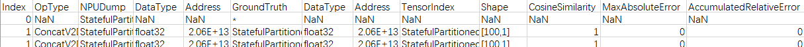
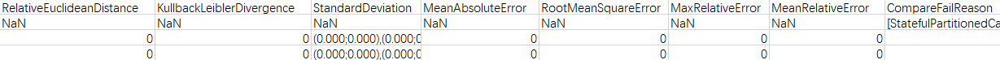

# Comparison of Dump Data Precision for Offline Models

## Overview

This document describes precision data comparison for traditional small models using a comparison tool. The tool can be used for comparison before and after ATC conversion of ONNX and TensorFlow models, comparison in TensorFlow training scenarios, and comparison between different versions of offline models.

## Preparations

**Environment Setup**

- Install msProbe by referring to [msProbe Installation Guide](../../install_guide/msprobe_install_guide.md).
- Install the matching CANN Toolkit and ops operator packages, and configure CANN environment variables. For details, see the *CANN Installation Guide*.

**Constraints**

Offline dump data of Caffe, ONNX, TensorFlow, and OM models is supported.

## Function Description

**Function**

Compare offline model dump data precision.

**Precautions**

None

**Syntax**

```shell
msprobe compare -m offline_data -tp <target_path> -gp <golden_path> [-fr <fusion_rule_file>] [-cfr <close_fusion_rule_file>] [-qfr <quant_fusion_rule_file>] [-mgf <model_graph_file>] [-o <output_path>]
```

**Parameters**

| Parameter                | Mandatory (Yes/No)| Description                                                                                                                                            |
|---------------------|------------------------------------------------------------------------------------------------------------------------------------------------|------|
| -m | Yes| Comparison mode. The value **offline_data** indicates the offline data comparison scenario.|
| -tp or --target_path| Yes| Directory of data files generated during execution on the Ascend AI Processor. There are multiple dump data files in binary format. You need to specify their parent directory, for example, **$HOME/MyApp_mind/resnet50**. The **resnet50** folder is used to store the dump data files.<br><br>Training scenario:<br><br>TensorFlow can be used as the original training network for comparison.<br>During single-file comparison, you need to specify the directory where the data file is located.<br>If batch comparison on multiple dump data files is supported, you can specify **dump_path/time/** as a fixed path. Only TensorFlow can be used as the original training network for comparison. The fixed path can store multiple dump data files. Each dump data file must have a unique sub-path, which is named in the format of ***dump_path/time**/**device_id/model_name/model_id/dump_step/dump file***.|
| -gp or --golden_path| Yes| Directory for storing the data file of the original network running on the GPU/CPU.<br><br>There are multiple .npy files. You need to specify their parent directory, for example, **$HOME/Standard_caffe/resnet50**. The **resnet50** folder is used to store the .npy data files.<br><br>If **-cfr** is used, it specifies the directory of the dump data file generated after model conversion with operator fusion disabled.|
| -o or --output_path | No| Path of the comparison result. Defaults to the current path.<br><br>You are not advised to configure directories that are different from those of the current user to avoid privilege escalation risks.<br><br>Training scenario:<br><br>For single-file comparison, the result file is named in the `result_{timestamp}.csv` format.<br>For batch comparison, the result file is named in the `{device_id}_{model_name}_{dump_step}_result_{timestamp}.csv` format (multiple .csv result files are generated).|
| -fr or --fusion_rule_file| No| Network-wide information file.<br><br>Inference scenario:<br><br>A .json file converted from the .om model file using ATC, which contains the mapping between network-wide operators.<br>This option specifies the .json file generated during model conversion when operator fusion is enabled by default. To specify the .json file generated during model conversion when operator fusion is disabled, use the **-cfr** option.<br><br>Training scenario:<br><br>It is a .json file converted from the .txt graph file using ATC.<br>For single-file comparison, set this option to a specific .json file. For batch comparison, set this option to a directory where multiple .json files are stored.|
| -qfr or --quant_fusion_rule_file  | No | Quantization information file (.json file generated by Ascend model compression).<br><br>The quantization information file in .json format is generated through AMCT-based quantization. It contains the mapping between network-wide quantization operators and is used for operator matching during precision comparison.<br><br>In scenarios where comparison is performed between non-quantized original Caffe models and quantized offline models, either this option or the **-fr** option must be specified. In scenarios where comparison is performed between non-quantized original Caffe models and quantized original models, only this option is used.<br><br>This option is supported only in the inference scenario.|
| -cfr or --close_fusion_rule_file | No| Network-wide information file (a .json file converted from the .om model file using ATC, which contains the mapping between network-wide operators when operator fusion is disabled).<br><br> This option is supported only in the inference scenario.|
| -mgf or --model_graph_file | No | Order direct OM-to-OM comparison results by the target OM graph JSON. Export it with `atc --mode=1 --om=<target.om> --json=<target.json>`. This option changes presentation only, not operator matching or precision values. It cannot be combined with `-fr`, `-qfr`, or `-cfr`. |

**Example**

1. Dump offline model data.

   You need to prepare the dump data of offline models running on GPU and NPU.

2. Compare dump data precision by running the following command.

   ```shell
   msprobe compare -m offline_data -tp ./data/target_path -gp ./data/golden_path -fr ./data/fusion_rule.json
   ```

   To enable graph ordering for direct, same-name OM-to-OM comparison:

   ```shell
   atc --mode=1 --om=./data/target.om --json=./data/target_model.json
   msprobe compare -m offline_data -tp ./data/target_path -gp ./data/golden_path -mgf ./data/target_model.json
   ```

**Output Description**

By default, the comparison result file `result_{timestamp}.csv` is generated in the path where the comparison command is executed.

Without `-mgf`, rows are sorted by the original `Index`. In direct OM-to-OM comparison, indices are assigned in target dump operator timestamp order, followed by operators present only in the reference dump. This does not guarantee model graph order.

Results follow the target JSON's `graph` array order, then each graph's `op` array order, regardless of node `id`. Matched graphs remain contiguous. Multiple Tensor rows for one operator retain their relative order. CSV `Index` is renumbered per result row as `0, 1, 2, ...` across the entire file; other columns and precision values are unchanged. Graph nodes without dump data do not produce rows. This is JSON presentation order, not a reconstructed dependency topology or actual multi-stream execution order.

Partially unmatched operators produce a warning and appear at the end in original Index order. If no operators match, comparison stops before computing and writing results. Invalid JSON, empty names, and duplicate names after normalization are rejected. Names follow the target dump's normal/FFTS rules: `/` and `.` become `_`; normal mode also handles `_lxsliceX` and `_sgt_graph_N`, while FFTS mode retains those fields.

Internal `msaccucmp.py` detail/mapping modes warn and ignore graph ordering, but still reject combinations with fusion rule options. Outer `-fr/-qfr/-cfr` correspond to inner `-f/-q/-cf`. Logs retain internal indices; Advisor uses the final CSV row indices. The new CSV `Index` cannot replace the existing OpSequence used by `--select/--range`. Consecutive CSV indices alone do not prove that graph ordering was enabled.

## Comparison Result File Description

Example of `result_{timestamp}.csv`:





| Parameter| Description|
|------|------|
| Index | Original comparison index by default; with `-mgf`, the final CSV display row number, consecutively renumbered from 0. |
| OpSequence | Sequence in which an operator runs during comparison on some operators, that is, the ID of the operator in the network-wide information file specified by the **-fr** parameter. |
| OpType | Operator type. It is used to obtain the operator type when **-fr** is specified.|
| NPUDump | Operator name of the **My Output** model.|
| DataType | Data type of operators on the **NPU Dump** side.|
| Address | Memory address of the dump Tensor, used to determine memory issues of the operator. The address can be extracted only for network-wide comparison of dump data files generated during network running on the Ascend AI Processor. |
| GroundTruth | Operator name of the **Ground Truth** model.|
| DataType | Data type of operators on the **Ground Truth** side.|
| TensorIndex | Input ID and output ID of the operator that generates the dump data based on the Ascend AI Processor.|
| Shape | Shape of the compared tensor.|
| CosineSimilarity | Result of the cosine similarity comparison. The value ranges from **-1** to **1**. A value closer to **1** indicates higher similarity.|
| MaxAbsoluteError | Result of the maximum absolute error comparison. The value ranges from **0** to infinity. A value closer to **0** indicates higher similarity.|
| AccumulatedRelativeError | Result of the accumulated relative error comparison. The value ranges from **0** to infinity. A value closer to **0** indicates higher similarity.|
| RelativeEuclideanDistance | Result of the Euclidean relative distance comparison. The value ranges from **0** to infinity. A value closer to **0** indicates higher similarity.|
| KullbackLeiblerDivergence | Result of the Kullback-Leibler divergence comparison. The value ranges from **0** to infinity. The smaller the Kullback-Leibler divergence, the closer the approximate distribution is to the true distribution.|
| StandardDeviation | Result of the standard deviation comparison. The value ranges from **0** to infinity. The smaller the standard deviation is, the smaller the dispersion is, and the closer the value is to the average value.|
| MeanAbsoluteError | Mean absolute error. The value ranges from **0** to infinity. If values of both **MeanAbsoluteError** and **RootMeanSquareError** are close to **0**, the measured value is more approximate to the actual value. If the value of **MeanAbsoluteError** is close to **0**, a larger value of **RootMeanSquareError** indicates that some values are excessively large. A larger value of **MeanAbsoluteError** and **RootMeanSquareError** value equal to or approximate to that of **MeanAbsoluteError** indicate that the overall deviation is more centralized. A larger value of **MeanAbsoluteError** and **RootMeanSquareError** value larger than that of **MeanAbsoluteError** indicate that the overall deviation exists and its distribution is scattered. Other situations do not exist because "RootMeanSquareError ≥ MeanAbsoluteError" is always true.|
| RootMeanSquareError | Root mean square error. The value ranges from **0** to infinity. If values of both **MeanAbsoluteError** and **RootMeanSquareError** are close to **0**, the measured value is more approximate to the actual value. If the value of **MeanAbsoluteError** is close to **0**, a larger value of **RootMeanSquareError** indicates that some values are excessively large. A larger value of **MeanAbsoluteError** and **RootMeanSquareError** value equal to or approximate to that of **MeanAbsoluteError** indicate that the overall deviation is more centralized. A larger value of **MeanAbsoluteError** and **RootMeanSquareError** value larger than that of **MeanAbsoluteError** indicate that the overall deviation exists and its distribution is scattered. Other situations do not exist because "RootMeanSquareError ≥ MeanAbsoluteError" is always true.|
| MaxRelativeError | Max. relative error. The value ranges from **0** to infinity. A value closer to **0** indicates higher similarity.|
| MeanRelativeError | Mean relative error. The value ranges from **0** to infinity. A value closer to **0** indicates higher similarity.|
| CompareFailReason | Cause of the comparison failure.<br><br>If the cosine similarity is **1**, check whether the input or output shapes of the operator are empty or all **1**. If the input or output shapes of the operator are empty or all **1**, the input or output of the operator is a scalar. In this case, the following message is displayed: "this tensor is scalar."|

**Result Analysis**

1. Confirm the command used the target OM's `-mgf` file, check unmatched warnings, and align `NPUDump` names with graph nodes. CSV row indices are not graph node offsets.
2. Check `NPUDump`, `GroundTruth`, `TensorIndex`, `DataType`, `Shape`, and `CompareFailReason` before interpreting numerical differences.
3. Follow the confirmed graph order and inspect `CosineSimilarity`, `MaxAbsoluteError`, and relative errors using thresholds appropriate for the model and data type. Sorting by error magnitude loses graph order.
4. At the first suspicious operator, check its inputs and upstream outputs. Follow divergent inputs upstream; investigate the operator when matching inputs produce divergent outputs. Verify data dependencies in the graph: the first suspicious CSV row is a lead, not proof of the root cause.
