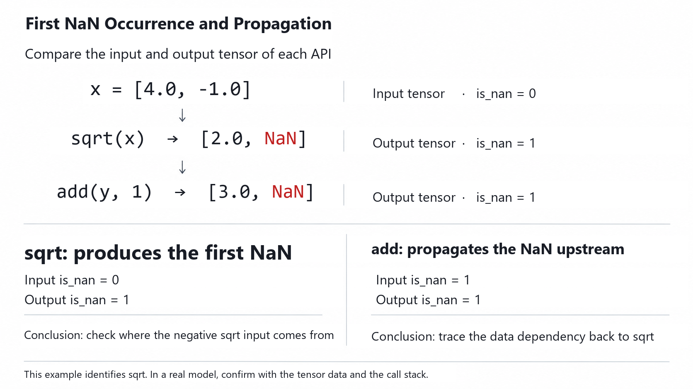

# nan_check Usage Example

This example collects one forward and backward computation.

- Taking a square root of a negative value makes the loss NaN. Use the saved files to identify the API and its input.
- Run on a single PyTorch NPU with the default `isnan` mode.

Configure collection in `config.json`, then call `PrecisionDebugger.start()` before the code you want to check and `stop()` afterward. After the run, check `dump.json` for the NaN detection results, read the `.pt` files for the input and output data, and check `stack.json` for the call locations.

## 1. Build

This example requires the `aclgraph_dump` module. Add `-e include-mod=aclgraph_dump` when building. For environment setup, build, and installation steps, see the [Installation Guide](../../install_guide/msprobe_install_guide.md).

## 2. Data Collection

Create `config.json` and the `repro_nan.py` below in the locally cloned `msprobe` directory, and run there. The default is already `isnan`; no additional detection-mode or `tensor_list` configuration is needed:

```json
{
    "task": "nan_check",
    "dump_path": "./nan_check_dump",
    "level": "L1"
}
```

To select ranks, steps, or an API range, see `rank`, `step`, `scope`, `list`, `data_mode`, and other fields in the [complete configuration example and parameter descriptions](./config_json_introduct.md#task--nan_check). This example uses their default settings.

`nan_check.detail` defaults to `true`, recording JSON results and saving tensors from matching calls. To save tensor files only, set `"nan_check": {"detail": false}`; `dump.json`, `stack.json`, and `construct.json` are then omitted. `detail` is supported only by the default `isnan` mode and cannot be configured with `slot`.

Create `repro_nan.py`. Green `+` lines are tool additions; remove the leading `+` before saving:

```diff
import torch
import torch_npu
+from msprobe.pytorch import PrecisionDebugger

torch.npu.set_device(0)
+debugger = PrecisionDebugger(config_path="./config.json")
x = torch.tensor([4.0, -1.0], device="npu", requires_grad=True)

+debugger.start()
y = torch.sqrt(x)
z = torch.add(y, 1.0)
loss = z.sum()
loss.backward()
+debugger.stop()
+debugger.step()
+torch.npu.synchronize()

print("loss:", loss.item())
print("x.grad:", x.grad.detach().cpu().tolist())
```

```bash
python3 repro_nan.py
```

Expected output:

```text
loss: nan
x.grad: [0.25, nan]
```

## 3. Saved Files

The saved-file format and values below are illustrative and expected; process IDs, API indices, and collection indices depend on the actual run. The tree omits `sum` and backward API files. `proc<pid>` identifies the process, and distributed execution uses `rank<ID>`.

```text
nan_check_dump/
└── step0/
    └── proc<pid>/
        ├── dump.json
        ├── stack.json
        ├── construct.json
        └── dump_tensor_data/
            ├── Torch.sqrt.0.forward.0.input.0.pt
            ├── Torch.sqrt.0.forward.0.output.0.pt
            ├── Torch.add.0.forward.0.input.0.pt
            ├── Torch.add.0.forward.0.output.0.pt
            └── ...
```

Here are some of the detection results for `sqrt` and `add` in `dump.json`:

```json
{
    "data": {
        "Torch.sqrt.0.forward": {
            "input_args": [{"shape": [2], "is_nan": 0}],
            "output": [{"shape": [2], "is_nan": 1}]
        },
        "Torch.add.0.forward": {
            "input_args": [{"shape": [2], "is_nan": 1}],
            "output": [{"shape": [2], "is_nan": 1}]
        }
    }
}
```

`is_nan` belongs to each tensor: `0` means no NaN, `1` means NaN, and `null` means detection is unavailable. When a forward output contains NaN, its inputs and outputs are automatically saved as `.pt` files. `stack.json` stores groups of API-name lists and call-stack lists.

Non-empty FP8/FP4 tensors have a detection result of `null`; integer, bool, and empty tensors record `0`. Unknown flags do not trigger saving. If another output in the same call contains NaN, all original input and output tensors are still submitted for saving.

## 4. File Reading and Cause Location

This command reads the latest collection and prints the `sqrt` flags, saved inputs and outputs, and matching call stack:

```bash
python3 - <<'PY'
import json
from pathlib import Path
import torch

dump_file = max(Path("nan_check_dump").rglob("dump.json"), key=lambda p: p.stat().st_mtime)
records = json.loads(dump_file.read_text(encoding="utf-8"))["data"]
api = next(name for name in records if "sqrt" in name and name.endswith(".forward"))
record = records[api]
print(api, "input=", record["input_args"][0]["is_nan"], "output=", record["output"][0]["is_nan"])
for path in sorted((dump_file.parent / "dump_tensor_data").glob(f"{api}.*.pt")):
    tensor = torch.load(path, map_location="cpu", weights_only=False)
    print(path.name, tensor.tolist())
stack = json.loads((dump_file.parent / "stack.json").read_text(encoding="utf-8"))
for api_names, frames in stack.values():
    if api in api_names:
        print("\n".join(frames))
PY
```

An excerpt of the processing output is as follows. Actual paths and line numbers vary.

```text
Torch.sqrt.0.forward input= 0 output= 1
Torch.sqrt.0.forward.0.input.0.pt [4.0, -1.0]
Torch.sqrt.0.forward.0.output.0.pt [2.0, nan]
File .../repro_nan.py, line 10, in <module>,
 y = torch.sqrt(x)
```

Conclusion: `sqrt` receives inputs without NaN and first produces NaN. The saved input contains `-1.0`, and the call stack points to `torch.sqrt(x)`. Inspect the source of the negative value and the operation's input domain at that line. Both the input and output of `add` contain NaN, showing upstream propagation.

The figure below combines the values and detection flags above, contrasting the first NaN from `sqrt` with its propagation through `add` in this example.


