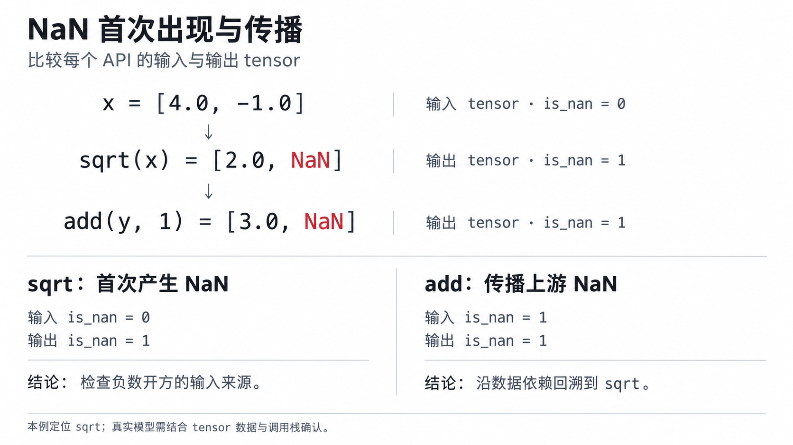

# nan_check 使用示例

本例采集一次前向、反向计算：

- 负数开平方使 loss 变为 NaN，再从落盘文件找到产生 NaN 的 API 和输入值。
- 使用单卡 PyTorch NPU、默认 `isnan` 模式。

采集由`config.json`控制，`PrecisionDebugger`启动和结束目标计算的采集；`dump.json`记录每个tensor的检测标志，`.pt`保存原始tensor，`stack.json`用于回到调用代码。

## 1. 构建

构建前完成以下准备：

1. 安装 CANN（CANN ≥ 8.5.0），参见[CANN 快速安装](https://www.hiascend.com/zh/cann/download)。
2. 安装配套 PyTorch 和 TorchNPU，参见[TorchNPU 快速安装](https://www.hiascend.com/zh/developer/software/ai-frameworks/pytorch/download)。
3. 准备支持 C++17 的编译器、Make 和 CMake ≥ 3.19.3。

完成上述准备后，执行以下构建命令：

```bash
# 以下 source 命令中的路径按实际 CANN 安装路径调整
source /usr/local/Ascend/ascend-toolkit/set_env.sh
git clone https://gitcode.com/Ascend/msprobe.git
cd msprobe
pip install uv
# 本例使用默认 isnan，tensor 自动落盘需要 aclgraph_dump 模块
python3 build.py -e include-mod=aclgraph_dump
```

构建后任选一种方式使用。

**安装wheel**：将msProbe及其Python依赖安装到当前Python环境。

```bash
pip install artifacts/mindstudio_probe*.whl
```

**通过PYTHONPATH使用源码**：在本地克隆的`msprobe`目录中，安装`pyproject.toml`声明的Python依赖，再将本地`python`目录加入Python模块查找路径。构建生成的扩展从`python/msprobe/lib`加载，此方式不安装上面的msProbe wheel。

```bash
pip install wheel einops "numpy>=1.23.0" "pandas>=1.3.5" pyyaml tqdm \
    "openpyxl>=3.0.6" matplotlib "tensorboard>=2.11.2" \
    "skl2onnx>=1.14.1" packaging pytz psutil
export PYTHONPATH="$PWD/python:$PYTHONPATH"
```

## 2. 运行采集

在本地克隆的`msprobe`目录中创建`config.json`和下方的`repro_nan.py`，并在该目录运行。默认已是`isnan`，无需额外配置检测模式或`tensor_list`：

```json
{
    "task": "nan_check",
    "dump_path": "./nan_check_dump",
    "level": "L1"
}
```

需要指定采集卡、step或API范围时，可在[完整配置示例及参数说明](./config_json_introduct.md#task配置为nan_check)中查看`rank`、`step`、`scope`、`list`、`data_mode`等字段；本例沿用默认值。

创建 `repro_nan.py`，绿色 `+` 行是工具新增代码，保存时去掉行首的 `+`：

```diff
import torch
import torch_npu
+from msprobe.pytorch import PrecisionDebugger

torch.npu.set_device(0)
+debugger = PrecisionDebugger(config_path="./config.json")
x = torch.tensor([4.0, -1.0], device="npu", requires_grad=True)

+debugger.start()
y = torch.sqrt(x)
z = torch.add(y, 1.0)
loss = z.sum()
loss.backward()
+debugger.stop()
+debugger.step()
+torch.npu.synchronize()

print("loss:", loss.item())
print("x.grad:", x.grad.detach().cpu().tolist())
```

```bash
python3 repro_nan.py
```

预期输出：

```text
loss: nan
x.grad: [0.25, nan]
```

## 3. 落盘结果

以下展示本例的落盘格式与预期内容，进程 ID、API 和采集序号以实际运行为准。目录树省略了`sum`和反向API文件；`proc<pid>`是进程目录，有分布式rank时使用`rank<ID>`。

```text
nan_check_dump/
└── step0/
    └── proc<pid>/
        ├── dump.json
        ├── stack.json
        ├── construct.json
        └── dump_tensor_data/
            ├── Torch.sqrt.0.forward.0.input.0.pt
            ├── Torch.sqrt.0.forward.0.output.0.pt
            ├── Torch.add.0.forward.0.input.0.pt
            ├── Torch.add.0.forward.0.output.0.pt
            └── ...
```

`dump.json` 节选，只保留这两个 API 的相关 tensor 字段：

```json
{
    "data": {
        "Torch.sqrt.0.forward": {
            "input_args": [{"shape": [2], "is_nan": 0}],
            "output": [{"shape": [2], "is_nan": 1}]
        },
        "Torch.add.0.forward": {
            "input_args": [{"shape": [2], "is_nan": 1}],
            "output": [{"shape": [2], "is_nan": 1}]
        }
    }
}
```

`is_nan` 是每个 tensor 的标志：`0` 不含 NaN，`1` 含 NaN，`null` 无法检测。前向输出含 NaN 时，输入、输出自动保存为 `.pt`；`stack.json` 按“API 名列表、调用栈列表”分组保存。

## 4. 读取文件并定位原因

下面的命令读取最近一次采集，打印 `sqrt` 的检测标志、保存的输入输出，以及对应调用栈：

```bash
python3 - <<'PY'
import json
from pathlib import Path
import torch

dump_file = max(Path("nan_check_dump").rglob("dump.json"), key=lambda p: p.stat().st_mtime)
records = json.loads(dump_file.read_text(encoding="utf-8"))["data"]
api = next(name for name in records if "sqrt" in name and name.endswith(".forward"))
record = records[api]
print(api, "input=", record["input_args"][0]["is_nan"], "output=", record["output"][0]["is_nan"])
for path in sorted((dump_file.parent / "dump_tensor_data").glob(f"{api}.*.pt")):
    tensor = torch.load(path, map_location="cpu", weights_only=False)
    print(path.name, tensor.tolist())
stack = json.loads((dump_file.parent / "stack.json").read_text(encoding="utf-8"))
for api_names, frames in stack.values():
    if api in api_names:
        print("\n".join(frames))
PY
```

处理结果节选（路径和行号以实际输出为准）：

```text
Torch.sqrt.0.forward input= 0 output= 1
Torch.sqrt.0.forward.0.input.0.pt [4.0, -1.0]
Torch.sqrt.0.forward.0.output.0.pt [2.0, nan]
File .../repro_nan.py, line 10, in <module>,
 y = torch.sqrt(x)
```

结论：`sqrt` 输入不含 NaN，输出首次出现 NaN；保存的输入中有 `-1.0`，对应调用栈指向 `torch.sqrt(x)`。回到这行代码检查负数的来源和计算定义域。`add` 的输入、输出都含 NaN，是在传播上游结果。

下图将上述输入、输出值与检测标志放在一起，对照本例中`sqrt`首次产生NaN和`add`传播NaN的区别。


